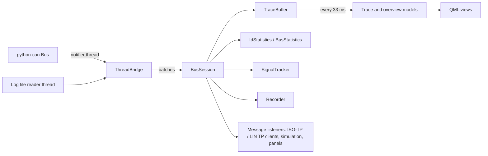

# Architecture

CANExplorer has three layers:

| Layer | Package | Depends on Qt |
|---|---|---|
| Core: sources, sessions, storage, decoding, protocols, diagnostics | `can_explorer/core` | no |
| Scripting: simulation nodes and their runtime | `can_explorer/scripting` | no |
| GUI adapters: models and controllers exposed to QML | `can_explorer/gui` | yes |
| User interface | `can_explorer/gui/qt` (QML) | yes |

The core is plain asyncio and is tested without Qt. Qt and asyncio share one event loop through
[qasync](https://github.com/CabbageDevelopment/qasync) (`can_explorer/__main__.py`), so coroutines, timers and Qt
signals all run on the GUI thread.

## Receive pipeline

- **Sources** (`core/sources.py`): `LiveSource` reads a python-can bus in python-can's notifier thread,
  `FileSource` reads a log file in a worker thread. Both hand frames to the event loop through a `ThreadBridge`,
  which wakes the loop once per batch instead of once per frame.
- **BusSession** (`core/session.py`) consumes the batches. For each frame it runs the protocol decoder (stateful,
  hence in arrival order), appends it to the bounded `TraceBuffer`, updates the per-identifier and bus statistics and
  the tracked signals, records it and calls the message listeners. After each batch it yields to the event loop so
  the GUI stays responsive under sustained traffic. It also transmits (single, periodic, hardware timed) and records.
- **Decoding** (`core/decoding.py`): the protocol decoder describes every frame on arrival; signal databases are
  stateless, so frames are only decoded with them when displayed, and the result is cached in the frame.
- **GUI adapters** (`gui/connection_manager.py`, `gui/models.py`): a `CanConnection` per connection drains the new frames
  from the session on a timer (33 ms by default) and appends them to the Qt models in one batch; the overview only
  refreshes the rows that changed.

`tools/benchmark.py` measures the pipeline: about 300 000 frames per second with J1939 and DBC decoding on a desktop
computer.

## Modules

| Module | Purpose |
|---|---|
| `core/frames.py` | `Frame`, hex parsing and formatting |
| `core/filters.py` | Display filter syntax |
| `core/store.py` | Trace ring buffer and per-identifier statistics |
| `core/busstats.py` | Frame rates and bus load |
| `core/signals.py` | Time series of tracked signals and bit fields |
| `core/database_io.py`, `core/dbf.py` | Loading, saving and converting signal databases; BUSMASTER DBF |
| `core/database_editor.py`, `core/ldf_editor.py`, `core/ldf_writer.py` | Editing CAN databases and LDF files; writing LDF files |
| `core/decoding.py`, `core/ldf.py` | Signal decoding with cantools databases and LDF files |
| `core/protocols/` | Passive ISO-TP, J1939 and CANopen decoders |
| `core/lin.py`, `core/lin_tp.py`, `core/lin_schedule.py` | LIN frames and decoder, LIN transport client, LIN master |
| `core/isotp_client.py`, `core/uds.py` | Active ISO-TP client and UDS client and decoder |
| `core/flashing.py` | Intel HEX, S-record and binary images; UDS download sequence |
| `core/uds_scan.py` | Interactive UDS discovery: service, DID, subfunction and routine scans and a one-byte sweep over a UDS transport, with the answers classified |
| `core/doip.py` | Diagnostics over IP (ISO 13400-2): vehicle discovery, entity status and power mode over UDP; the tester's TCP connection with routing activation and alive checks; the UDS transport per target address; the simulated DoIP entity |
| `core/j1939_tools.py` | J1939 NAME, DM1/DM2, transport reassembly, network tracking and sending with BAM or RTS/CTS |
| `core/canopen_tools.py` | EDS/DCF object dictionaries, SDO client, NMT, PDO mappings, network tracking, simulated node |
| `core/physical_io.py` | Digital lines and analogue inputs: aio_usb (pyusb) and simulated devices, polled on a worker thread |
| `core/gvret.py` | `GvretBus`, the python-can interface for GVRET devices (SavvyCAN protocol) |
| `core/j2534.py`, `core/j2534_driver.py`, `core/j2534_bridge.py` | `J2534Bus`, the python-can interface for J2534 pass-thru drivers: registry lookup and DLL architecture check; the ctypes driver calls (standard library only); the 32-bit bridge process that runs them for 32-bit drivers, over JSON lines on stdin/stdout |
| `core/elm327.py` | `Elm327Bus`, the python-can interface for ELM327 and OBDLink OBD adapters (text commands, monitoring on a worker thread) |
| `core/ethercat.py` | EtherCAT master for CoE: SOEM (pysoem) and simulated backends on a worker thread, states, SDO, SDO information, PDO assignment |
| `core/mqtt.py`, `gui/mqtt.py` | MQTT bridge of a bus (aiomqtt on a thread of its own): signals, frames and status out, allow-listed send requests in; the connection's MQTT controller |
| `core/compare.py` | Comparing two recordings |
| `core/gateway.py` | Bus gateway: forwarding rules between sessions, with filtering, identifier rewriting, rate limiting and an echo guard |
| `core/reverse/` | Reverse engineering: bit fields (`fields.py`), bit and byte statistics with the notch (`bitstats.py`), checksum detection (`checksums.py`), the automatic analysis of fields, their kinds and multiplexers (`analysis.py`), correlation with reference signals (`reference.py`) and OBD-II polling (`obd.py`), event markers (`markers.py`), synthetic traffic with known signals and scoring of found fields (`synthetic.py`) |
| `core/bushealth.py` | Error frame decoding, error states and the bus health history |
| `core/updates.py`, `gui/updates.py` | Finding, downloading, verifying and installing new releases from GitHub |
| `core/remote.py` | `RemoteBus`, the python-can interface for buses shared by `can-server` |
| `core/diagnostic_description.py`, `core/odx.py` | ECU diagnostic descriptions: CANdelaStudio CDD; ASAM ODX and packaged ODX (PDX) |
| `core/trace_store.py` | Trace frames in memory and in temporary files on disk, by absolute index |
| `core/conditions.py`, `core/recording.py` | Conditions on frames; split and triggered recordings |
| `core/simulation.py` | Simulated UDS ECU and LIN slaves (tests, demos) |
| `scripting/` | Simulation node API and runtime |
| `gui/connection_manager.py` | Connections, preferences and channel detection for QML |
| `gui/models.py` | Trace (a paged view of the trace store) and overview table models |
| `gui/trace_tools.py`, `gui/workspace.py` | Trace search and bookmarks; workspace files |
| `gui/diagnostics.py`, `gui/simulation.py` | Diagnostics and simulation controllers, panel bridge |
| `gui/flashing.py`, `gui/j1939.py`, `gui/canopen.py`, `gui/uds_scan.py` | Flashing, J1939, CANopen and UDS discovery controllers of a connection |
| `gui/database_editor.py`, `gui/compare.py`, `gui/multibus.py`, `gui/ethercat.py`, `gui/physical_io.py`, `gui/doip.py`, `gui/gateway.py` | Database editor, recording comparison, multi-bus trace, EtherCAT, Physical I/O, DoIP and bus gateway tools (the DoIP tool reuses the diagnostics and flashing controllers with its own transport) |
| `gui/bushealth.py` | Bus health page of a connection |
| `gui/reverse.py`, `gui/reverse_tools.py` | Reverse engineering page of a connection; its analysis, reference and marker tools (run in a worker thread) |
| `gui/translations.py` | Translations from Qt Linguist files |
| `gui/plot_view.py`, `gui/signal_plot.py` | Time range, cursors and charts of the signal plots; plot item (QQuickPaintedItem) |
| `gui/app_state.py` | Persistent settings (QSettings) |
| `gui/qt/CanExplorer/` | QML views, dialogs and dashboard components; `Theme.qml` holds the colours of the six themes, `GlassPanel.qml` the frosted glass of dialogs, menus and popups |
| `gui/qt/CanExplorerStyle/` | Qt Quick Controls style drawing buttons, inputs, dialogs, menus etc. with the theme colours (Fusion for the rest) |
| `sys/config.py`, `sys/environment.py` | Application settings; clean-up of snap environments |
| `can_server/` | `can-server`: shares local CAN interfaces over WebSocket |
