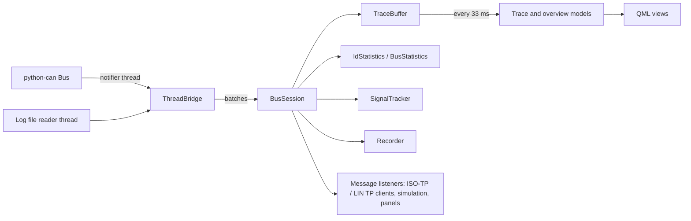

# Architecture

CANExplorer has three layers:

| Layer | Package | Depends on Qt |
|---|---|---|
| Core: sources, sessions, storage, decoding, protocols, diagnostics | `can_explorer/core` | no |
| Scripting: simulation nodes and their runtime | `can_explorer/scripting` | no |
| GUI adapters: models and controllers exposed to QML | `can_explorer/gui` | yes |
| User interface | `can_explorer/gui/qt` (QML) | yes |

The core is plain asyncio and is tested without Qt. Qt and asyncio share one event loop through
[qasync](https://github.com/CabbageDevelopment/qasync) (`can_explorer/__main__.py`), so coroutines, timers and Qt
signals all run on the GUI thread.

## Receive pipeline

- **Sources** (`core/sources.py`): `LiveSource` reads a python-can bus in python-can's notifier thread,
  `FileSource` reads a log file in a worker thread. Both hand frames to the event loop through a `ThreadBridge`,
  which wakes the loop once per batch instead of once per frame.
- **BusSession** (`core/session.py`) consumes the batches. For each frame it runs the protocol decoder (stateful,
  hence in arrival order), appends it to the bounded `TraceBuffer`, updates the per-identifier and bus statistics and
  the tracked signals, records it and calls the message listeners. After each batch it yields to the event loop so
  the GUI stays responsive under sustained traffic. It also transmits (single, periodic, hardware timed) and records.
- **Decoding** (`core/decoding.py`): the protocol decoder describes every frame on arrival; signal databases are
  stateless, so frames are only decoded with them when displayed, and the result is cached in the frame.
- **GUI adapters** (`gui/connection_manager.py`, `gui/models.py`): a `CanConnection` per connection drains the new frames
  from the session on a timer (33 ms by default) and appends them to the Qt models in one batch; the overview only
  refreshes the rows that changed.

`tools/benchmark.py` measures the pipeline: about 300 000 frames per second with J1939 and DBC decoding on a desktop
computer.

## Modules

| Module | Purpose |
|---|---|
| `core/frames.py` | `Frame`, hex parsing and formatting |
| `core/filters.py` | Display filter syntax |
| `core/store.py` | Trace ring buffer and per-identifier statistics |
| `core/busstats.py` | Frame rates and bus load |
| `core/signals.py` | Time series of tracked signals |
| `core/database_io.py`, `core/dbf.py` | Loading, saving and converting signal databases; BUSMASTER DBF |
| `core/decoding.py`, `core/ldf.py` | Signal decoding with cantools databases and LDF files |
| `core/protocols/` | Passive ISO-TP, J1939 and CANopen decoders |
| `core/lin.py`, `core/lin_tp.py`, `core/lin_schedule.py` | LIN frames and decoder, LIN transport client, LIN master |
| `core/isotp_client.py`, `core/uds.py` | Active ISO-TP client and UDS client and decoder |
| `core/diagnostic_description.py` | CANdelaStudio CDD reader |
| `core/trace_store.py` | Trace frames in memory and in temporary files on disk, by absolute index |
| `core/conditions.py`, `core/recording.py` | Conditions on frames; split and triggered recordings |
| `core/simulation.py` | Simulated UDS ECU and LIN slaves (tests, demos) |
| `scripting/` | Simulation node API and runtime |
| `gui/connection_manager.py` | Connections, preferences and channel detection for QML |
| `gui/models.py` | Trace (a paged view of the trace store) and overview table models |
| `gui/trace_tools.py`, `gui/workspace.py` | Trace search and bookmarks; workspace files |
| `gui/diagnostics.py`, `gui/simulation.py` | Diagnostics and simulation controllers, panel bridge |
| `gui/signal_plot.py` | Plot item (QQuickPaintedItem) |
| `gui/app_state.py` | Persistent settings (QSettings) |
| `gui/qt/CanExplorer/` | QML views, dialogs and dashboard components; `Theme.qml` holds the colours of the six themes, `GlassPanel.qml` the frosted glass of dialogs, menus and popups |
| `gui/qt/CanExplorerStyle/` | Qt Quick Controls style drawing buttons, inputs, dialogs, menus etc. with the theme colours (Fusion for the rest) |
| `sys/config.py`, `sys/environment.py` | Application settings; clean-up of snap environments |
