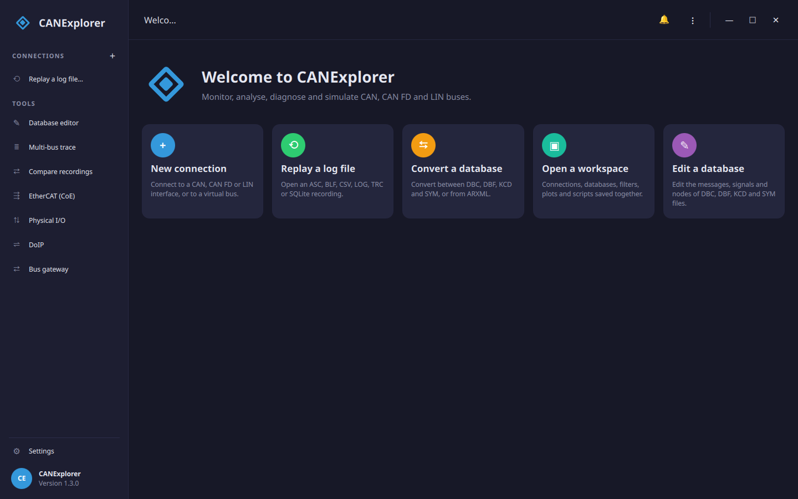
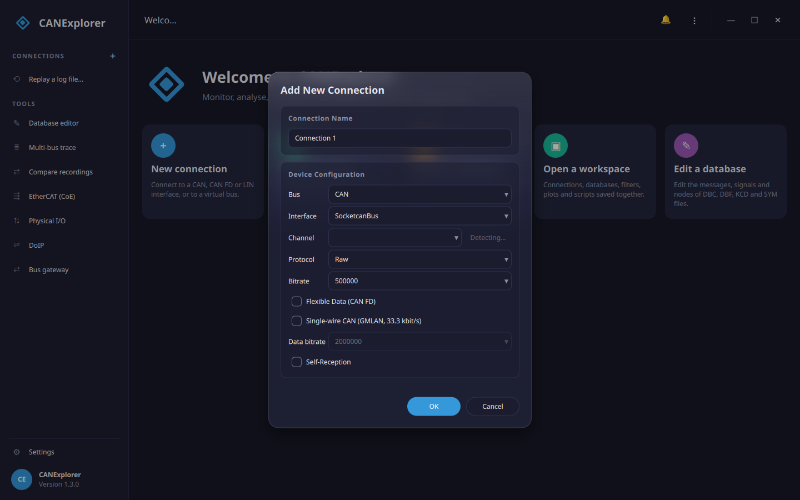

# Quick start

In about ten minutes, you will connect to a bus, watch a simulated engine and gearbox send their messages, plot
their signals and record the traffic. Everything runs on a **virtual bus** inside CANExplorer, so you need no
hardware.

## Before you start

You need CANExplorer and the three files of the example simulation:

| File | What it is |
|---|---|
| `vehicle.dbc` | The signal database: which messages exist and what their bytes mean |
| `engine_simulation.py` | Two simulated bus nodes, *Engine* and *Gearbox* |
| `engine_panel.qml` | A small control panel with an ignition switch, a target-speed slider and an engine-speed gauge |

=== "Installed with an installer"

    The installers do not contain the example files. Download them from GitHub into a folder of your choice:
    [vehicle.dbc](https://raw.githubusercontent.com/AKJ7/CANExplorer/master/examples/simulation/vehicle.dbc),
    [engine_simulation.py](https://raw.githubusercontent.com/AKJ7/CANExplorer/master/examples/simulation/engine_simulation.py)
    and [engine_panel.qml](https://raw.githubusercontent.com/AKJ7/CANExplorer/master/examples/simulation/engine_panel.qml)
    (right click → *Save link as…*).

    Then start CANExplorer from the start menu, the applications folder or the desktop.

=== "Run from source"

    The files are in `examples/simulation` of the repository. Start CANExplorer from the repository folder:

    ```bash
    uv run canexplorer
    ```

CANExplorer opens on its welcome page:



## 1. Connect to a virtual bus

1. Click **New connection** on the welcome page (or press ++ctrl+n++).
2. Fill in the dialog:

    | Field | Value |
    |---|---|
    | Connection Name | `Demo` |
    | Bus | **CAN** |
    | Interface | **VirtualBus** |
    | Channel | `demo` (any name works; connections with the same channel share the bus) |
    | Protocol | **Raw** |

    Leave the other fields as they are.

    

3. Click **OK**, then **Connect** in the top bar.

!!! success "Check"
    *Demo* appears in the sidebar under **Connections** with a green dot, and its **Dashboard** opens. The bus is
    still quiet: nothing sends yet.

## 2. Load the signal database

Click **Load database…** and choose `vehicle.dbc`.

From now on, CANExplorer shows the messages of this database by name (*EngineData*, *VehicleSpeed*) with their
signal values, instead of raw bytes.

!!! tip
    Load the database before starting the simulation, as in this guide. If you load it later, the running
    simulation restarts so that the nodes can use it.

## 3. Start the simulated engine

Click **Simulation** in the sidebar, then:

1. **Load script…** → `engine_simulation.py`. The list shows *Nodes: Engine, Gearbox*.
2. **Add panel…** → `engine_panel.qml`. The panel appears on the right.
3. **Start simulation**.

Now drive the engine from the panel:

- Switch on **Ignition**: the engine idles at 800 rpm.
- Drag **Target speed** to the right: the engine speeds up and the gearbox shifts from *Neutral* to *First*, then
  *Second*.


!!! success "Check"
    The panel shows the engine speed, coolant temperature, gear and vehicle speed changing, and the **Console**
    at the bottom shows lines such as `[Gearbox] shifted to First`.

## 4. Look at the traffic

The views in the sidebar show the same traffic in different ways. Try each one:

| View | What you see |
|---|---|
| **Trace** | Every frame as it arrives, with its decoded signals in the *Info* column |
| **Overview** | One row per message, with count, cycle time (*EngineData* every 100 ms) and the bytes that changed |
| **Signals** | Live charts: check `EngineData.EngineSpeed` and `VehicleSpeed.WheelSpeed`, then move the slider |
| **Dashboard** | Frame rates, bus load and the busiest messages at a glance |


!!! tip
    Press ++ctrl+k++ to open the command palette and jump to any view or command by typing its name.

## 5. Record and replay

1. Click **Record…**, choose a file name such as `demo.blf` and confirm. Move the slider for a while.
2. Click **● Stop recording**.
3. Open **⋮ → Replay Log File…** (++ctrl+o++) and choose `demo.blf`.

The recording opens as a new connection and plays back with its original timing. Use the playback bar to pause
it or change its speed.

!!! tip
    **Replay to bus…** on the *Demo* connection sends a recording onto the bus again, for example to feed it to
    another program.

## Something does not work?

??? question "The trace stays empty"
    Check that the connection is connected (green dot in the sidebar; the top bar shows **Disconnect**), that the
    simulation runs (the button reads **Stop simulation**) and that **Ignition** is on. Without ignition, the
    engine sends 0 rpm, but frames still arrive every 100 ms.

??? question "The console shows *Load a signal database to send message … by name*"
    The simulation runs without a database. Load `vehicle.dbc` with **Load database…**; the simulation restarts
    and the nodes find their messages.

??? question "*Unknown message … in vehicle.dbc*"
    The script asks for a message that is not in the database. Message names are case sensitive: `VehicleSpeed`,
    not `vehiclespeed`.

??? question "The panel does not react"
    The panel only controls a running simulation: click **Start simulation** first. After editing a panel file,
    click **Reload panels**.

## Next steps

- Connect to a real bus: [Installation](installation.md#setting-up-interfaces) sets up the drivers, and
  [Connections](../user-guide/connections.md) explains the connection dialog.
- Write your own nodes and panels: [Simulation and scripting](../user-guide/simulation.md).
- Test the simulated ECU automatically: [Test automation](../user-guide/test-automation.md) runs
  `examples/testing/vehicle_tests.py` against this simulation.
- Diagnose an ECU: [Diagnostics](../user-guide/diagnostics.md).
