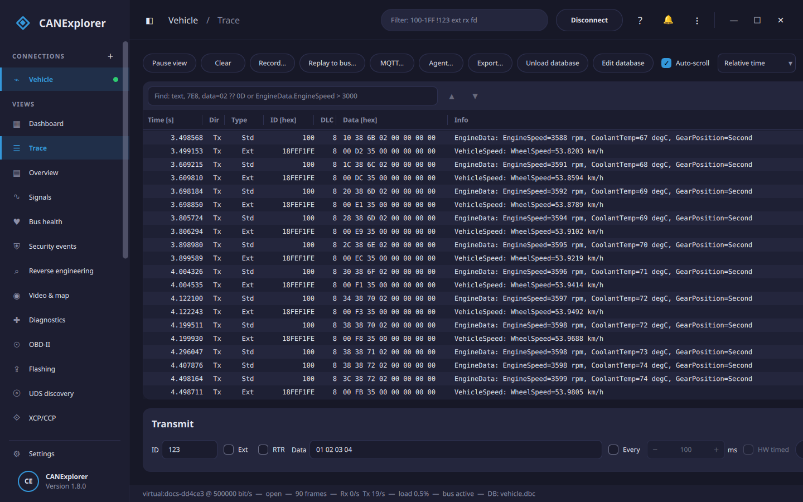

  { width="420" }

# CANExplorer

CANExplorer is a cross-platform tool to monitor, analyse, diagnose and simulate **CAN**, **CAN FD** and **LIN**
buses. It runs on Linux, Windows and macOS with any interface supported by
[python-can](https://python-can.readthedocs.io/), and without hardware on a virtual bus.

## Download

Ready-to-run installers of the latest release — no Python needed. The button for your platform is highlighted:

[:material-microsoft-windows: Windows](https://github.com/AKJ7/CANExplorer/releases/latest){ .md-button data-download="windows" }
[:material-apple: macOS](https://github.com/AKJ7/CANExplorer/releases/latest){ .md-button data-download="macos" }
[:material-linux: Linux · AppImage](https://github.com/AKJ7/CANExplorer/releases/latest){ .md-button data-download="appimage" }
[:material-linux: Linux · .deb](https://github.com/AKJ7/CANExplorer/releases/latest){ .md-button data-download="deb" }

Fetching the latest release… meanwhile, browse <a href="https://github.com/AKJ7/CANExplorer/releases">all releases</a>.

Prefer a package manager or running from source? The [installation guide](getting-started/installation.md) covers
the Snap, the archives and building with `uv`. Installed copies [update themselves](user-guide/updates.md).

## Features

-   :material-monitor-dashboard: **Monitoring**

    ---

    Trace and per-identifier overview, display filters, bus load and error statistics, pause, copy and export.

    [:octicons-arrow-right-24: Trace and overview](user-guide/trace-and-overview.md)

-   :material-database: **Signal databases**

    ---

    Decode signals with DBC, BUSMASTER DBF, AUTOSAR ARXML, KCD, SYM and LIN LDF files, plot them live and
    convert between the formats.

    [:octicons-arrow-right-24: Signal databases](user-guide/signal-databases.md)

-   :material-record-rec: **Recording and replay**

    ---

    Record to ASC, BLF, CSV, LOG, TRC, SQLite and MF4 files, replay them with their original timing and compare
    two recordings.

    [:octicons-arrow-right-24: Recording and replay](user-guide/recording-and-replay.md)

-   :material-stethoscope: **Diagnostics**

    ---

    UDS over ISO-TP, the LIN transport layer and DoIP, with DTCs, security access, Authentication (0x29),
    CANdelaStudio CDD and ASAM ODX/PDX descriptions and ECU flashing; OBD-II, and GMLAN diagnostics for GM/Opel
    vehicles.

    [:octicons-arrow-right-24: Diagnostics](user-guide/diagnostics.md)

-   :material-transit-connection-variant: **Protocols**

    ---

    Decoding of ISO-TP, UDS, J1939, CANopen and LIN; J1939 network and trouble code tools, a CANopen master and
    LIN master schedule tables.

    [:octicons-arrow-right-24: Protocol decoding](user-guide/protocols.md)

-   :material-ethernet: **Automotive Ethernet**

    ---

    Open or capture pcap/pcapng traffic and decode SOME/IP, DoIP, gPTP, AVTP, TSN and more, field by field; SOME/IP
    service discovery with E2E checks, and diagnostics over DoIP.

    [:octicons-arrow-right-24: Ethernet capture](user-guide/ethernet.md)

-   :material-magnify-scan: **Reverse engineering**

    ---

    Bit and byte statistics, automatic detection of counters, checksums and multiplexers, and correlation with
    logged or polled values, promoted to a DBC when found.

    [:octicons-arrow-right-24: Reverse engineering](user-guide/reverse-engineering.md)

-   :material-shield-lock: **Security**

    ---

    A password-protected key store for SecOC, TLS, IPsec/MACsec, seed/key and UDS Authentication, with security
    profiles and key servers, security events, security tests and an audit log.

    [:octicons-arrow-right-24: Security manager](user-guide/security-manager.md)

-   :material-script-text: **Simulation and scripting**

    ---

    Simulated bus nodes in Python and control panels in QML, like CAPL nodes and panels.

    [:octicons-arrow-right-24: Simulation and scripting](user-guide/simulation.md)

-   :material-check-decagram: **Test automation**

    ---

    ECU test scripts with checks, timing measurements and UDS requests, run in the Tests view or headless with
    `can-test`, with HTML, JUnit and Markdown reports for CI.

    [:octicons-arrow-right-24: Test automation](user-guide/test-automation.md)

## Where to start

- New to CANExplorer? Follow the [quick start](getting-started/quick-start.md): it needs no hardware.
- Looking for a specific feature? The [user guide](user-guide/index.md) describes every part of the application.
- Writing simulation scripts or panels? See the [scripting API](reference/scripting-api.md) and the
  [QML panel API](reference/panel-api.md).
- Working on CANExplorer itself? Start with the [architecture](development/architecture.md).

CANExplorer is open source, developed on [GitHub](https://github.com/AKJ7/CANExplorer).
