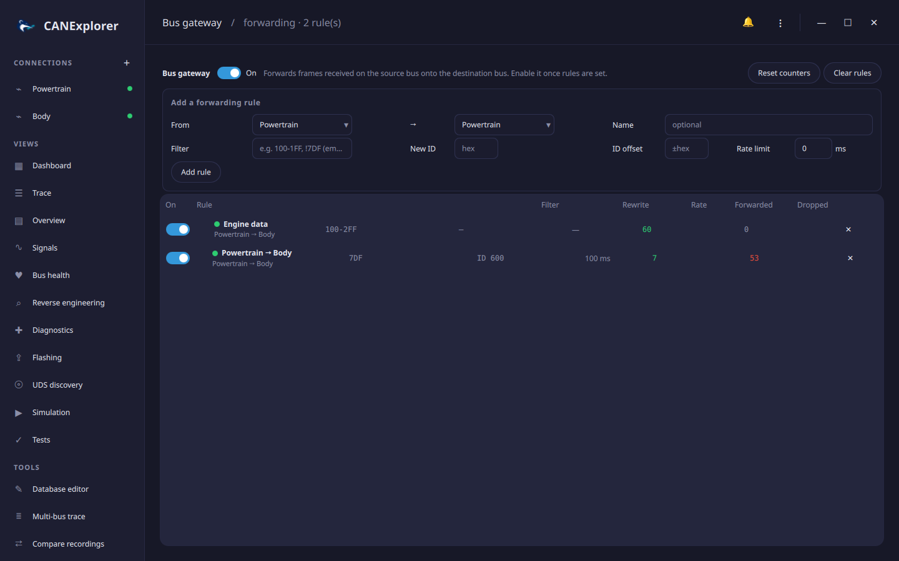

# Bus gateway

The **Bus gateway** tool in the sidebar forwards frames received on one connection onto another, with per-rule
filtering, identifier rewriting and rate limiting. It turns CANExplorer into a configurable CAN gateway between two
interfaces — useful on a bench or in a HIL setup to bridge two buses, inject a subset of one bus's traffic into
another, translate identifiers between two address layouts, or protect a slower bus by rate-limiting what reaches
it. Any pair of open connections works, including a real interface and the [simulated](simulation.md) one.



## How it works

Each **rule** forwards frames **received** on a source connection to a destination connection. Only received bus
traffic is forwarded — never frames CANExplorer itself transmits — so frames the gateway injects are not forwarded
again, and two mirror rules between the same pair of buses cannot form a loop. (A short echo guard also ignores a
forwarded frame that a bus with *receive own messages* reflects back.)

Turn the gateway **On** once the rules are set. It keeps running in the background while you use the rest of the
application; the per-rule counters update live.

## Adding a rule

| Field | Meaning |
|---|---|
| **From / →** | The source connection (frames come from its bus) and the destination (they are sent on its bus). The destination must be able to transmit. They must differ. |
| **Name** | An optional label; defaults to `source → destination`. |
| **Filter** | Which received frames to forward, in the [filter syntax](filters.md): identifiers and ranges in hex (`100-1FF`), `!` to exclude, `std`/`ext`/`fd`. Empty forwards every frame. |
| **New ID** | Rewrite the identifier to this value. Most useful with a single-identifier filter, since every forwarded frame gets this identifier. |
| **ID offset** | Add this signed hex value to the identifier instead of rewriting it — e.g. `+100` to shift a block of identifiers between two address layouts. Ignored when **New ID** is set. |
| **Rate limit** | The minimum milliseconds between forwarded frames of the *same* identifier; faster frames are dropped. `0` forwards everything. |

The payload, length, extended/FD flags and bitrate-switch bit are forwarded unchanged.

## The rule list

Each rule shows a status dot — green when it is actively forwarding, amber when enabled but its connections are not
both open, grey when switched off — its route, filter, rewrite, rate limit, and the number of frames **forwarded**
and **dropped**. The **On** switch enables or disables a single rule; **✕** removes it. **Reset counters** zeroes
the tallies and **Clear rules** removes them all.

A rule whose source or destination connection has been closed or removed is marked *(connection missing)* and
forwards nothing until the connection is back; frames that cannot be sent (the destination is closed) count as
dropped.

## In scripts

`can_explorer.core.gateway` runs the same forwarding over `BusSession` objects, so a script can set up a gateway on
virtual buses without the GUI:

```python
from can_explorer.core.filters import MessageFilter
from can_explorer.core.gateway import Gateway, GatewayRule

sessions = {'A': session_a, 'B': session_b}
gateway = Gateway(sessions.get)
gateway.set_rules([
    GatewayRule('powertrain', 'A', 'B', MessageFilter.parse('100-2FF')),
    GatewayRule('obd', 'A', 'B', MessageFilter.parse('7DF'), new_id=0x600, min_interval=0.1),
])
gateway.start()
...
print(gateway.rules[0].forwarded, gateway.rules[0].dropped)
gateway.stop()
```
