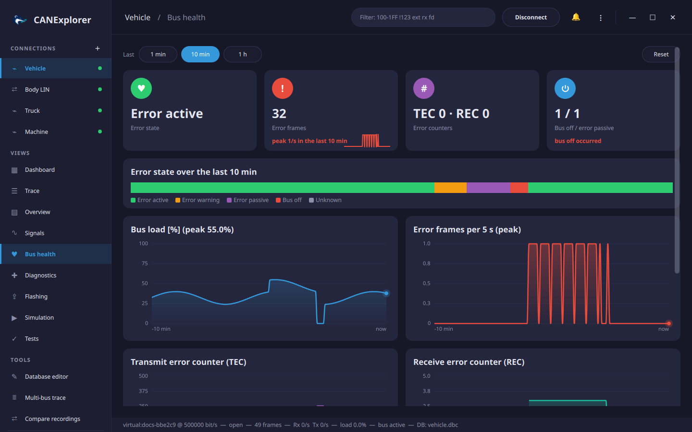

# Bus health

The **Bus health** view of a connection shows how well the bus works over the last minute, ten minutes or hour:
its error state, error frames, the error counters of the CAN controller and the bus load.

## Error state

CAN controllers count transmit (TEC) and receive (REC) errors and change their state with them:

| State | When | Effect |
|---|---|---|
| Error active | Both counters below 96 | Normal operation |
| Error warning | A counter at 96 or above | Still normal; a sign of trouble |
| Error passive | A counter at 128 or above | The controller only sends passive error flags and waits longer before sending |
| Bus off | TEC at 256 or above | The controller does not take part in the bus until it is restarted |

The card at the top shows the current state; the timeline below shows the state of every second of the chosen
window, and the cards count the error frames and how often the bus went bus off or error passive.

The state comes from the error frames, which the interface reports in the SocketCAN layout (SocketCAN on Linux,
and interfaces using it such as gs_usb, PCAN or Kvaser with SocketCAN drivers): bus off, controller restarted,
error warning and passive, and the TEC and REC when the driver includes them. Interfaces reporting their state
through python-can (e.g. PCAN on Windows) are used too.

!!! note "Error frames on Linux"
    SocketCAN delivers error frames only when they are enabled, and many drivers report the error counters only
    with `berr-reporting`: `sudo ip link set can0 type can bitrate 500000 berr-reporting on restart-ms 100`.
    Without error frames the state stays *unknown* (or *active* while frames flow).

## Charts

- **Bus load** in percent (or frames per second when the bitrate is unknown), with its peak in the window.
- **Error frames** per second; over 10 minutes and an hour each point covers 5 or 30 seconds and shows the peak
  of that time, so short bursts stay visible.
- **TEC** and **REC**, when the interface reports them.

**1 min**, **10 min** and **1 h** choose the window. The history covers the last hour while the connection exists,
also while the view is not shown; **Reset** forgets it.

## Error events

The list at the bottom shows the latest error frames, decoded: the error class (e.g. *bus off*, *no
acknowledgement*, *lost arbitration*), controller problems (*RX buffer overflow*, *TX error passive*, *back to
error active*), protocol violations (*bit stuffing error*, *frame format error*, *unable to send dominant bit*) and
the counters. The trace shows the same text in the **Info** column of error frames.
