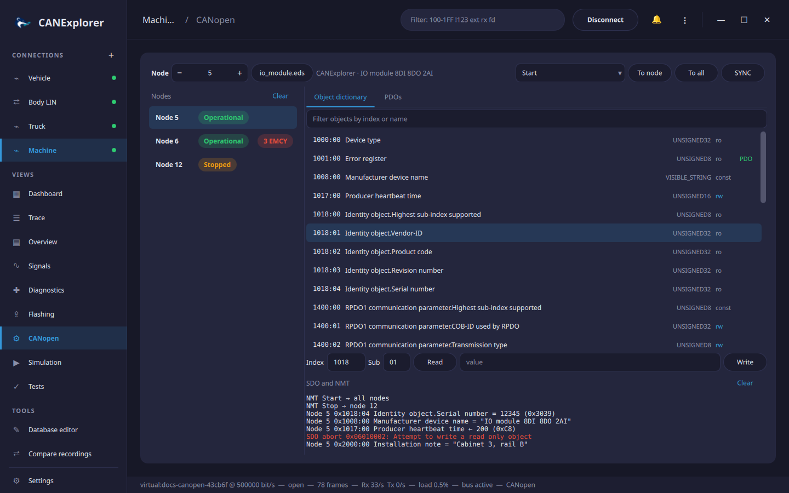
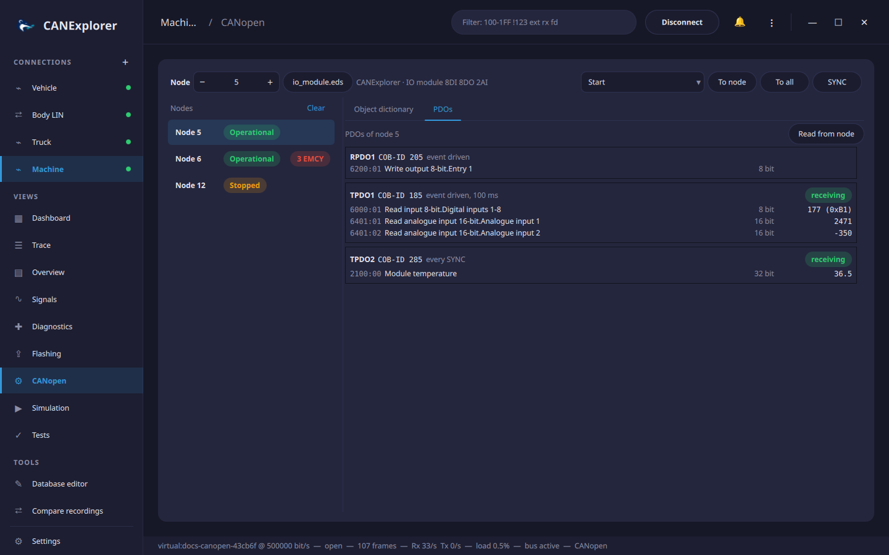

# CANopen

Connections with the **CANopen** protocol have a **CANopen** view in the sidebar: a CANopen master to control the
nodes' states (NMT), read and write their object dictionaries (SDO), and see their PDOs and emergency messages.
The trace decodes the same traffic, see [Protocol decoding](protocols.md).



## Nodes

Every node sending heartbeats, boot-up messages, emergencies, TPDOs or SDO responses is listed with its NMT state:
*Pre-Operational*, *Operational*, *Stopped* or *Boot-up*. Nodes without a heartbeat show *Unknown*; their state
appears once they send one (object 0x1017, *Producer heartbeat time*). Clicking a node selects it for the
dictionary, SDO and PDO functions, as does the **Node** field at the top.

Emergency messages (EMCY) are counted per node; the list below the nodes shows those of the selected node, newest
first, with the error code and its meaning (e.g. *0x8130 Life guard or heartbeat error*). Hovering a message shows
the error register and the manufacturer specific bytes. *0x0000* (error reset) is shown in green.

## NMT and SYNC

Choose an NMT command (*Start*, *Stop*, *Enter Pre-Operational*, *Reset Node*, *Reset Communication*) and send it
**To node** (the selected node) or **To all** nodes. **SYNC** sends one SYNC message (COB-ID 0x080), which makes
nodes send their synchronous TPDOs.

## Object dictionary

**Object dictionary…** loads the node's electronic data sheet (EDS) or device configuration file (DCF). The
dictionary lists every object and sub-index with its name, data type and access (`ro`, `wo`, `rw`, `rwr`, `rww`,
`const`); **PDO** marks objects that can be mapped to PDOs. The filter field finds objects by index or name.
A DCF also sets the node ID, and its configured values (`ParameterValue`) are used instead of the defaults.
Clicking the file name unloads the dictionary.

Clicking an object fills in its index and sub-index. **Read** uploads the value from the node, **Write** downloads
the value in the field:

- With a dictionary, values are shown and entered in the object's data type: numbers in decimal or `0x` hex,
  floats, strings as text. The values of `UNSIGNED` objects are also shown in hex.
- Without one, values are shown and entered as hex bytes, and only the standard objects (0x1000 to 0x1018) have
  names.

Up to 4 bytes are transferred in one expedited message, longer values (such as device names) segmented. The
history below lists the results; failed transfers show the SDO abort code and its meaning, e.g. *0x06010002:
Attempt to write a read only object*, or that the node did not answer within one second.

## PDOs



The **PDOs** tab shows the RPDOs and TPDOs of the selected node with their COB-ID, transmission type
(*event driven* with the event timer, *every SYNC*, *every n SYNCs*, *synchronous (acyclic)* or *remote request*)
and mapped objects. Received PDOs show the current values of the mapped objects, decoded with their data types;
disabled PDOs (bit 31 of the COB-ID set) are dimmed.

The mapping comes from the loaded dictionary. **Read from node** reads the actual communication and mapping
parameters of the first four RPDOs and TPDOs over SDO instead, which also works without a dictionary.

With a dictionary loaded, the trace names the objects in SDO messages of the selected node and shows the values in
its PDOs:

```text
SDO request node 5: read 0x1018:01 Identity object.Vendor-ID
TPDO1 node 5: Digital inputs 1-8=5, Analogue input 1=1200, Analogue input 2=-350
```

The NMT, SYNC, SDO and PDO functions use the predefined connection set (COB-IDs 0x600 + node ID for SDO requests,
0x580 + node ID for responses). They are not shown for log replays, where the view shows the nodes, emergencies
and PDOs of the recording.

!!! example "Try it without hardware"
    `examples/canopen/io_module.eds` describes a digital and analogue I/O module. Scripts can simulate it with
    `CanOpenNodeSimulator` from `can_explorer.core.canopen_tools`, as the documentation screenshots do.
