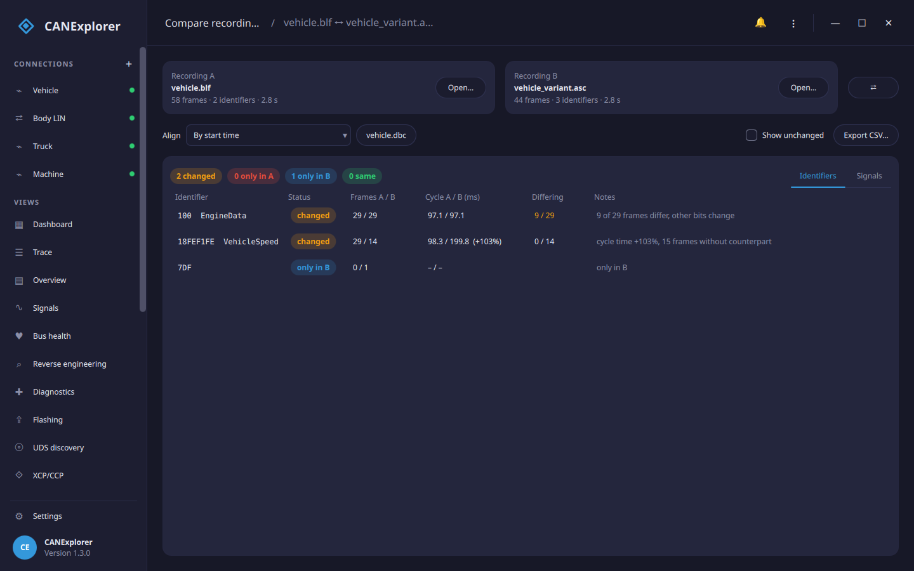
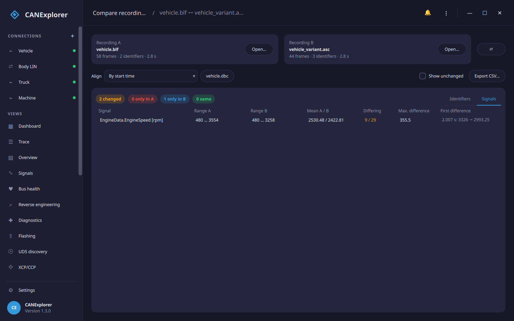

# Comparing recordings

**Compare recordings** under *Tools* in the sidebar compares two log files, for example a recording of a working
vehicle with one of a faulty one, or the traffic before and after a software update. It shows which identifiers
appear in only one recording, which changed their cycle time, length or payloads, and, with a signal database,
which signal values differ.



## Recordings

**Open…** in the *Recording A* and *Recording B* cards reads a log file in any of the
[replayable formats](recording-and-replay.md), which can differ between A and B (e.g. a BLF file with an ASC file).
The cards show the number of frames and identifiers and the duration. **⇄** swaps A and B. Error and remote frames
are not compared.

## Alignment

To compare payloads and signal values, the frames of an identifier in A are paired with frames in B:

| Align | Pairs |
|---|---|
| **By start time** | Frames at the same time since the start of each recording |
| **By first frame of an identifier** | Frames at the same time since the first frame of the given identifier (hex, e.g. `100` or `18FEF100`) in each recording, such as a wake-up or ignition message. When it is missing in a recording, the start is used and a note says so |
| **By frame sequence** | The first frame of an identifier in A with its first frame in B, the second with the second, and so on, whatever their times |

Aligned by time, a frame is paired with the nearest frame of the same identifier in B that is at most half a cycle
(and at most 0.5 s) away; frames without such a counterpart are counted.

## Identifiers

The **Identifiers** tab lists every identifier with:

| Column | |
|---|---|
| Status | *changed*, *only in A*, *only in B*, or *same* (shown with **Show unchanged**) |
| Frames A / B | Number of frames in each recording |
| Cycle A / B | Median time between frames in milliseconds, with the change when it is 1 % or more |
| Differing | Paired frames with different payloads, of all paired frames |
| Notes | Why the identifier counts as changed: cycle time more than 10 % different, other lengths, differing frames, bits that change in one recording but not in the other, frames without counterpart |

Hovering an identifier with differing frames shows the time of the first difference and both payloads. With a
database loaded, identifiers show their message names.

## Signals



**Database…** loads a signal database (DBC, DBF, KCD, SYM, ARXML or LDF) and enables the **Signals** tab. For each
signal it shows the range and mean of its values in A and B, the paired frames in which its value differs, the
largest difference and the first one, e.g. *2.095 s: 3381 → 3042.75*. Changed signals are listed first;
**Show unchanged** also lists the others.

## Export

**Export CSV…** saves the identifier comparison, one line per identifier with the status, frame counts, cycle
times, paired and differing frames, the first difference with both payloads and the notes, separated by `;`.

## In scripts

`can_explorer.core.compare` compares two recordings from a script:

```python
from can_explorer.core.compare import compare, read_recording, summary_csv

a, b = read_recording('before.asc'), read_recording('after.asc')
comparison = compare(a, b)                           # align='id' or 'sequence', database=… adds signal values
print(comparison.counts())                           # {'only_a': …, 'only_b': …, 'changed': …, 'same': …}
for difference in comparison.ids:
    print(difference.status, hex(difference.key[0]))
open('diff.csv', 'w').write(summary_csv(comparison))
```
