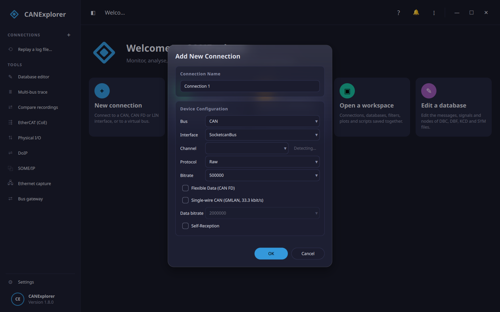

# Connections

## Creating a connection

**+** next to *Connections* in the sidebar, **⋮ → New Connection…** or ++ctrl+n++ opens the connection dialog.

| Field | Description |
|---|---|
| Connection name | Name in the sidebar |
| Bus | **CAN** or **LIN** ([LIN](lin.md) works through SocketCAN LIN drivers such as sllin) |
| Interface | The python-can interface, e.g. *SocketcanBus*, *PcanBus*, *KvaserBus*, *VirtualBus*, or *RemoteBus* for a bus shared by [can-server](remote-buses.md) on another computer |
| Channel | Channel of the interface, e.g. `can0`, `PCAN_USBBUS1` or any name for *VirtualBus*. **Detect** probes all installed drivers and lists their channels; you can also type a channel |
| Protocol | Protocol decoder for the *Info* column: Raw, ISO-TP, UDS, J1939, CANopen ([Protocol decoding](protocols.md)) |
| Bitrate | Nominal bitrate (CAN) |
| Flexible Data (CAN FD) | Enables CAN FD and the **Data bitrate** |
| Single-wire CAN (GMLAN) | A GM single-wire low-speed bus (SWCAN) at 33.3 kbit/s; see [GMLAN](gmlan.md) |
| Baud rate | LIN baud rate (LIN) |
| Self-Reception | The interface reports the frames CANExplorer sends (`receive_own_messages`); without it, sent frames are added to the trace directly |

The connection is created closed; press **Connect** to open the bus. **Disconnect** closes it and stops
recordings, periodic transmissions, schedules and simulations of the connection.

!!! note
    Some drivers ignore the bitrate given here and use the configuration of the operating system, e.g. SocketCAN
    interfaces are configured with `ip link`, see [Installation](../getting-started/installation.md#setting-up-interfaces).

### When Detect does not list your device

**Detect** asks every installed CAN driver for its channels at once (some drivers take seconds), and asks again,
one at a time, the drivers that failed: some vendor libraries do not tolerate being loaded next to other drivers.
What each driver reported is written to the log, and the [system report](#system-report) lists it per driver:
the channels it found, *none*, or why it found nothing — *unavailable* (its driver library is not installed or does
not load, with the error), *unsupported* (it cannot list channels: type the channel in), *error* (with the error)
or *timed out*. A driver that only worked on its own is marked *[probed alone]*.

### System report

**Copy System Report** in the menu copies a report to paste into a
[bug report](https://github.com/AKJ7/CANExplorer/issues/new/choose): the CANExplorer, Python, PyQt, Qt and
python-can versions, the operating system and desktop, what each CAN driver reported in the last **Detect** (it runs
one first when there was none), and whether the last crash left a [crash report](../getting-started/installation.md#if-canexplorer-crashes).

## Recent connections

**⋮ → Recent Connections** (and the welcome page) reopens the last ten connections with their settings.

## Log file replays

**⋮ → Replay Log File…** (++ctrl+o++) opens a recording as a connection; see
[Recording, replay and export](recording-and-replay.md#replay).

## Closing

**⋮ → Close Connection** (++ctrl+w++) disconnects and removes the current connection.
