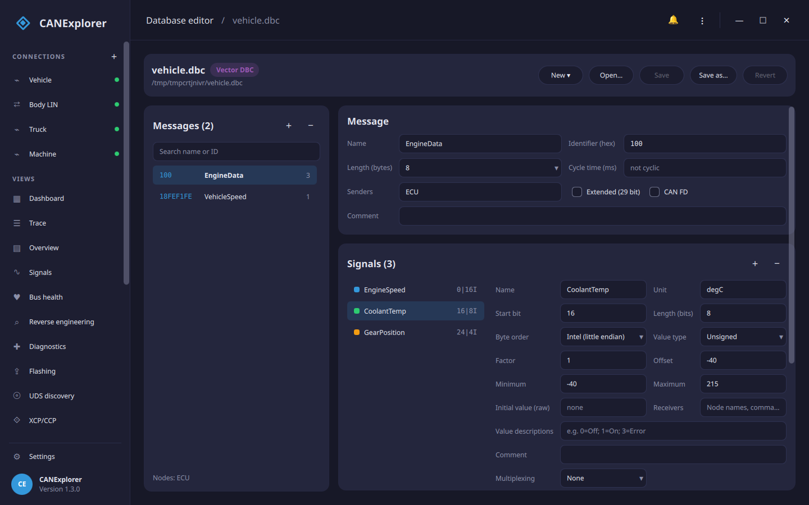
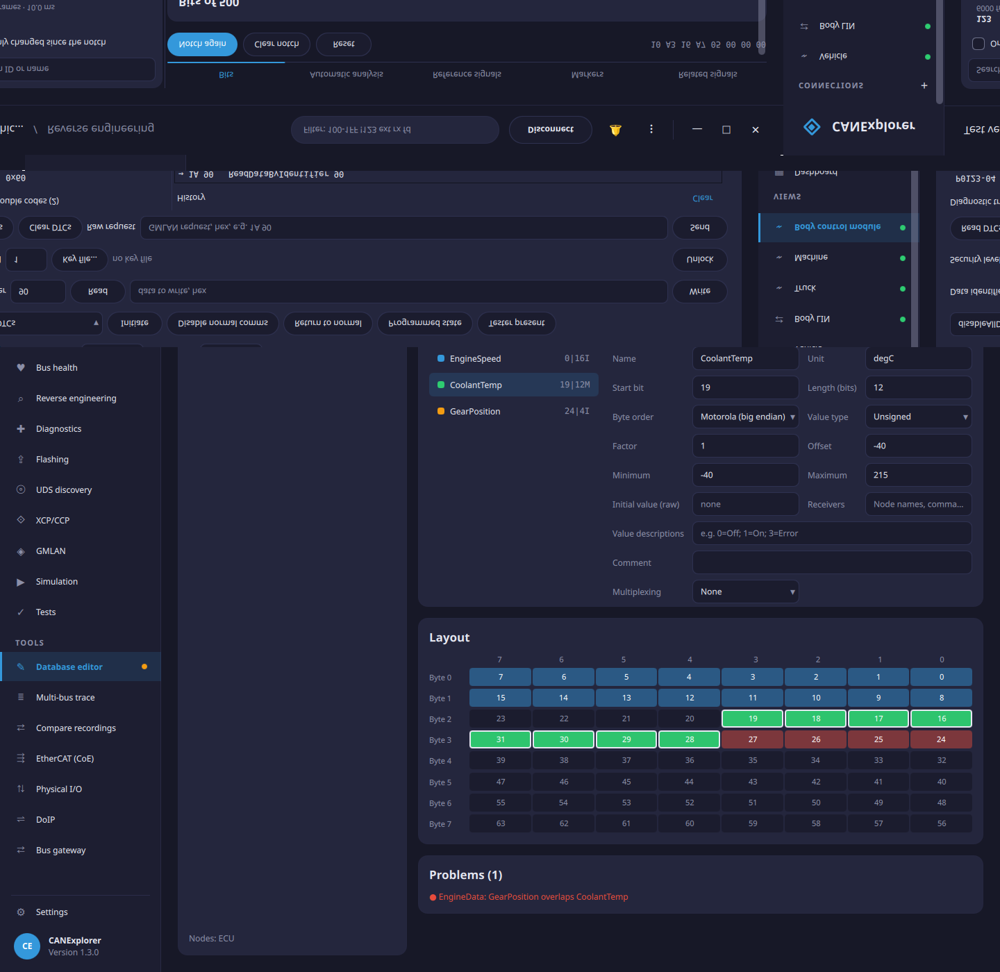
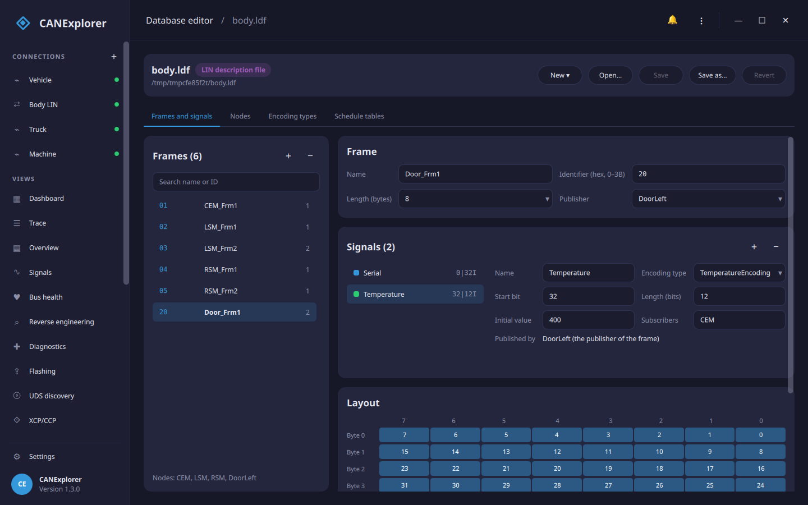

# Database editor

The database editor creates and changes signal databases: CAN databases with their messages, signals and nodes,
and LIN description files with their frames, signals, nodes, encoding types and schedule tables. Open it with
**Database editor** under *Tools* in the sidebar, **⋮ → Edit Signal Database…**, the welcome page, or **Edit
database** in the toolbar of a connection, which opens the database the connection decodes with.



## Formats

| Format | Open | Save |
|---|---|---|
| Vector DBC (`.dbc`) | ✓ | ✓ |
| BUSMASTER DBF (`.dbf`) | ✓ | ✓ |
| Kayak KCD (`.kcd`) | ✓ | ✓ |
| PCAN Symbol (`.sym`) | ✓ | ✓ |
| AUTOSAR ARXML (`.arxml`) | ✓ | Save as one of the CAN formats above |
| LIN description file (`.ldf`) | ✓ | ✓ (see [LIN databases](#lin-databases)) |

**New ▾** creates an empty CAN or LIN database. CANdelaStudio diagnostic descriptions (CDD) cannot be edited.

**Save** writes back to the opened file; **Save as…** writes another file, in the format of its extension, which
also converts the database. When the format cannot hold everything, the editor lists what was left out under
*Notes*, for example several senders of a message in a DBF file, or senders and receivers in a SYM file.
**Revert** reloads the file and discards the changes. An orange dot next to the file name and next to *Database
editor* in the sidebar marks unsaved changes; opening another file, creating a new one or quitting asks before
they are lost.

Connections that decode with the saved file reload it, so the trace, overview and signal plots use the changes
right away.

## Messages

The list on the left shows the identifier, name, an **FD** tag for CAN FD frames, the number of signals and a red
dot for messages with problems. **+** adds a message with a free identifier, **−** removes the selected one; the
search field filters by name or identifier.

| Property | Description |
|---|---|
| Name | Letters, digits and `_`, not starting with a digit; unique |
| Identifier | Hexadecimal; up to 7FF, or 1FFFFFFF for extended frames |
| Length | 0 to 8 bytes, or up to 64 bytes for CAN FD frames |
| Cycle time | In milliseconds; empty for messages that are not sent cyclically |
| Senders | Node names, comma separated; unknown nodes are added to the database |
| Extended (29 bit), CAN FD | Frame format |
| Comment | Free text |

## Signals

Select a signal in the list (its colour matches the layout below); **+** adds an 8 bit signal at the first free
byte, **−** removes the selected one. Changes are applied when a field is left or ++enter++ is pressed; invalid
values are reported in the header and the field returns to the stored value.

| Property | Description |
|---|---|
| Name | Unique within the message |
| Start bit, length | Position and size in bits. For Motorola signals the start bit is the most significant bit, as in DBC files |
| Byte order | Intel (little endian) or Motorola (big endian) |
| Value type | Unsigned or signed |
| Factor, offset | Physical value = raw value × factor + offset |
| Minimum, maximum | Physical range; empty for none |
| Unit | E.g. `rpm`, `km/h` |
| Initial value | Raw value before the first frame |
| Receivers | Node names, comma separated |
| Value descriptions | Names of raw values, e.g. `0=Off; 1=On; 3=Error` (hexadecimal values such as `0x0F=Fault` work too) |
| Comment | Free text |
| Multiplexing | **None**, **Multiplexer** (the switch) or **Multiplexed** (present only for some switch values) |

### Multiplexing

A message can carry different signals depending on the value of one **multiplexer** (switch) signal. Set one signal
to **Multiplexer**, then set the others to **Multiplexed** and enter the **switch values** they appear for
(e.g. `0, 1, 3`). Multiplexed signals for different switch values may share the same bits. When a message has more
than one multiplexer, a second control chooses which switch a signal follows. The switch cannot be removed while
signals still follow it, and renaming it updates them.

## Layout and problems

The layout shows the bits of the message, byte by byte with bit 7 on the left. Each signal's bits have its
colour, the selected signal is outlined, bits used by several signals are red, and clicking a bit selects its
signal.



*Problems* lists what makes frames undecodable or ambiguous: overlapping signals, signals reaching beyond the
message length, minimums above maximums and identifiers used by two messages. They do not prevent saving.

## LIN databases

A LIN description file opens with four tabs.



**Frames and signals** works like the CAN messages above, with the properties of LIN frames and signals:

| Frame | |
|---|---|
| Identifier | 0 to 0x3B (0x3C and above are the diagnostic frames) |
| Length | 1 to 8 bytes |
| Publisher | The node sending the response; it also publishes the frame's signals |

| Signal | |
|---|---|
| Start bit, length | Bit offset in the frame and width (1 to 64 bits); LIN sends the least significant bit first |
| Initial value | A number, or for byte arrays the bytes, e.g. `1, 2, 3, 4` for a 32 bit signal |
| Subscribers | The nodes receiving the signal |
| Encoding type | How raw values translate into physical values and texts, see below |

**Nodes** sets the bus speed, the LIN protocol and language versions, the channel name and the master node with
its time base and jitter, and lists the slave nodes with their node attributes: configured and initial NAD,
supplier and function ID, variant and LIN protocol. Renaming a node renames it in all frames, signals and
schedule tables; a node that still publishes frames or signals cannot be removed.

**Encoding types** and **Schedule tables** are edited as text in the syntax of the LDF and checked when
**Apply** is pressed:

```text
logical_value, 0, "off";
physical_value, 1, 254, 0.5, -40, "degC";
```

```text
SeatStatus delay 10 ms;
MasterReq delay 20 ms;
AssignNAD { SeatECU } delay 20 ms;
```

Renaming a frame or signal also renames it in schedule tables, sporadic and event triggered frames, node
attributes and encodings; removing a frame removes its signals and its schedule entries. The file is written in
the LDF syntax and read back with the LIN parser before it replaces the file, so only valid files are saved.
Comments of the original file are not kept.

