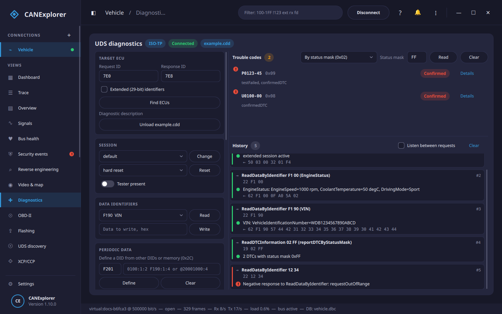
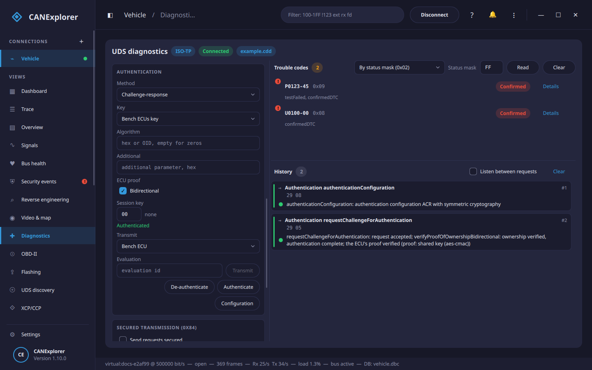

# Diagnostics (UDS)

The **Diagnostics** view sends Unified Diagnostic Services (ISO 14229) requests to an ECU and shows the responses.
On CAN it uses ISO-TP (ISO 15765-2); on [LIN](lin.md) connections the LIN transport layer.



The view has three parts: the services on the left, grouped into sections (Target ECU, Session, Data identifiers,
Periodic data, Security access, Routine control, Raw request); the ECU's **Trouble codes** at the top right; and the request
**History** below them. The panes can be resized by dragging the dividers. The header shows the transport, whether
the connection is open, whether tester present is running and which diagnostic description is loaded. Errors appear
in a banner below the header until the next request succeeds or you dismiss them.

## Addressing

- **CAN**: the **Request ID** and **Response ID** of the ECU (default `7E0`/`7E8`), **Extended (29-bit) identifiers** for 29-bit identifiers.
  Classic CAN and CAN FD frames (on CAN FD connections) are supported. Normal addressing (and normal fixed
  addressing, e.g. `18DA10F1`/`18DAF110`) needs only the identifiers. For **extended or mixed addressing**, where
  every frame starts with an address byte (the target address N_TA, or the address extension N_AE of mixed
  addressing), add that byte after a colon: request `6F1:12`, response `612:F1` sends to the ECU at address 0x12
  and accepts only response frames that start with 0xF1. The address byte takes one byte of every frame, so a
  single frame holds 6 bytes (61 on CAN FD). Everything that uses the view's addressing (requests, tester
  present, listening, flashing, UDS discovery) uses the address byte too.
- **LIN**: the **NAD** of the slave node (default `01`). Requests are sent in master request frames (0x3C) and the
  response is collected by polling slave response headers (0x3D).
- **Ethernet**: vehicles with an Ethernet diagnostic port are diagnosed with the [DoIP](doip.md) tool, which offers
  this view with the ECU's logical **Target address**.

In [scripts](test-automation.md), `IsoTpClient` takes the address bytes as `tx_address` and `rx_address`, and the
simulated ECU (`UdsEcuSimulator`) as `request_address` and `response_address`:

```python
from can_explorer.core.isotp_client import IsoTpClient
from can_explorer.core.uds import UdsClient

client = UdsClient(IsoTpClient(session, 0x6F1, 0x612, tx_address=0x12, rx_address=0xF1))
```

To find the services, data identifiers, subfunctions and routines an undocumented ECU exposes, use the
[UDS discovery](uds-discovery.md) page, which scans them over this same transport.

OBD adapters such as the OBDLink MX+ work as
[ELM327 connections](../reference/interfaces.md#elm327-and-obdlink-adapters) (interface *Elm327Bus*) for diagnostics
at a vehicle's OBD port, over USB, Bluetooth or WiFi.
Workshop interfaces with a J2534 driver work as
[J2534 connections](../reference/interfaces.md#j2534-pass-thru-devices) (interface *J2534Bus*).

## Services

| Section | Service |
|---|---|
| Session: **Change** | DiagnosticSessionControl (0x10): default, programming, extended, safety system |
| Session: **Reset** | ECUReset (0x11): hard, key off/on, soft reset |
| Session: **Tester present** | Keeps a non-default session alive: TesterPresent (0x3E 0x80) every 2 seconds |
| Data identifiers | ReadDataByIdentifier (0x22) and WriteDataByIdentifier (0x2E) |
| Security access | SecurityAccess (0x27), see below |
| Routine control | RoutineControl (0x31): start, stop, request results, with parameters |
| Target ECU: **Find ECUs** | A functional TesterPresent (0x3E 0x00 to 0x7DF, or 0x18DB33F1 with 29-bit identifiers), listing the ECUs that answer |
| Raw request | Any request as hex bytes |
| Trouble codes: **Read** / **Clear** | ReadDTCInformation (0x19) reports, see [Trouble codes](#trouble-codes), and ClearDiagnosticInformation (0x14) |
| Trouble codes: **Details** | A DTC's snapshot (0x19 0x04) and extended data (0x19 0x06) records |
| Periodic data | DynamicallyDefineDataIdentifier (0x2C) and ReadDataByPeriodicIdentifier (0x2A), see [Periodic data](#periodic-data) |
| Secured transmission (0x84) | SecuredDataTransmission (0x84): every request of the page in a signed and/or encrypted envelope, see [Secured data transmission](#secured-data-transmission-0x84) |

Every request and its response are added to the **History**, numbered, with the service name above the request
bytes and the interpretation above the response bytes. A coloured stripe and a status mark show the outcome: a
filled circle for a positive response, a diamond for a negative response, a circle with "!" for a timeout or
transport error. Responses are interpreted: standardised data identifiers by name (VIN, ECU serial number, …) with
text values, negative response codes by name (e.g. *securityAccessDenied*), sub-functions by name (e.g.
*reportDTCSnapshotRecordByDTCNumber*, *disableRxAndTx*).

Responses time out after 1 s (P2) and "response pending" answers are waited for up to 5 s each (P2*). When the ECU
reports its own P2 and P2* times in its DiagnosticSessionControl response, those times plus 0.5 s are used for the
new session, but never shorter than 1 s and 5 s, so a slow transport (DoIP over WiFi, an ELM327 adapter) is not cut
short. An ECU that needs 40 s to erase its flash memory and says so is therefore waited for.

### Messages between requests

Some messages an ECU sends answer no request: event-triggered responses set up with ResponseOnEvent (0x86), a late
answer to a request that already timed out, periodic data on the diagnostic channel. They are listed in the
**History** as *Unsolicited (sent by the ECU)*, marked with ↯, instead of being dropped. A response must echo the
request's sub-function or identifier to count as its answer, so an event response for another DID arriving during a
read is listed as unsolicited and the read still gets its own answer.

Messages arriving **during** a request are always listed. To receive them **between** requests too, turn on
**Listen between requests** in the History header (CAN only). It is off by default because receiving a segmented
message means answering its flow control on the response ID, and two tools doing that for the same IDs (e.g. this
view and the [OBD-II](obd.md) page, both on 0x7E8) would disturb the ECU's transfer. While it is on, everything this
view's addressing uses — requests, tester present, [flashing](flashing.md), [UDS discovery](uds-discovery.md) — shares
one ISO-TP receiver, so each flow control is answered once.

To try ResponseOnEvent, send the setup as **Raw request**s: `86 03 02 F1 90 22 F1 90` reports a change of DID F190
(onChangeOfDataIdentifier, infinite window, DID F190, service to respond to `22 F1 90`), then `86 05 02` starts it.

## Periodic data

The **Periodic data** section (CAN connections) makes the ECU send data on its own, without polling:

1. Optionally **Define** a DID combining parts of others (DynamicallyDefineDataIdentifier 0x2C), e.g. DID `F201`
   from `0100:1:2 F190:1:4` — 2 bytes of DID 0100 from its first byte, 4 bytes of the VIN — or from memory areas
   such as `@20001000:4` (address in hex, size in bytes). **Clear** removes it (all of them with the DID field
   empty). Many ECUs only allow this in the extended session.
2. **Start** sends the periodic DIDs (F200-F2FF, several separated by spaces) at the slow, medium or fast rate
   (ReadDataByPeriodicIdentifier 0x2A). The rates themselves are configured in the ECU. **Stop** ends it.

The list shows each DID's latest value (decoded with the [diagnostic description](#diagnostic-descriptions-cdd-odxpdx)
if it knows the DID), the number of messages and the measured rate.

ECUs send periodic data in two ways. Per ISO 14229-1:2020 it is the DID's low byte followed by the data in single CAN
frames, usually on a CAN ID of their own: enter it as **Frames on CAN ID**. A CAN frame carries no data length, so
the shown data includes the frame's padding unless the description knows the DID's length. Earlier ECUs send it on
the diagnostic response ID with the service ID 0x6A in front: leave the field empty, which turns on listening
between requests. Periodic messages are not added to the History.

## Trouble codes

**Read** in the **Trouble codes** pane lists the DTCs of the chosen report in SAE J2012 notation, e.g. `P0123-45`
(code and failure type) with their status byte and the names of the status bits set (testFailed, confirmedDTC, …).
Confirmed DTCs are marked with a red mark and a *Confirmed* label, pending ones with an amber diamond and *Pending*.
**Clear** clears all diagnostic information (group 0xFFFFFF).

| Report | ReadDTCInformation sub-function |
|---|---|
| By status mask | 0x02 reportDTCByStatusMask: the DTCs with one of the **Status mask** bits set (`FF` for all) |
| Supported DTCs | 0x0A reportSupportedDTC: every DTC the ECU can report, whatever its status |
| Fault detection counters | 0x14 reportDTCFaultDetectionCounter: how close each DTC is to failing (−128 passed … 127 failed) |
| User-defined memory | 0x17 reportUserDefMemoryDTCByStatusMask: the DTCs of a secondary fault memory (**Memory** selection) |
| Permanent, WWH-OBD | 0x55 reportWWHOBDDTCWithPermanentStatus: the emissions-related permanent DTCs |

**Details** on a DTC reads its **snapshot records** (freeze frames: the conditions when the fault was stored) and its
**extended data records** (counters such as occurrence and ageing), all record numbers. A snapshot record is a list
of data identifiers with their values. The response does not give their lengths, so they are split with the loaded
[diagnostic description](#diagnostic-descriptions-cdd-odxpdx), which also decodes the values into fields. Without one,
or for a DID it does not know, the rest of the record is shown in hex as *not decoded*, and not split at a guess.
Extended data records are manufacturer-defined bytes and are shown in hex; in scripts, give their lengths as
`record_lengths` to split them.

## Security access

Seed/key algorithms are specific to each manufacturer, so CANExplorer does not include any. Provide the algorithm as
a Python file defining:

```python
def compute_key(level: int, seed: bytes) -> bytes:
    """Return the key for the seed received for the given (odd) security level."""
    return bytes(byte ^ 0xFF for byte in seed)  # Example only
```

Choose it with **Choose key algorithm…**, select the (odd) level and press **Unlock**: CANExplorer requests the seed, calls
`compute_key` and sends the key. A seed of zeros means the level is already unlocked.

Manufacturer algorithms and their constants are secrets: add the file to the
[security manager](security-manager.md#seedkey-algorithms) and choose it with **From Security Manager** instead, so it
is kept encrypted rather than as a loose file. The same button lists the
[security profiles](security-manager.md#security-profiles-and-key-servers) that compute keys, such as a key server,
so the algorithm need not be on this computer at all. Flashing uses the same choice.

!!! warning
    The key file is executed. Only use files you trust.

### Testing security access

Two tests check how well an ECU protects its security access — run them only on ECUs and benches you are
authorised to test. They use the level set above.

**Analyse Seeds** requests 32 seeds and reports what would make a key guessable: repeated seeds, seed bytes that
never change, seeds that grow by a constant or small step (a counter or timer rather than random numbers), short
seeds, and zero seeds. Many ECUs keep the same seed until a key is sent, so choose how the seed is renewed between
requests: a **new session** (back to the default session and into the extended session again), an **ECU reset**, or
**repeated requests**.

**Test Lockout** sends up to 10 wrong keys and records after how many attempts the ECU answers
`exceedNumberOfAttempts` (NRC 0x36), and whether it then refuses seeds with `requiredTimeDelayNotExpired` (NRC 0x37).
With **Then reset the ECU**, it also checks whether a reset ends that delay — if it does, an attacker can reset and
try again. The ECU stays locked out for its delay time afterwards.

ISO 14229-1 leaves the number of attempts and the delay to the manufacturer, so the results say what was observed;
what is acceptable is for the test plan to decide. Test scripts run the same tests with
`await t.uds.seed_analysis(level, count=32, between='session')` and `await t.uds.lockout_test(level, max_attempts=10,
test_reset=True)`, which return reports with their `findings`. Both are recorded in the
[audit log](security-manager.md#audit-log).

## Authentication (0x29)

ECUs with *secure diagnostics* grant protected services only to an authenticated tester: they answer
`authenticationRequired` (NRC 0x34) until the tester proves its identity. ISO 14229-1:2020 offers two methods, both
in the **Authentication** section (**Method**); **Configuration** asks the ECU which one it offers
(authenticationConfiguration, 0x08).

### Certificate exchange

**Certificate exchange** (PKI) is the method AUTOSAR ECUs implement:

1. **verifyCertificateUnidirectional** sends the tester's certificate. The ECU checks it against the
   certificate authorities it trusts and answers with a random challenge.
2. **proofOfOwnership** sends the tester's signature over that challenge, made with the certificate's private key.
   The ECU checks it with the certificate's public key and answers *ownership verified, authentication complete*.
   It then grants what the roles in the certificate allow, until **De-authenticate**, a reset or a session timeout.

| Setting | Meaning |
|---|---|
| Certificate | A *TLS client certificate* entry of the [security manager](security-manager.md) — the certificate (sent as X.509 DER) and its private key; the store must be unlocked. Or a [security profile](security-manager.md#security-profiles-and-key-servers) with a certificate, which signs the proof itself (e.g. on a key server or in a hardware module): the private key never reaches this computer |
| Proof | The signature scheme of the proof of ownership: ECDSA with SHA-256 (DER-encoded or raw r ‖ s), Ed25519, RSA-PSS or RSA PKCS#1 v1.5 with SHA-256. Which one an ECU expects is part of its configuration (in AUTOSAR, its crypto service's signature job), so choose the one of your ECUs |
| Bidirectional | Use **verifyCertificateBidirectional** instead: the tester sends a challenge too, and the ECU answers with its own certificate and its signature over that challenge. The ECU's proof is verified, and its certificate is checked against the chosen *trusted certificates* |

The log shows each step, and a refusal with its reason, e.g. `certificateVerificationFailed-InvalidChainOfTrust`
(0x52) for a certificate from an issuer the ECU does not trust, or `ownershipVerificationFailed` (0x58) for a proof
the ECU cannot verify (a wrong key, or a different signature scheme). Test scripts authenticate with
`await t.uds.authenticate(certificate, private_key, 'ecdsa-sha256')`; `can_explorer.core.uds_auth.credentials`
loads a certificate and key from the key store.

Where this comes from: ISO 14229-1 is not freely available. The messages, sub-function numbers, return values and
NRCs follow the open-source *python-udsoncan* implementation of the service (and are tested byte for byte against
it); the exchange — which sub-functions, and that the proof is the signature over the ECU's challenge — follows the
public AUTOSAR Diagnostic Communication Manager specification (R23-11, §7.6.2.10), which agrees with it where they
overlap. Limits:

- Session keys: **Session key** (the communicationConfiguration) asks the ECU for one; turning its session key
  information into a key is manufacturer specific, see [Session keys](#session-keys).
- transmitCertificate (0x04) is encoded and decoded (also in the trace) but not offered as a procedure.
- Certificate formats other than X.509 (e.g. card-verifiable certificates) are not supported.

The [revocation lists](security-manager.md#revocation-lists) of the key store are applied: in bidirectional mode, an
ECU certificate they revoke is refused. The simulated ECU refuses revoked tester certificates with
`certificateVerificationFailed-InvalidCertificate` (NRC 0x57), as the AUTOSAR Dcm does.

### Challenge-response

**Challenge-response** authenticates without certificates: the ECU already knows the tester's key.



1. **requestChallengeForAuthentication** (0x05) names an algorithm (the *algorithmIndicator*); the ECU answers with
   the algorithm it uses, a challenge, and the additional parameter it needs, if any.
2. **verifyProofOfOwnershipUnidirectional** (0x06) sends the tester's proof over the challenge, made for the
   algorithm the ECU answered with. The ECU answers *ownership verified, authentication complete*, or
   `ownershipVerificationFailed` (0x58).

| Setting | Meaning |
|---|---|
| Key | A *UDS authentication key* of the [security manager](security-manager.md) (a key shared with the ECU: the proof is its HMAC-SHA-256 or AES-CMAC over the challenge), a *TLS client certificate* entry (its private key signs the challenge, with the **Proof** scheme), or a [security profile](security-manager.md#security-profiles-and-key-servers) that proves challenges or signs |
| Algorithm | The algorithmIndicator to ask for: 16 bytes in hex (shorter values are zero padded), or a dotted OID such as `2.16.840.1.101.3.4.2.1`, sent DER encoded (tag, length, value). Empty sends zeros |
| Additional parameter | Hex bytes, sent when the ECU asks for an additional parameter |
| Bidirectional | Use **verifyProofOfOwnershipBidirectional** (0x07): the tester sends a challenge too, and the ECU answers with its proof over it. It is checked with the shared key, the profile, or the public keys of the chosen *trusted certificates*; without any of them the log says it was not checked |

Test scripts authenticate with `await t.uds.authenticate_challenge_response(prove)`, where `prove(challenge,
algorithm_indicator)` returns the proof; `can_explorer.core.uds_auth.challenge_response_credentials` makes one from
a key store entry or a profile.

What the proof is computed over is up to the vehicle manufacturer: ISO 14229-1 leaves the challenge's contents and
the proof to it, and AUTOSAR ECUs do not implement this method. The message layouts follow *python-udsoncan* (and
are tested byte for byte against it); the built-in proofs — a MAC or a signature over the ECU's challenge, as in the
certificate exchange — are a choice, not taken from the standard. When an ECU expects something else (the challenge
with a VIN or a counter, a key derived per ECU, …), put the construction into a security profile's
`prove_challenge`. Whether an OID algorithmIndicator includes the DER tag and length is not specified publicly
either; enter the 16 bytes in hex when an ECU expects only the value. A session key asked for with **Session key** can
protect [secured transmission](#session-keys).

## Secured data transmission (0x84)

**SecuredDataTransmission** (0x84, positive response 0xC4) carries any diagnostic request and its response inside a
cryptographically protected envelope: signed, encrypted, or both, with an anti-replay counter. ECUs use it to
accept writes, routines or downloads only from a tester that holds the right key. With **Send requests secured** in
the **Secured transmission (0x84)** section, every request of the Diagnostics page (DID reads and writes, DTCs,
routines, raw requests, …) travels in an envelope, and every response is checked and unwrapped. The log shows the
wrapped service as usual, followed by `(secured: counter 12, response signature verified)`.

| Setting | Meaning |
|---|---|
| Key | **None (unsigned)**: plain envelopes. A *UDS secured data key* of the [security manager](security-manager.md): CANExplorer's [reference scheme](#the-reference-scheme). Or a **provider file**: a Python file with the manufacturer's scheme (see [below](#provider-files)) |
| Algorithm | The *Signature/Encryption Calculation* byte (hex): which algorithm protects the message. 0x00–0x7F are vehicle manufacturer specific, 0x80–0x8F system supplier specific |
| MAC bytes | For a secured data key: the signature length, truncating the MAC (0: the full MAC) |
| Sign / Encrypt | Sign the request; encrypt its internal message (a provider file with `encrypt` and `decrypt`) |
| Signed response | Ask the ECU to sign its response (*signature on the response is requested*) and refuse an unsigned one |
| Counter | The anti-replay counter of the next request; it increases by one per request. An ECU refuses counters it has already seen, so after restarting CANExplorer set it past the last one used |

TesterPresent keep-alive and [flashing](flashing.md) are sent unsecured. Negative responses to the envelope itself,
such as `secureDataVerificationFailed` (NRC 0x3A) for a bad signature or a replayed counter, are shown for the
wrapped request. A plain request to a DID that needs the envelope is answered `secureDataTransmissionRequired` (0x38).
The [trace](protocols.md) describes 0x84 and 0xC4 messages: their flags, counter and algorithm, and the
service inside them unless it is encrypted.

### The envelope

ISO 14229-1:2020 defines the envelope, for requests and responses alike:

| Field | Bytes | Contents |
|---|---|---|
| Administrative Parameter | 2 | bit 0 *request message*, bit 3 *pre-established key*, bit 4 *encrypted*, bit 5 *signed*, bit 6 *signature on the response requested*; the other bits are reserved |
| Signature/Encryption Calculation | 1 | the algorithm |
| Signature Length | 2 | the length of the Signature/MAC at the end (0: not signed) |
| Anti-replay Counter | 2 | |
| Internal message | 1 + n | the wrapped service ID and its parameters, or their ciphertext |
| Signature/MAC | Signature Length | |

ISO 14229-1 is not freely available. This layout follows Wireshark's UDS dissector and the tables of the *py-uds*
knowledge base, which agree on the fields and the bit positions. Scapy's UDS layer has the same fields with the
administrative bits in mirrored order (request message as bit 15); CANExplorer follows the two sources that agree.
The NRCs 0x38–0x3A follow *python-udsoncan* and Wireshark. The AUTOSAR Dcm does not support the service. ISO
14229-1:2013 had a single opaque record instead: such a message (or any message that does not fit the 2020 layout)
is labelled *not decoded* in the trace, not guessed at.

### The reference scheme

The standard leaves the cryptography to the vehicle manufacturer: which algorithms the algorithm byte stands for,
what the signature covers, how the counter enters the computation, and how keys are agreed. A *UDS secured data
key* of the security manager therefore uses **CANExplorer's own reference scheme**, a documented choice, not taken
from the standard. The signature is an HMAC-SHA-256 or AES-CMAC with the shared key over every byte before the
signature (service ID to internal message), truncated to **MAC bytes**. It does not encrypt. It works with the
simulated ECU and with ECUs built to the same scheme, not with any particular manufacturer's ECUs: for those, use a
provider file.

### Provider files

A provider file implements the manufacturer's scheme. It defines any of these functions; `header` has the fields
`administrative`, `algorithm`, `signature_length` and `counter`, and the flags `request`, `signed`, `encrypted`,
`pre_established_key` and `signature_on_response_requested`:

```python
def signature_length(header) -> int: ...  # Needed with sign(): the length is part of the signed header
def sign(header, data: bytes) -> bytes: ...  # data: the message bytes before the signature
def verify(header, data: bytes, signature: bytes) -> bool: ...  # Optional: otherwise sign() and compare
def encrypt(header, plaintext: bytes) -> bytes: ...  # The internal message (service ID and parameters)
def decrypt(header, ciphertext: bytes) -> bytes: ...
```

Requests are encrypted first, then signed. In scripts, wrap any transport:

```python
from can_explorer.core.uds import UdsClient
from can_explorer.core.uds_secured import MacProvider, SecuredOptions, SecuredTransport

secured = SecuredTransport(transport, MacProvider(key, 'aes-cmac', 8), SecuredOptions(signature_on_response=True))
uds = UdsClient(secured)
await uds.write_data_by_identifier(0xF198, b'WS-0042')  # Sent signed; the response is verified
print(secured.next_counter, secured.last.describe())
```

`uds_secured.load_provider('keystore:<entry>')` or `load_provider('oem.py')` loads a provider, and
`uds_secured.secured_request` sends one request.

### Session keys

Authentication (0x29) can establish a session key for the secured requests that follow. The tester asks for one
with the *communicationConfiguration* byte (**Session key** in the Authentication section, hex; 00 asks for none),
and the ECU answers the last step with *session key information*. The Authentication section then shows
`session key info 16 bytes (communicationConfiguration 0x01, challenge-response)`, and **Session key
(Authentication)** in the Secured transmission section protects the requests with it. These envelopes set the
*pre-established key* bit. De-authenticating, or authenticating again, ends the session key and the secured requests
that use it.

Which communicationConfiguration values ask for a session key, and what the session key information holds ("e.g.
encrypted session keys"), are left to the vehicle manufacturer; the AUTOSAR Dcm supports only 0 (no session key).
So turning it into a key is up to the source of the authentication:

- A **security profile** (the authentication's certificate or key) with `session_provider(context)`: it returns the
  0x84 provider, e.g. after unwrapping the session key information with the tester's private key, or a key agreement
  with the ephemeral public keys of the certificate exchange.
- A **UDS authentication key** (challenge-response with a shared key): CANExplorer's **reference derivation**, a
  documented choice, not from the standard. The session key is HKDF-SHA-256 (RFC 5869) of the shared key, with the
  ECU's challenge followed by the tester's challenge (empty when unidirectional) as the salt, and the label
  `CANExplorer UDS session key`, the communicationConfiguration byte and the session key information as the info. It
  is 32 bytes for HMAC-SHA-256 and 16 for AES-CMAC, the MAC of the key entry. The signatures are then those of the
  [reference scheme](#the-reference-scheme) with the session key. The simulated ECU's session key information for it
  is a random 16-byte nonce.

`context` (`can_explorer.core.uds_secured.SessionContext`) holds the method (`certificate` or
`challenge-response`), the communicationConfiguration, the session key information, both challenges, the algorithm
indicator, the certificates, and the ephemeral public keys of the certificate exchange. In scripts:

```python
from can_explorer.core.uds_secured import SecuredOptions, SecuredTransport, SessionContext, session_provider

result = await uds.authenticate_challenge_response(prove, communication_configuration=0x01)
provider = session_provider(SessionContext.from_result(result), oem_session_provider)  # Or 'profile:<name>'
secured = UdsClient(SecuredTransport(transport, provider, SecuredOptions(pre_established_key=True)))
```

`uds.authenticate(…, ephemeral_public_key=…)` sends the tester's ephemeral public key with the proof of ownership
(bytes, or a function of the ECU's ephemeral public key returning it), for key agreements.

## Diagnostic descriptions (CDD, ODX/PDX)

A diagnostic description of the ECU names its data identifiers and describes their data. CANExplorer reads Vector
CANdelaStudio files (`.cdd`), ASAM ODX files (`.odx`, `.odx-d`) and packaged ODX archives (`.pdx`). Load one with
**Load description (.cdd)…** in the Target ECU section of the Diagnostics view (or with **Load database…**):

- The data identifier list starts with the identifiers of the ECU.
- ReadDataByIdentifier responses are decoded into fields with units and value texts:
  `EngineStatus: EngineSpeed=1000 rpm, CoolantTemperature=50 degC, DrivingMode=Sport`.
- The UDS and LIN protocol decoders of the trace use the description too.

Supported are the simple data types (unsigned, signed, float, ASCII and UTF-8 text in both byte orders, with linear
scaling and value texts). From CDD files, DIDs built from structures, unions (shown as all alternatives) and shared
DID structures are read too. From ODX, the ReadDataByIdentifier services with fixed-length data object properties
(IDENTICAL, LINEAR and TEXTTABLE compu methods) are read; a `.pdx` archive's ODX documents are all read and their
identifiers combined. Data of other types (structures, variable-length or multiplexed fields) is shown in hex.

## More services in scripts

`UdsClient` (`can_explorer.core.uds`) covers the rest of ISO 14229-1 for [test scripts](test-automation.md) and
your own code:

| Service | Methods |
|---|---|
| ReadDTCInformation (0x19) | `read_dtc_information(sub, …)` for 0x01, 0x02, 0x03, 0x04, 0x06, 0x07, 0x0A, 0x14, 0x17, 0x18, 0x19, 0x42 and 0x55 (`can_explorer.core.uds_dtc`) |
| ReadScalingDataByIdentifier (0x24) | `read_scaling_data_by_identifier(did)`: the data types and lengths of a DID |
| CommunicationControl (0x28), ControlDTCSetting (0x85) | `communication_control(control, communication)`, `control_dtc_setting(on)` |
| DynamicallyDefineDataIdentifier (0x2C) | `dynamically_define_by_identifier(dddid, [(did, position, size), …])`, `dynamically_define_by_memory_address(dddid, [(address, size), …])`, `clear_dynamically_defined()` |
| ReadDataByPeriodicIdentifier (0x2A) | `read_data_by_periodic_identifier(mode, [pdid, …])`, with a `PeriodicDataReceiver` (`can_explorer.core.uds_periodic`) collecting the data, its counts and rates |
| RequestFileTransfer (0x38) | `write_file(path, data)`, `read_file(path)`, `read_directory(path)`, `delete_file(path)` |
| ResponseOnEvent (0x86) | `response_on_event(event_type, …)`, with an `EventCollector` (`can_explorer.core.uds_events`) collecting the event-triggered responses |
| LinkControl (0x87) | `link_control(control, mode=…, baudrate=…)` |

```python
from can_explorer.core import uds_dtc, uds_events, uds_periodic

details = await uds.read_dtc_information(uds_dtc.REPORT_SNAPSHOT_BY_DTC, dtc=0x012345, description=description)
print(details.describe())

# The ECU sends data on its own: DID F201 built from two bytes of DID 0100, at the fast rate, on CAN id 0x5E8
await uds.dynamically_define_by_identifier(0xF201, [(0x0100, 1, 2)])
receiver = uds_periodic.PeriodicDataReceiver(lengths={0xF201: 2})
receiver.attach(session, 0x5E8)
await uds.read_data_by_periodic_identifier(uds_periodic.SEND_AT_FAST_RATE, [0xF201])

# Tell me when DID F190 changes
events = uds_events.EventCollector(uds)
await uds.response_on_event(
    uds_events.ON_CHANGE_OF_DATA_IDENTIFIER,
    event_record=uds_events.data_identifier_record(0xF190),
    service_to_respond=bytes([0x22, 0xF1, 0x90]),
)
await uds.response_on_event(uds_events.START)
await uds.listen(10)  # Receive for 10 s; the event responses land in events.events
```

Responses that do not answer the current request (event-triggered responses, periodic data on the diagnostic
channel, stale answers of an earlier request) go to the `add_unsolicited_listener` callbacks instead of being
dropped. A response must echo the request's sub-function or identifier, so an event response for one DID is not
taken as the answer to a read of another.

**Periodic data** arrives, per ISO 14229-1:2020, as the periodic identifier followed by the data, without a service
ID, in single CAN frames usually sent on an identifier of their own (give it to `attach`). Older ECUs send it on the
diagnostic response identifier with the service ID 0x6A in front (`listen_to(uds)`). A CAN frame has no data length,
so the data includes the frame's padding unless `lengths` (or a diagnostic description) gives the DID's length.

**Functional requests** (`can_explorer.core.uds_functional`) go to all ECUs at once and collect every answer:

```python
from can_explorer.core.uds_functional import FunctionalUdsClient, obd_11bit

with obd_11bit(session) as transport:  # 0x7DF; ECUs answer on 0x7E8-0x7EF (obd_29bit: 0x18DB33F1)
    everyone = FunctionalUdsClient(transport)
    print(await everyone.discover())  # [0x7E8, 0x7E9]
    print(await everyone.read_dtcs())  # {response id: [DTC, …]}
```

On CAN a functional request must fit a single frame (7 bytes, 62 on CAN FD). The ECUs' answers may be segmented;
the flow control for each goes to that ECU's physical request identifier. `mapped(session, functional_id, {response
id: request id})` covers other addressing schemes, and `DoipFunctional(client, address)` sends to a functional logical
address over [DoIP](doip.md); the functional addresses are vehicle specific, so none is assumed.

!!! note "What is not decoded"
    ISO 14229-1 is a paywalled standard. These services were checked against free references: the AUTOSAR
    Diagnostic Communication Manager specification (R23-11), the udsoncan library and Wireshark's UDS dissector.
    Where they leave a layout open it is kept as bytes:

    - The scaling byte extensions of the bit-mapped types (0x24); formula and unit/format extensions are returned
      as bytes, not evaluated.
    - The durations of the ResponseOnEvent window times other than *infinite*, and the per-event records of
      *reportActivatedEvents* (their length depends on each event's service to respond to).
    - SecuredDataTransmission (0x84): ISO 14229-1:2013 records are not decoded, and encrypted internal messages
      only with a provider that decrypts them (see [above](#secured-data-transmission-0x84)).
    - Directory information of RequestFileTransfer *readDir* is returned as bytes: its format is manufacturer specific.
    - For 0x19 0x55 the references disagree: udsoncan reads 5-byte records (with a severity), the AUTOSAR
      specification returns DTCAndStatusRecords (4 bytes). CANExplorer follows AUTOSAR.

## Simulated ECU

`can_explorer.core.simulation` contains a UDS server (sessions, DIDs, security access with the key *seed XOR 0xFF*,
DTCs with snapshot and extended data records, routines, downloads for [flashing](flashing.md), communication
control, DTC setting, scaling data, dynamically defined and periodic DIDs, a small file system for RequestFileTransfer,
ResponseOnEvent, link control, functional requests on 0x7DF, and Authentication by certificate exchange when given a
`can_explorer.core.uds_auth.AuthenticationServer` with the trusted certificates and the DIDs it protects, and by
challenge-response when given a `ChallengeResponseConfig`, e.g. `symmetric_challenge_response(key, 'aes-cmac')`,
and SecuredDataTransmission when given a `can_explorer.core.uds_secured.SecuredServerConfig` with a provider and
the DIDs that need it; with a `SessionKeyIssuer` for its AuthenticationServer it issues session keys for the
communicationConfiguration 0x01, its own choice)
reachable over ISO-TP (`UdsEcuSimulator`) or behind simulated LIN slaves (`LinSlaveSimulator`). The
tests and `tools/docs_screenshots.py` use them; the latter shows how to run one next to the application.
