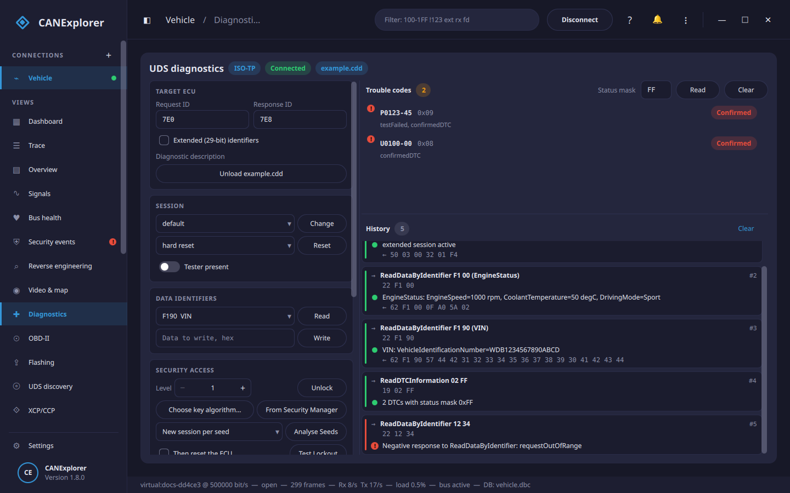
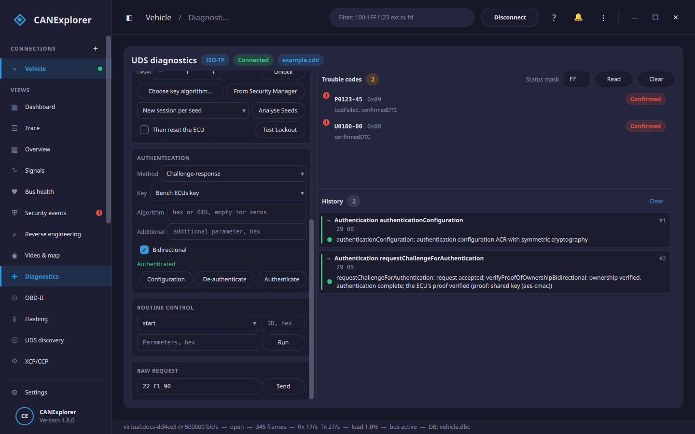

# Diagnostics (UDS)

The **Diagnostics** view sends Unified Diagnostic Services (ISO 14229) requests to an ECU and shows the responses.
On CAN it uses ISO-TP (ISO 15765-2); on [LIN](lin.md) connections the LIN transport layer.



The view has three parts: the services on the left, grouped into sections (Target ECU, Session, Data identifiers,
Security access, Routine control, Raw request); the ECU's **Trouble codes** at the top right; and the request
**History** below them. The panes can be resized by dragging the dividers. The header shows the transport, whether
the connection is open, whether tester present is running and which diagnostic description is loaded. Errors appear
in a banner below the header until the next request succeeds or you dismiss them.

## Addressing

- **CAN**: the **Request ID** and **Response ID** of the ECU (default `7E0`/`7E8`), **Extended (29-bit) identifiers** for 29-bit identifiers.
  Classic CAN and CAN FD frames (on CAN FD connections) are supported, with normal addressing.
- **LIN**: the **NAD** of the slave node (default `01`). Requests are sent in master request frames (0x3C) and the
  response is collected by polling slave response headers (0x3D).
- **Ethernet**: vehicles with an Ethernet diagnostic port are diagnosed with the [DoIP](doip.md) tool, which offers
  this view with the ECU's logical **Target address**.

To find the services, data identifiers, subfunctions and routines an undocumented ECU exposes, use the
[UDS discovery](uds-discovery.md) page, which scans them over this same transport.

OBD adapters such as the OBDLink MX+ work as
[ELM327 connections](../reference/interfaces.md#elm327-and-obdlink-adapters) (interface *Elm327Bus*) for diagnostics
at a vehicle's OBD port, over USB, Bluetooth or WiFi.
Workshop interfaces with a J2534 driver work as
[J2534 connections](../reference/interfaces.md#j2534-pass-thru-devices) (interface *J2534Bus*).

## Services

| Section | Service |
|---|---|
| Session: **Change** | DiagnosticSessionControl (0x10): default, programming, extended, safety system |
| Session: **Reset** | ECUReset (0x11): hard, key off/on, soft reset |
| Session: **Tester present** | Keeps a non-default session alive: TesterPresent (0x3E 0x80) every 2 seconds |
| Data identifiers | ReadDataByIdentifier (0x22) and WriteDataByIdentifier (0x2E) |
| Security access | SecurityAccess (0x27), see below |
| Routine control | RoutineControl (0x31): start, stop, request results, with parameters |
| Raw request | Any request as hex bytes |
| Trouble codes: **Read** / **Clear** | ReadDTCInformation 0x19 0x02 (report DTCs by status mask) and ClearDiagnosticInformation (0x14) |

Every request and its response are added to the **History**, numbered, with the service name above the request
bytes and the interpretation above the response bytes. A coloured stripe and a status mark show the outcome: a
filled circle for a positive response, a diamond for a negative response, a circle with "!" for a timeout or
transport error. Responses are interpreted: standardised data identifiers by name (VIN, ECU serial number, …) with
text values, negative response codes by name (e.g. *securityAccessDenied*). "Response pending" answers are waited
for (up to 5 s each); other responses time out after 1 s.

## Trouble codes

**Read** in the **Trouble codes** pane lists the DTCs matching the **Status mask** (hexadecimal, `FF` for all) in
SAE J2012 notation, e.g. `P0123-45` (code and failure type) with their status byte and the names of the status bits
set (testFailed, confirmedDTC, …). Confirmed DTCs are marked with a red mark and a *Confirmed* label, pending ones
with an amber diamond and *Pending*. **Clear** clears all diagnostic information (group 0xFFFFFF).

## Security access

Seed/key algorithms are specific to each manufacturer, so CANExplorer does not include any. Provide the algorithm as
a Python file defining:

```python
def compute_key(level: int, seed: bytes) -> bytes:
    """Return the key for the seed received for the given (odd) security level."""
    return bytes(byte ^ 0xFF for byte in seed)  # Example only
```

Choose it with **Choose key algorithm…**, select the (odd) level and press **Unlock**: CANExplorer requests the seed, calls
`compute_key` and sends the key. A seed of zeros means the level is already unlocked.

Manufacturer algorithms and their constants are secrets: add the file to the
[security manager](security-manager.md#seedkey-algorithms) and choose it with **From Security Manager** instead, so it
is kept encrypted rather than as a loose file. The same button lists the
[security profiles](security-manager.md#security-profiles-and-key-servers) that compute keys, such as a key server,
so the algorithm need not be on this computer at all. Flashing uses the same choice.

!!! warning
    The key file is executed. Only use files you trust.

### Testing security access

Two tests check how well an ECU protects its security access — run them only on ECUs and benches you are
authorised to test. They use the level set above.

**Analyse Seeds** requests 32 seeds and reports what would make a key guessable: repeated seeds, seed bytes that
never change, seeds that grow by a constant or small step (a counter or timer rather than random numbers), short
seeds, and zero seeds. Many ECUs keep the same seed until a key is sent, so choose how the seed is renewed between
requests: a **new session** (back to the default session and into the extended session again), an **ECU reset**, or
**repeated requests**.

**Test Lockout** sends up to 10 wrong keys and records after how many attempts the ECU answers
`exceedNumberOfAttempts` (NRC 0x36), and whether it then refuses seeds with `requiredTimeDelayNotExpired` (NRC 0x37).
With **Then reset the ECU**, it also checks whether a reset ends that delay — if it does, an attacker can reset and
try again. The ECU stays locked out for its delay time afterwards.

ISO 14229-1 leaves the number of attempts and the delay to the manufacturer, so the results say what was observed;
what is acceptable is for the test plan to decide. Test scripts run the same tests with
`await t.uds.seed_analysis(level, count=32, between='session')` and `await t.uds.lockout_test(level, max_attempts=10,
test_reset=True)`, which return reports with their `findings`. Both are recorded in the
[audit log](security-manager.md#audit-log).

## Authentication (0x29)

ECUs with *secure diagnostics* grant protected services only to an authenticated tester: they answer
`authenticationRequired` (NRC 0x34) until the tester proves its identity. ISO 14229-1:2020 offers two methods, both
in the **Authentication** section (**Method**); **Configuration** asks the ECU which one it offers
(authenticationConfiguration, 0x08).

### Certificate exchange

**Certificate exchange** (PKI) is the method AUTOSAR ECUs implement:

1. **verifyCertificateUnidirectional** sends the tester's certificate. The ECU checks it against the
   certificate authorities it trusts and answers with a random challenge.
2. **proofOfOwnership** sends the tester's signature over that challenge, made with the certificate's private key.
   The ECU checks it with the certificate's public key and answers *ownership verified, authentication complete*.
   It then grants what the roles in the certificate allow, until **De-authenticate**, a reset or a session timeout.

| Setting | Meaning |
|---|---|
| Certificate | A *TLS client certificate* entry of the [security manager](security-manager.md) — the certificate (sent as X.509 DER) and its private key; the store must be unlocked. Or a [security profile](security-manager.md#security-profiles-and-key-servers) with a certificate, which signs the proof itself (e.g. on a key server or in a hardware module): the private key never reaches this computer |
| Proof | The signature scheme of the proof of ownership: ECDSA with SHA-256 (DER-encoded or raw r ‖ s), Ed25519, RSA-PSS or RSA PKCS#1 v1.5 with SHA-256. Which one an ECU expects is part of its configuration (in AUTOSAR, its crypto service's signature job), so choose the one of your ECUs |
| Bidirectional | Use **verifyCertificateBidirectional** instead: the tester sends a challenge too, and the ECU answers with its own certificate and its signature over that challenge. The ECU's proof is verified, and its certificate is checked against the chosen *trusted certificates* |

The log shows each step, and a refusal with its reason, e.g. `certificateVerificationFailed-InvalidChainOfTrust`
(0x52) for a certificate from an issuer the ECU does not trust, or `ownershipVerificationFailed` (0x58) for a proof
the ECU cannot verify (a wrong key, or a different signature scheme). Test scripts authenticate with
`await t.uds.authenticate(certificate, private_key, 'ecdsa-sha256')`; `can_explorer.core.uds_auth.credentials`
loads a certificate and key from the key store.

Where this comes from: ISO 14229-1 is not freely available. The messages, sub-function numbers, return values and
NRCs follow the open-source *python-udsoncan* implementation of the service (and are tested byte for byte against
it); the exchange — which sub-functions, and that the proof is the signature over the ECU's challenge — follows the
public AUTOSAR Diagnostic Communication Manager specification (R23-11, §7.6.2.10), which agrees with it where they
overlap. Limits:

- Only communication configuration 0 (no session key): the ECU's session key information, if any, is not used to
  secure the following requests.
- transmitCertificate (0x04) is encoded and decoded (also in the trace) but not offered as a procedure.
- Certificate formats other than X.509 (e.g. card-verifiable certificates) are not supported.

The [revocation lists](security-manager.md#revocation-lists) of the key store are applied: in bidirectional mode, an
ECU certificate they revoke is refused. The simulated ECU refuses revoked tester certificates with
`certificateVerificationFailed-InvalidCertificate` (NRC 0x57), as the AUTOSAR Dcm does.

### Challenge-response

**Challenge-response** authenticates without certificates: the ECU already knows the tester's key.



1. **requestChallengeForAuthentication** (0x05) names an algorithm (the *algorithmIndicator*); the ECU answers with
   the algorithm it uses, a challenge, and the additional parameter it needs, if any.
2. **verifyProofOfOwnershipUnidirectional** (0x06) sends the tester's proof over the challenge, made for the
   algorithm the ECU answered with. The ECU answers *ownership verified, authentication complete*, or
   `ownershipVerificationFailed` (0x58).

| Setting | Meaning |
|---|---|
| Key | A *UDS authentication key* of the [security manager](security-manager.md) (a key shared with the ECU: the proof is its HMAC-SHA-256 or AES-CMAC over the challenge), a *TLS client certificate* entry (its private key signs the challenge, with the **Proof** scheme), or a [security profile](security-manager.md#security-profiles-and-key-servers) that proves challenges or signs |
| Algorithm | The algorithmIndicator to ask for: 16 bytes in hex (shorter values are zero padded), or a dotted OID such as `2.16.840.1.101.3.4.2.1`, sent DER encoded (tag, length, value). Empty sends zeros |
| Additional parameter | Hex bytes, sent when the ECU asks for an additional parameter |
| Bidirectional | Use **verifyProofOfOwnershipBidirectional** (0x07): the tester sends a challenge too, and the ECU answers with its proof over it. It is checked with the shared key, the profile, or the public keys of the chosen *trusted certificates*; without any of them the log says it was not checked |

Test scripts authenticate with `await t.uds.authenticate_challenge_response(prove)`, where `prove(challenge,
algorithm_indicator)` returns the proof; `can_explorer.core.uds_auth.challenge_response_credentials` makes one from
a key store entry or a profile.

What the proof is computed over is up to the vehicle manufacturer: ISO 14229-1 leaves the challenge's contents and
the proof to it, and AUTOSAR ECUs do not implement this method. The message layouts follow *python-udsoncan* (and
are tested byte for byte against it); the built-in proofs — a MAC or a signature over the ECU's challenge, as in the
certificate exchange — are a choice, not taken from the standard. When an ECU expects something else (the challenge
with a VIN or a counter, a key derived per ECU, …), put the construction into a security profile's
`prove_challenge`. Whether an OID algorithmIndicator includes the DER tag and length is not specified publicly
either; enter the 16 bytes in hex when an ECU expects only the value. The ECU's session key information is not used.

## Diagnostic descriptions (CDD, ODX/PDX)

A diagnostic description of the ECU names its data identifiers and describes their data. CANExplorer reads Vector
CANdelaStudio files (`.cdd`), ASAM ODX files (`.odx`, `.odx-d`) and packaged ODX archives (`.pdx`). Load one with
**Load description (.cdd)…** in the Target ECU section of the Diagnostics view (or with **Load database…**):

- The data identifier list starts with the identifiers of the ECU.
- ReadDataByIdentifier responses are decoded into fields with units and value texts:
  `EngineStatus: EngineSpeed=1000 rpm, CoolantTemperature=50 degC, DrivingMode=Sport`.
- The UDS and LIN protocol decoders of the trace use the description too.

Supported are the simple data types (unsigned, signed, float, ASCII and UTF-8 text in both byte orders, with linear
scaling and value texts). From CDD files, DIDs built from structures, unions (shown as all alternatives) and shared
DID structures are read too. From ODX, the ReadDataByIdentifier services with fixed-length data object properties
(IDENTICAL, LINEAR and TEXTTABLE compu methods) are read; a `.pdx` archive's ODX documents are all read and their
identifiers combined. Data of other types (structures, variable-length or multiplexed fields) is shown in hex.

## Simulated ECU

`can_explorer.core.simulation` contains a UDS server (sessions, DIDs, security access with the key *seed XOR 0xFF*,
DTCs, routines, downloads for [flashing](flashing.md), and Authentication by certificate exchange when given a
`can_explorer.core.uds_auth.AuthenticationServer` with the trusted certificates and the DIDs it protects, and by
challenge-response when given a `ChallengeResponseConfig`, e.g. `symmetric_challenge_response(key, 'aes-cmac')`)
reachable over ISO-TP (`UdsEcuSimulator`) or behind simulated LIN slaves (`LinSlaveSimulator`). The
tests and `tools/docs_screenshots.py` use them; the latter shows how to run one next to the application.
