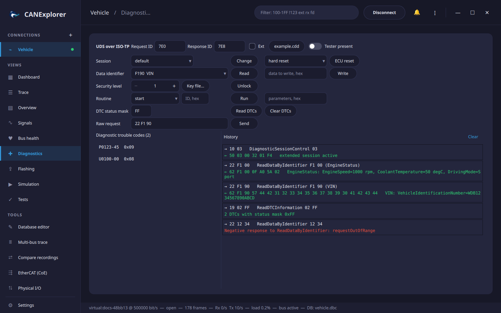

# Diagnostics (UDS)

The **Diagnostics** view sends Unified Diagnostic Services (ISO 14229) requests to an ECU and shows the responses.
On CAN it uses ISO-TP (ISO 15765-2); on [LIN](lin.md) connections the LIN transport layer.



## Addressing

- **CAN**: the **Request ID** and **Response ID** of the ECU (default `7E0`/`7E8`), **Ext** for 29-bit identifiers.
  Classic CAN and CAN FD frames (on CAN FD connections) are supported, with normal addressing.
- **LIN**: the **NAD** of the slave node (default `01`). Requests are sent in master request frames (0x3C) and the
  response is collected by polling slave response headers (0x3D).

OBD adapters such as the OBDLink MX+ work as
[ELM327 connections](../reference/interfaces.md#elm327-and-obdlink-adapters) (interface *Elm327Bus*) for diagnostics
at a vehicle's OBD port, over USB, Bluetooth or WiFi.
Workshop interfaces with a J2534 driver work as
[J2534 connections](../reference/interfaces.md#j2534-pass-thru-devices) (interface *J2534Bus*).

## Services

| Row | Service |
|---|---|
| Session | DiagnosticSessionControl (0x10): default, programming, extended, safety system |
| ECU reset | ECUReset (0x11): hard, key off/on, soft reset |
| Data identifier | ReadDataByIdentifier (0x22) and WriteDataByIdentifier (0x2E) |
| Security level | SecurityAccess (0x27), see below |
| Routine | RoutineControl (0x31): start, stop, request results, with parameters |
| DTC status mask | ReadDTCInformation 0x19 0x02 (report DTCs by status mask) and ClearDiagnosticInformation (0x14) |
| Raw request | Any request as hex bytes |
| Tester present | Keeps a non-default session alive: TesterPresent (0x3E 0x80) every 2 seconds |

Every request and its response are added to the **History** (positive responses in green, negative responses and
timeouts in red). Responses are interpreted: standardised data identifiers by name (VIN, ECU serial number, …) with
text values, negative response codes by name (e.g. *securityAccessDenied*). "Response pending" answers are waited
for (up to 5 s each); other responses time out after 1 s.

## Trouble codes

**Read DTCs** lists the DTCs matching the status mask (hexadecimal, `FF` for all) in SAE J2012 notation, e.g.
`P0123-45` (code and failure type) with their status byte; hover a DTC to see the status bits (testFailed,
confirmedDTC, …). **Clear DTCs** clears all diagnostic information (group 0xFFFFFF).

## Security access

Seed/key algorithms are specific to each manufacturer, so CANExplorer does not include any. Provide the algorithm as
a Python file defining:

```python
def compute_key(level: int, seed: bytes) -> bytes:
    """Return the key for the seed received for the given (odd) security level."""
    return bytes(byte ^ 0xFF for byte in seed)  # Example only
```

Choose it with **Key file…**, select the (odd) level and press **Unlock**: CANExplorer requests the seed, calls
`compute_key` and sends the key. A seed of zeros means the level is already unlocked.

!!! warning
    The key file is executed. Only use files you trust.

## Diagnostic descriptions (CDD)

A Vector CANdelaStudio description (`.cdd`) of the ECU names its data identifiers and describes their data. Load it
with **Description…** in the Diagnostics view (or with **Load database…**):

- The data identifier list starts with the identifiers of the ECU.
- ReadDataByIdentifier responses are decoded into fields with units and value texts:
  `EngineStatus: EngineSpeed=1000 rpm, CoolantTemperature=50 degC, DrivingMode=Sport`.
- The UDS and LIN protocol decoders of the trace use the description too.

Supported are the simple data types of CDD files (unsigned, signed, float and text values in both byte orders, with
linear scaling and text tables, including value ranges) and DIDs built from structures, unions (shown as all
alternatives) and shared DID structures. Data of other types is shown in hex.

## Simulated ECU

`can_explorer.core.simulation` contains a UDS server (sessions, DIDs, security access with the key *seed XOR 0xFF*,
DTCs, routines, downloads for [flashing](flashing.md)) reachable over ISO-TP (`UdsEcuSimulator`) or behind simulated LIN slaves (`LinSlaveSimulator`). The
tests and `tools/docs_screenshots.py` use them; the latter shows how to run one next to the application.
