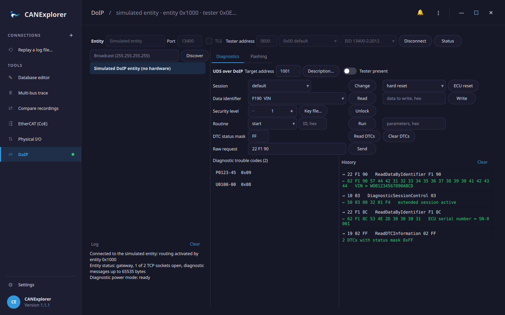

# DoIP (Diagnostics over IP)

The **DoIP** tool in the sidebar runs UDS diagnostics and flashing over Ethernet with Diagnostics over IP
(ISO 13400-2), the way vehicles with an Ethernet diagnostic port (and their gateways) are diagnosed and programmed.
It finds the DoIP entities on the network, connects to one with routing activation, and offers the
[Diagnostics](diagnostics.md) and [Flashing](flashing.md) views over that connection. A simulated entity works
without a vehicle. Test scripts can use DoIP too (see [below](#in-scripts)).



## Connecting the vehicle

Connect the computer to the vehicle's diagnostic Ethernet, e.g. with an Ethernet (ENET) cable for the OBD port.
Such a cable also switches the vehicle's diagnostic Ethernet on through the activation line (OBD pin 8).

The vehicle gets an IP address from a DHCP server on the network, or chooses a link-local address (169.254.x.x)
when there is none. Set the computer's network adapter to obtain its address automatically: without a DHCP server,
it chooses a link-local address too, and both end up on the same network.

DoIP uses UDP and TCP port 13400 (TCP port 3496 with TLS). If **Discover** finds nothing, allow incoming UDP on
port 13400 in the computer's firewall, or enter the entity's address directly.

## Finding entities

**Discover** sends a vehicle identification request and lists the entities that answer within 2 seconds: their IP
address, logical address, VIN and EID (usually their MAC address). It asks every network of the computer by
default; the field next to the button can name a directed broadcast address instead (e.g. `192.168.0.255`), or one
entity's address. An entity that needs a central security routing activation first says so under the entry.

Click an entity to connect to it, or type its address into **Entity**. The **Simulated DoIP entity** is always at
the bottom of the list.

## Connecting

| Setting | Meaning |
|---|---|
| Entity, Port | The entity's IP address and TCP port (13400) |
| TLS | TLS on port 3496 (ISO 13400-2:2019). The entity's certificate is not verified |
| Tester address | CANExplorer's logical address (default `0E00`; external test equipment uses `0E00` to `0FFF`) |
| Activation type | Routing activation type: *default*, *WWH-OBD* or *central security* |
| Protocol version | The DoIP version of the messages sent: ISO 13400-2:2012 (2) or 2019 (3) |

**Connect** opens the TCP connection and activates routing. The log shows the result, and if the entity refuses,
the reason (e.g. *unknown source address* for a tester address the entity does not accept, or *missing
authentication*). Once connected, the top bar shows the entity's logical address. CANExplorer answers the entity's
alive checks itself, so an idle connection stays open. **Status** asks the entity for its node type, open TCP
sockets and maximum message size, and for its diagnostic power mode (whether its ECUs are ready for diagnostics).

## Diagnostics and flashing

The **Diagnostics** and **Flashing** tabs work like the [Diagnostics](diagnostics.md) and [Flashing](flashing.md)
views of a CAN connection: sessions, data identifiers, security access, routines, DTCs, raw requests, tester
present, diagnostic descriptions, and programming firmware files.

Instead of CAN identifiers, the requests go to a **Target address**: the logical address of an ECU behind the
entity (default `1001`), or the entity's own logical address for the gateway itself. The vehicle's diagnostic
documentation lists the logical addresses of its ECUs. Every request is acknowledged by the entity before the ECU
answers. A request to an address the entity does not know is refused (*unknown target address*), and so is one to
an ECU that cannot be reached (*target unreachable*).

## Simulated entity

The simulated DoIP entity runs on this computer and needs no network. It is a gateway with the logical address
`1000` and a simulated ECU at `1001`. The ECU is the same as the [simulated UDS ECU](simulation.md) on CAN: it has a
VIN, a serial number and two DTCs, accepts security access with the key algorithm in
`examples/flashing/simulator_key.py`, and stores what is flashed.

## In scripts

`can_explorer.core.doip` talks to DoIP entities from [test scripts](test-automation.md) and simulations. A
`DoipClient` connection offers a UDS transport per target address:

```python
from can_explorer.core.doip import DoipClient, discover
from can_explorer.core.uds import UdsClient

entities = await discover()                      # [DoipEntity(host='169.254.12.3', vin='WDB…', logical_address=0x1000, …)]
async with DoipClient(entities[0].host, source_address=0x0E00) as client:
    with client.transport(0x1001) as transport:
        uds = UdsClient(transport)
        print(await uds.read_data_by_identifier(0xF190))
        await uds.diagnostic_session_control(0x03)
```

`DoipEntitySimulator` is the simulated entity, with a `UdsServer` (`can_explorer.core.simulation`) per target
address, e.g. to test a script without a vehicle:

```python
from can_explorer.core.doip import DoipEntitySimulator
from can_explorer.core.simulation import UdsServer

simulator = DoipEntitySimulator(targets={0x1001: UdsServer(), 0x1002: UdsServer()})
await simulator.start()                          # On 127.0.0.1 and a free port: simulator.port
async with DoipClient(simulator.host, simulator.port) as client:
    ...
await simulator.stop()
```

`entity_status()` and `power_mode()` ask an entity for its status and diagnostic power mode. With
`DoipClient(..., tls=context)`, scripts can pass their own `ssl.SSLContext` to verify the entity's certificate.

## Limitations

- Discovery uses IPv4 broadcasts. Entities with only an IPv6 address are reached by entering their address.
- Vehicle announcements that entities send by themselves at start-up are not listened for: **Discover** asks for
  them.
- The trace does not show DoIP messages; the history of the Diagnostics tab and the log list the requests,
  responses and connection events.
