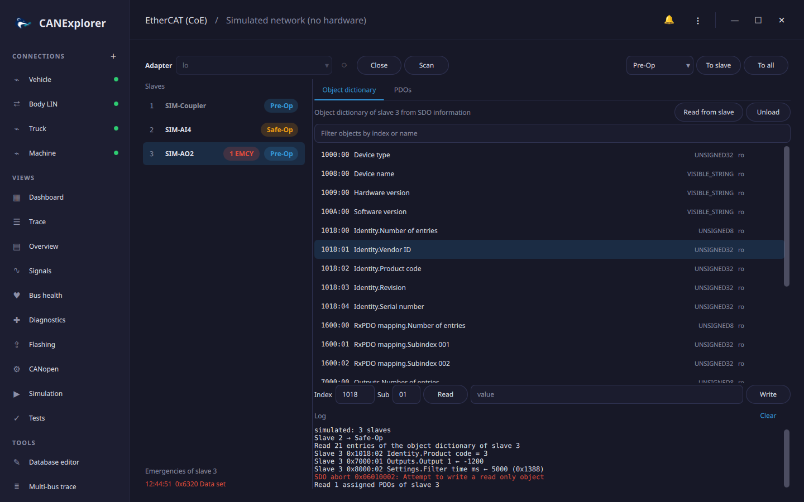
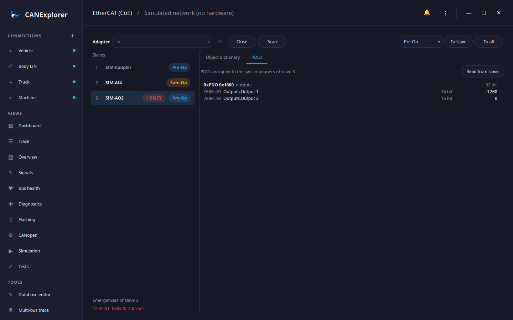

# EtherCAT (CoE)

The **EtherCAT (CoE)** tool in the sidebar is an EtherCAT master for configuring slaves through CANopen over
EtherCAT (CoE). It finds the slaves on a network adapter, changes their EtherCAT states, reads and writes their
object dictionaries with SDO transfers, and shows their PDO assignment and emergency messages. Working with CoE
objects is the same as in the [CANopen view](canopen.md); the difference is the network the objects are reached on.



The tool configures slaves; it does not exchange cyclic process data. Slaves can be brought to *Init*, *Pre-Op*
and *Safe-Op*, but not to *Op*, which needs a running process data cycle (use the PLC or your master software for
that).

## Requirements

Real EtherCAT networks need the optional [pysoem](https://github.com/bnjmnp/pysoem) package, which contains the
[SOEM](https://github.com/OpenEtherCATsociety/SOEM) master. Run CANExplorer from source with the `ethercat` extra:

```bash
uv sync --extra ethercat
```

The installers do not include it and offer only the simulated network. EtherCAT sends raw Ethernet frames, so the
master needs raw access to the network adapter:

| System | Access |
|---|---|
| Linux | Run as root, or give Python the capability: `sudo setcap cap_net_raw,cap_net_admin+ep "$(readlink -f .venv/bin/python)"` |
| Windows | Install [Npcap](https://npcap.com/) (in WinPcap compatible mode) |
| macOS | Read and write access to `/dev/bpf*`, e.g. with Wireshark's *ChmodBPF* |

Use an adapter that only the EtherCAT network is connected to: the master's frames are not meant for other
networks.

!!! note "Licensing"
    SOEM is licensed under the GPL version 2 with a linking exception, and its license asks anyone distributing an
    EtherCAT master to obtain an EtherCAT Master License from Beckhoff Automation. EtherCAT® is a registered
    trademark of Beckhoff Automation GmbH.

## Network and slaves

Choose an **Adapter** and click **Open**. The master finds the slaves and brings them to *Pre-Op*, where their
mailboxes work. The list shows each slave's position in the network, name and state; hovering a slave shows its
vendor ID, product code and revision, and why a state change failed (the AL status code, e.g. *Invalid output
configuration*). Slaves without a CoE mailbox (such as couplers) are dimmed. **Scan** finds the slaves again, for
example after you change the wiring. The states are read every second.

Choose a state and click **To slave** for the selected slave or **To all**. *Safe-Op* configures the process data
mapping of all slaves first. A slave that does not reach the state is reported with the state it is in and the
reason, e.g. *Slave 2 is in Pre-Op + Error: Invalid output configuration*.

Emergency messages (EMCY) are counted per slave; the list below the slaves shows those of the selected slave with
the error code and its meaning. Hovering a message shows the error register and the manufacturer specific bytes.

**Simulated network** works without hardware and pysoem: a coupler without a mailbox, a four channel analogue
input terminal and a two channel analogue output terminal. Writing more than 1000 to the output terminal's filter
time (0x8000:02) makes it send an emergency.

## Object dictionary

**Read from slave** reads the selected slave's object dictionary with the SDO information service, which most
CoE slaves support. For slaves without it, **EDS file…** loads an EDS or DCF file instead. The dictionary belongs
to the slave it was read or loaded for; **Unload** removes it.

The dictionary, the filter and the **Read** and **Write** fields work as in the
[CANopen view](canopen.md#object-dictionary): with a dictionary values are shown and entered in the objects' data
types, without one as hex bytes. Double-clicking an object reads it. Failed transfers show the SDO abort code and
its meaning, e.g. *0x06010002: Attempt to write a read only object*.

## PDOs



**Read from slave** on the **PDOs** tab reads which PDOs are assigned to the process data sync managers (0x1C12
for the outputs, RxPDOs, and 0x1C13 for the inputs, TxPDOs), the objects mapped to each, and the current values
of these objects over SDO. Objects that cannot be read over SDO show no value.
