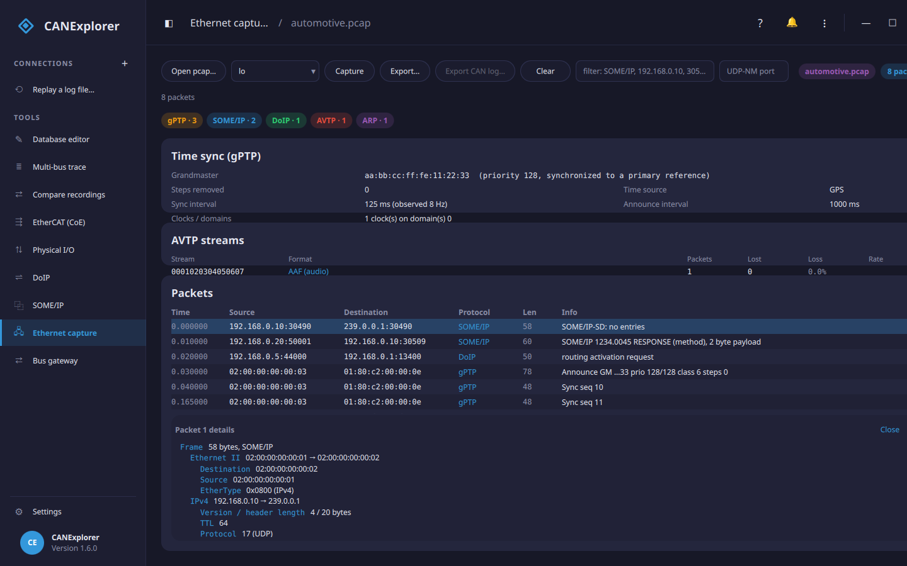

# Ethernet capture

The **Ethernet capture** tool opens a **pcap** or **pcapng** capture of automotive Ethernet traffic (or captures
live on Linux, macOS and Windows) and decodes the packets down the stack — Ethernet, 802.1Q VLAN, the 802.1CB redundancy tag (R-TAG),
IPv4/IPv6, ARP, ICMP, IGMP/MLD and UDP/TCP — and recognises the automotive protocols carried on top: **SOME/IP**
(and SOME/IP-SD), **DoIP**, **gPTP** (IEEE 802.1AS), **AVTP** (IEEE 1722, including the **AAF / CVF / CRF** stream
formats and **CAN, LIN and FlexRay tunnelled over Ethernet** via ACF, and MAAP), **LLDP**, the **SRP/TSN** control
protocols (MVRP, MSRP, MMRP), **MACsec** (802.1AE), **UDP-NM** (AUTOSAR network management, on a port you set) and
common infrastructure (DHCP, DNS/mDNS, IPsec ESP/AH). It is a standalone tool, separate from the CAN connections.

Where the [SOME/IP](someip.md) and [DoIP](doip.md) tools interpret one protocol live, this one shows *everything*
on an Ethernet segment — so you can see what is actually on the wire, and which protocols.

## Opening a capture

**Open pcap…** reads a capture file. It reads both the classic **pcap** format and **pcapng** (Wireshark's
default), for the Ethernet link type.

Each packet is shown with its time, source and destination (IP and port, or MAC for non-IP frames), the highest
recognised **protocol**, length and an **info** summary (for example a SOME/IP method and payload size, a DoIP
payload type, a gPTP message type, an AVTP stream with its sequence number and format — e.g. `AAF int16 48kHz 2ch`
— or an LLDP neighbour). The **filter** box narrows the list by any text — a protocol (`SOME/IP`), an address
(`192.168.0.10`) or a port (`30509`) — and the pills above the table show the **protocol breakdown**. **Export…**
saves the packets back to a pcap file.

## Packet details

Click a packet to open the **details** pane beneath the list: a field-by-field dissection of that frame, layer by
layer — Ethernet (addresses and EtherType), any 802.1Q VLAN or 802.1CB R-TAG, the IPv4/IPv6 header (addresses,
protocol, TTL), the UDP/TCP header (ports, length/sequence) and the recognised application protocol (for SOME/IP,
each message; for AVTP ACF, the tunnelled CAN frames). Each row records the byte span it covers. **Close** dismisses
the pane.

## Network management (UDP-NM)

AUTOSAR **UDP-NM** (the network-management messages ECUs exchange to keep a bus awake and coordinate sleep) has no
standard UDP port, so set the **UDP-NM port** box in the toolbar to the port your project uses. Matching UDP frames
are then decoded as **UDP-NM**, showing the source node, the control-bit-vector flags (Repeat Message, Active
Wakeup, Sleep Ready, PN Learning) and any requested partial networks. The capture is re-decoded as soon as you
change the port.

**SOME/IP spanning packets is reassembled**: a message carried over **TCP** that is split across segments is
decoded on the segment that completes it (the earlier ones show `[SOME/IP segment]`), and a **SOME/IP-TP**
segmented message is reassembled across its datagrams. When the capture contains Service Discovery, a **SOME/IP
services** card lists the services offered — their service and instance ids, version, endpoints and how many times
each was offered.

## Time sync (gPTP)

When the capture contains **gPTP** (IEEE 802.1AS) traffic, a **Time sync** card summarises the network's time
synchronisation:

- the **grandmaster** — its clock identity, priority and clock quality (for example "synchronized to a primary
  reference") and its time source (GPS, PTP…),
- how many **clocks** and **domains** are present, and the **steps removed** from the grandmaster, and
- the **Sync** and **Announce** intervals the grandmaster advertises, with the **observed Sync rate** measured from
  the capture.

Each gPTP packet in the list also shows its message type (Announce, Sync, Follow_Up, Pdelay…) with the sequence
number, and the grandmaster and clock class for Announce messages.

## Fieldbus tunnelled over Ethernet (AVTP ACF)

IEEE 1722 can carry fieldbus frames over Ethernet using its **Acyclic Control Format (ACF)**, in a **TSCF**
(time-synchronous) or **NTSCF** (non-time-synchronous) AVTP frame. CANExplorer expands the three automotive
fieldbuses:

- **CAN / CAN FD** (`ACF_CAN`, and the abbreviated `ACF_CAN_BRIEF`) — labelled **ACF-CAN**, showing the bus id and
  each frame's identifier, data and flags (RTR, CAN FD), e.g. `CAN bus 0 123#0011223344556677, 7DF#0203 FD`.
- **LIN** (`ACF_LIN`) — labelled **ACF-LIN**, showing the bus id, frame id and data.
- **FlexRay** (`ACF_FlexRay`) — labelled **ACF-FlexRay**, showing the bus id, slot id, cycle and data.

Several frames may be packed into one Ethernet frame. Any other ACF message type (MOST, I²C, sensor, …) is
recognised and named but not expanded.

The AVTP **stream** formats are also decoded to their header fields: **AAF** (audio) shows the sample format, rate,
channel count and bit depth; **CVF** (compressed video) shows the format and codec (MJPEG, H.264, H.265, …); and
**CRF** (clock reference) shows the reference type, base frequency and timestamp interval. The media payload itself
is not decoded.

## AVTP stream health

When the capture contains AVTP streams, an **AVTP streams** card lists each stream (by stream id and format) with
its **packet count, lost frames, loss %** and average **rate**. Lost frames are inferred from gaps in the 8-bit
AVTP sequence number — so dropped or starved stream packets show up immediately — while sequence wrap-around,
duplicated and reordered (late) frames are accounted for separately rather than counted as loss. A non-zero loss is
highlighted, making a struggling audio/video stream or a reservation problem easy to spot.

**Export CAN log…** writes all the tunnelled CAN frames to a CAN log file (`.asc`, `.blf`, `.log`, `.csv`, `.trc`)
with their capture timing. Open that log as a [replay](recording-and-replay.md) connection to run the tunnelled
traffic through the ordinary CAN views — the trace, plots, decoders and the [reverse-engineering](reverse-engineering.md)
tools — exactly as if it had been captured on a CAN bus. The ACF `can_bus_id` is kept as the message's channel, so
frames from different buses stay distinguishable.

## Capturing live

Pick an interface and press **Capture** to capture live from it. Live capture works on **Linux, macOS and
Windows** through **libpcap** (Npcap on Windows — install it if the interface list is empty); where libpcap is not
present on Linux, it falls back to a raw `AF_PACKET` socket. Raw capture needs privileges — run as root or grant
the binary `CAP_NET_RAW` on Linux, BPF device access on macOS, or install Npcap on Windows — and a full view of the
traffic needs a **network tap** or a **mirror/SPAN port**, since a plain host only sees broadcast/multicast and the
traffic addressed to it. You can also always capture with another tool (Wireshark and the like) and open the saved
pcap/pcapng here.

## Limits

- pcap and pcapng are read for the **Ethernet** link type only.
- The packet list is a summary per packet; click a packet for its field-by-field **details** (see above). To decode
  SOME/IP payloads into named signals, load a FIBEX or ARXML file in the [SOME/IP](someip.md) tool.
- TCP reassembly follows the stream in capture order (a 4 GiB sequence-number wrap within one connection is not
  handled). Live capture goes through libpcap/Npcap (or an `AF_PACKET` socket on Linux) and needs capture
  privileges; you can always open a saved pcap/pcapng instead.
- IEEE 1722 is a paywalled standard, so ACF decoding covers what the open references pin down: CAN/CAN-FD, LIN and
  FlexRay frames in version-0 TSCF/NTSCF frames. Control frames of another AVTP version, or other ACF message types, are
  labelled but not expanded.
