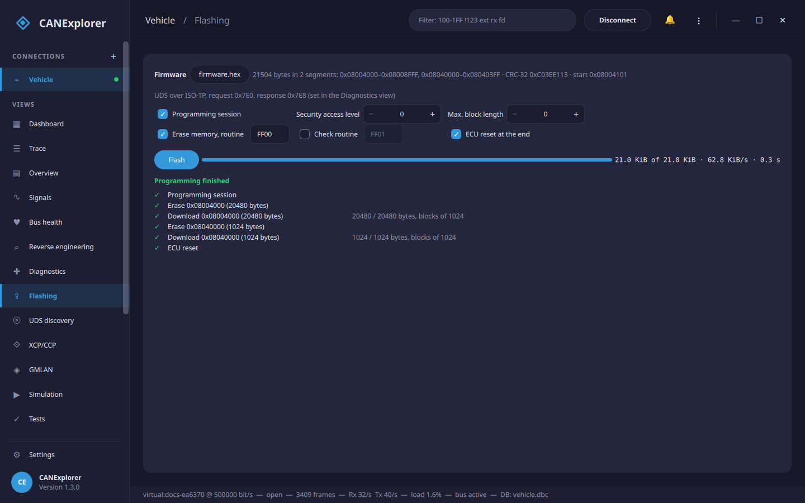

# Flashing

The **Flashing** view programs an ECU over UDS (ISO 14229) with a firmware file: it downloads each segment with
*RequestDownload* (0x34), *TransferData* (0x36) and *RequestTransferExit* (0x37) and shows the progress. It uses
the transport and addressing of the [Diagnostics](diagnostics.md) view: ISO-TP with the request and response
identifiers set there on CAN, the LIN transport layer with the NAD on LIN. Over Ethernet, the [DoIP](doip.md)
tool has a Flashing tab that programs the ECU at its target address.



!!! danger "Programming can make an ECU unusable"
    An interrupted or wrong download can leave an ECU without a working application. Use the files and the
    sequence of the ECU's manufacturer, keep the power supply stable, and do not disconnect during flashing.

## Firmware files

**Open file…** loads:

| Format | Extensions |
|---|---|
| Intel HEX (data, extended segment and linear addresses, start address) | `.hex`, `.ihex`, `.ihx` |
| Motorola S-record (S1/S2/S3 data, S5/S6 counts, S7/S8/S9 start address) | `.s19`, `.s28`, `.s37`, `.srec`, `.mot` |
| Binary, placed at the **Base address** (hex) shown for binary files | `.bin` and others |

Files with other extensions are recognised by their content. Checksums, record counts and overlapping addresses
are checked when the file is loaded. The line next to the file shows the size, the segments (contiguous address
ranges, each downloaded separately), the CRC-32 of the data and the start address.

## Sequence

| Step | Request | Option |
|---|---|---|
| Programming session | DiagnosticSessionControl 0x02 | **Programming session** |
| Security access | SecurityAccess with the seed of the chosen level and the key computed by the key file of the Diagnostics view | **Security access level** (0: none) |
| For each segment: erase | RoutineControl start, routine **FF00** (eraseMemory) with the segment's address and size | **Erase memory** |
| For each segment: download | RequestDownload with the address and size, TransferData blocks, RequestTransferExit | |
| Check | RoutineControl start of the given routine, e.g. **FF01** (checkProgrammingDependencies) | **Check routine** |
| ECU reset | ECUReset hard reset | **ECU reset at the end** |

Addresses and sizes are sent with 4 bytes each (addressAndLengthFormatIdentifier 0x44), without compression or
encryption (dataFormatIdentifier 0x00). The block size is the maximum the ECU returns in its RequestDownload
response, at most 4095 bytes (the ISO-TP limit); **Max. block length** limits it further, e.g. for ECUs with small
receive buffers. The block counter starts at 1 and wraps from 0xFF to 0x00. *Response pending* answers, common
while erasing, are waited for.

**Flash** runs the steps, listed with their state, the bytes transferred, the transfer rate and the time left.
**Cancel** stops after the current request. A failing step shows the ECU's negative response (e.g.
*securityAccessDenied* or *requestSequenceError*) and the following steps are skipped.

!!! example "Try it without hardware"
    The [simulated ECU](diagnostics.md#simulated-ecu) (`UdsEcuSimulator` with `UdsServer` from
    `can_explorer.core.simulation`) accepts downloads in the programming
    session and stores the data. `examples/flashing/firmware.hex` is an example firmware with two segments and
    `examples/flashing/simulator_key.py` the simulator's key algorithm for security access.

## In scripts

`can_explorer.core.flashing` programs an ECU over UDS from a script, over the same ISO-TP transport as the
[Diagnostics](diagnostics.md) client:

```python
from can_explorer.core.flashing import FlashJob, FlashOptions, load_image
from can_explorer.core.isotp_client import IsoTpClient
from can_explorer.core.uds import UdsClient

image = load_image('firmware.hex')                  # Intel HEX, S-record or binary (binary needs base_address=…)
job = FlashJob(image, FlashOptions())               # set security_level and compute_key for a secured ECU
await job.run(UdsClient(IsoTpClient(session, 0x7E0, 0x7E8)))   # session: the connection's bus
print(job.error or f'programmed {job.bytes_done} bytes')
```
