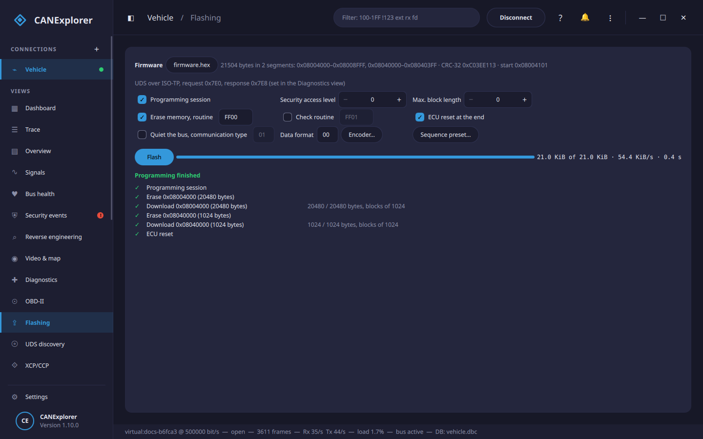

# Flashing

The **Flashing** view programs an ECU over UDS (ISO 14229) with a firmware file: it downloads each segment with
*RequestDownload* (0x34), *TransferData* (0x36) and *RequestTransferExit* (0x37) and shows the progress. It uses
the transport and addressing of the [Diagnostics](diagnostics.md) view: ISO-TP with the request and response
identifiers set there on CAN, the LIN transport layer with the NAD on LIN. Over Ethernet, the [DoIP](doip.md)
tool has a Flashing tab that programs the ECU at its target address.



!!! danger "Programming can make an ECU unusable"
    An interrupted or wrong download can leave an ECU without a working application. Use the files and the
    sequence of the ECU's manufacturer, keep the power supply stable, and do not disconnect during flashing.

## Firmware files

**Open file…** loads:

| Format | Extensions |
|---|---|
| Intel HEX (data, extended segment and linear addresses, start address) | `.hex`, `.ihex`, `.ihx` |
| Motorola S-record (S1/S2/S3 data, S5/S6 counts, S7/S8/S9 start address) | `.s19`, `.s28`, `.s37`, `.srec`, `.mot` |
| Binary, placed at the **Base address** (hex) shown for binary files | `.bin` and others |

Files with other extensions are recognised by their content. Checksums, record counts and overlapping addresses
are checked when the file is loaded. The line next to the file shows the size, the segments (contiguous address
ranges, each downloaded separately), the CRC-32 of the data and the start address.

## Sequence

| Step | Request | Option |
|---|---|---|
| Programming session | DiagnosticSessionControl 0x02 | **Programming session** |
| Security access | SecurityAccess with the seed of the chosen level and the key computed by the key file of the Diagnostics view | **Security access level** (0: none) |
| For each segment: erase | RoutineControl start, routine **FF00** (eraseMemory) with the segment's address and size | **Erase memory** |
| For each segment: download | RequestDownload with the address and size, TransferData blocks, RequestTransferExit | |
| Check | RoutineControl start of the given routine, e.g. **FF01** (checkProgrammingDependencies) | **Check routine** |
| ECU reset | ECUReset hard reset | **ECU reset at the end** |

Addresses and sizes are sent with 4 bytes each (addressAndLengthFormatIdentifier 0x44), by default without
compression or encryption (dataFormatIdentifier 0x00, see [Compressed or encrypted downloads](#compressed-or-encrypted-downloads)). The block size is the maximum the ECU returns in its RequestDownload
response, at most 4095 bytes (the ISO-TP limit); **Max. block length** limits it further, e.g. for ECUs with small
receive buffers. The block counter starts at 1 and wraps from 0xFF to 0x00. *Response pending* answers, common
while erasing, are waited for.

**Flash** runs the steps, listed with their state, the bytes transferred, the transfer rate and the time left.
**Cancel** stops after the current request. A failing step shows the ECU's negative response (e.g.
*securityAccessDenied* or *requestSequenceError*) and the following steps are skipped.

### Quieting the bus

**Quiet the bus** frames the programming with the steps OEM flash sequences usually add, sent **functionally** to all
ECUs (0x7DF, or 0x18DB33F1 with 29-bit identifiers):

| Step | Request |
|---|---|
| Extended session (all ECUs) | DiagnosticSessionControl 0x83 (extended, no positive response) |
| Tester present (all ECUs) | TesterPresent 0x3E 0x80 every 2 s until the end, so no ECU falls back to the default session mid-download |
| DTC setting off (all ECUs) | ControlDTCSetting 0x82: no DTCs are stored for the missing messages of the ECU being programmed |
| Communication control (all ECUs) | CommunicationControl 0x83 with the **communication** type: `01` normal messages, `03` also network management |
| *…the programming steps…* | |
| Afterwards (all ECUs) | CommunicationControl 0x80 (enable), ControlDTCSetting 0x81 (on), DiagnosticSessionControl 0x81 (default) |

Diagnostic messages are not affected by CommunicationControl, so the ECU being programmed still answers.

### Sequence presets

**Sequence preset…** loads a JSON file with a manufacturer's own order of steps, replacing the step options of the
view (the security key, block length, data format and encoder still apply). Each step has a `step` kind and its
parameters; numbers are written in hex as strings (`"FF01"`) or as plain numbers; `functional: true` sends a step to
all ECUs; `name` overrides the shown name:

| `step` | Parameters | Request |
|---|---|---|
| `session` | `session` | DiagnosticSessionControl |
| `security` | `level` (odd) | SecurityAccess with the key algorithm of the Diagnostics view |
| `dtc_setting` | `on` | ControlDTCSetting |
| `communication_control` | `control`, `communication` | CommunicationControl |
| `keep_alive` | `interval` (s, default 2) | TesterPresent from now until the end |
| `routine` / `check` | `routine`, `control` (default 1), `data` (hex) | RoutineControl |
| `write_did` | `did`, `data` (hex) | WriteDataByIdentifier, e.g. a fingerprint |
| `request` | `payload` (hex) | Any request |
| `program` | `erase_routine` (`null`: no erase) | Erase and download every segment — exactly one per sequence |
| `reset` | `type` (default 1) | ECUReset |
| `wait` | `seconds` | A pause |

```json
{
  "name": "Quiet bus, programming session, check dependencies",
  "steps": [
    {"step": "session", "session": "03", "functional": true},
    {"step": "keep_alive", "functional": true},
    {"step": "dtc_setting", "on": false, "functional": true},
    {"step": "communication_control", "control": "03", "communication": "01", "functional": true},
    {"step": "session", "session": "02"},
    {"step": "security", "level": 1},
    {"step": "program", "erase_routine": "FF00"},
    {"step": "routine", "routine": "FF01", "name": "Check programming dependencies"},
    {"step": "reset", "type": 1}
  ]
}
```

`examples/flashing/sequence_quiet_bus.json` is this preset with the restoring steps. A preset is checked when it is
loaded: unknown steps, missing parameters and even security levels are reported.

### Compressed or encrypted downloads

Some ECUs expect the data compressed or encrypted, announced by the **Data format** (dataFormatIdentifier: the
compression method in the high nibble, the encryption method in the low one). These schemes are manufacturer
specific, so CANExplorer does not include any: **Encoder…** loads a Python file defining

```python
def encode(data: bytes, address: int) -> bytes:
    return my_compress(data)  # The segment's data as the ECU expects it
```

which is applied to each segment before its download. RequestDownload still announces the segment's own size
(`FlashOptions(encoded_size=True)` in scripts announces the encoded size instead, for ECUs that expect that).

!!! example "Try it without hardware"
    The [simulated ECU](diagnostics.md#simulated-ecu) (`UdsEcuSimulator` with `UdsServer` from
    `can_explorer.core.simulation`) accepts downloads in the programming
    session and stores the data. `examples/flashing/firmware.hex` is an example firmware with two segments and
    `examples/flashing/simulator_key.py` the simulator's key algorithm for security access.

## In scripts

`can_explorer.core.flashing` programs an ECU over UDS from a script, over the same ISO-TP transport as the
[Diagnostics](diagnostics.md) client:

```python
from can_explorer.core.flashing import FlashJob, FlashOptions, load_image
from can_explorer.core.isotp_client import IsoTpClient
from can_explorer.core.uds import UdsClient

image = load_image('firmware.hex')  # Intel HEX, S-record or binary (binary needs base_address=…)
job = FlashJob(image, FlashOptions())  # set security_level and compute_key for a secured ECU
await job.run(UdsClient(IsoTpClient(session, 0x7E0, 0x7E8)))  # session: the connection's bus
print(job.error or f'programmed {job.bytes_done} bytes')
```

With `FlashOptions(pre_programming=True)` or a preset (`load_sequence(path)` returns its name and steps, passed as
`FlashJob(image, options, sequence=steps)`), give the job a functional client for the steps to all ECUs:

```python
from can_explorer.core.uds_functional import FunctionalUdsClient, obd_11bit

with obd_11bit(session) as functional:
    await job.run(UdsClient(IsoTpClient(session, 0x7E0, 0x7E8)), FunctionalUdsClient(functional))
```

Without one, functional steps go to the ECU being programmed only (the step says so).
