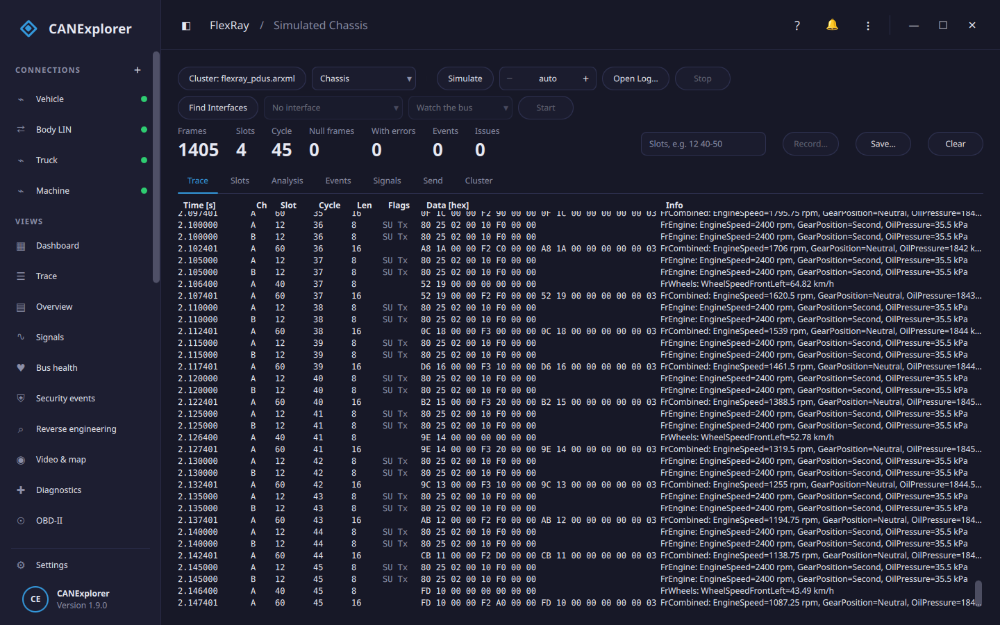

# FlexRay

The **FlexRay** tool (in the sidebar's tools, or the command palette) shows the frames of a FlexRay cluster: from a
simulated cluster, a capture or log file, or a Vector or Intrepid interface — watching the bus or taking part in the
cluster and sending frames. With the cluster's description loaded, each frame is named, its PDUs and signals are
decoded, and the traffic is checked against the schedule.



FlexRay frames are identified by their **slot** (1–2047), the **cycle** they were sent in (0–63) and the **channel**
(A or B); a frame may be sent in every cycle or in some (e.g. from cycle 1, every 4th). The tabs:

- **Trace**: each frame with its time, channel, slot, cycle, length, flags (`S` sync, `U` startup, `Tx` sent by this
  tool's interface), payload and decoded values; null frames as such, and the errors the interface reported (header
  or frame CRC, coding, TSS, …). Filter it by slots, e.g. `12 40-50`.
- **Slots**: one row per slot and channel — static or dynamic segment (with the cluster's parameters), how many
  frames came, in how many cycles, how many were null frames, and the last payload and values.
- **Analysis**: the [schedule and health check](#checking-the-schedule-and-the-bus).
- **Events**: symbols (CAS/MTS, wakeup), the controller's protocol state and the errors the interface reported.
- **Signals**: [plots](#plotting-signals) of the cluster's signals.
- **Send**: [sending frames](#sending) while taking part in the cluster (or in the simulation).
- **Cluster**: the cluster's timing parameters, its frames, its PDUs and the ECUs with a FlexRay controller.

## The cluster description

**Load Cluster…** reads the cluster from a FIBEX or AUTOSAR ARXML file. When the file describes several FlexRay
clusters, a list next to the button chooses one.

- **AUTOSAR ARXML** (the System Template, free from autosar.org): the FLEXRAY-CLUSTER's parameters, its physical
  channels (CHANNEL-A, CHANNEL-B) and their frame triggerings with their absolutely scheduled timings (slot ID, and a
  cycle counter or a base cycle with a cycle repetition). A frame's PDUs come from its PDU-TO-FRAME-MAPPINGs, each
  with its position (START-POSITION, byte aligned) and its **update bit** (UPDATE-INDICATION-BIT-POSITION). The PDUs
  and signals are read as for CAN, so multiplexed, secured and container PDUs work the same. The ECUs'
  FLEXRAY-COMMUNICATION-CONTROLLERs are read too, for [taking part in the cluster](#interfaces).
- **FIBEX** (ASAM MCD-2 NET, the FlexRay clusters of FIBEX 2 to 4): the frame triggerings of each channel with their
  slot and their cycles (BASE-CYCLE and CYCLE-REPETITION, or CYCLE-COUNTER), the frames with their signal instances
  directly or in PDU instances (with their position and PDU-UPDATE-BIT-POSITION), multiplexed PDUs (a switch selecting
  switched PDUs, and a static part), the codings (bit length, signedness, linear scaling and text tables), and the
  cluster's timing parameters.

A PDU whose update bit is clear in a frame was not refreshed by its sender: its values are not decoded (the trace
says "not updated"), so stale values are not shown as current ones.

The **cluster parameters** used are the cycle length, the macrotick, the number and length of the static slots, the
static payload length, the minislots, the network idle time and the bit rate. They place each static slot in the
cycle, tell the static segment from the dynamic one, and drive the simulation and the timing check.

!!! note "FIBEX: what is read as public FIBEX readers read it"
    ASAM's FIBEX schema and specification are for ASAM members only, so the FIBEX names are those public readers
    and files use. A signal instance's BIT-POSITION is read as the open-source canmatrix library reads it: for
    big-endian (high-low byte order) signals, the most significant bit, in the DBC numbering. A switched PDU's signal
    positions are read relative to the multiplexed PDU, as canmatrix writes them. The cluster's CYCLE and MACROTICK
    are read in microseconds, as NI-XNET's FIBEX files give them. Check such details against a value you know.

## Sources

- **Simulate** sends the loaded cluster's frames in their slots and cycles with changing signal values, every PDU
  updated: to try the tool and a description without a cluster. The cycle time is the description's (or 5 ms, or
  the one chosen); static slots are placed at their offsets. Sync and startup frames are sent in the key slots of
  the description's controllers, else in the two lowest slots sent every cycle. The simulation also takes frames to
  [send](#sending).
- **Open Log…** reads:
    - **pcap or pcapng** captures: FlexRay frames and symbols recorded with the `LINKTYPE_FLEXRAY` link type (as
      Wireshark and measurement hardware write them, and as this tool records), and FlexRay frames tunnelled over
      Ethernet in IEEE 1722 ACF messages.
    - **Vector BLF** logs (CANoe, CANalyzer, Vector loggers): the FlexRay frames (VBLFLEXRAYVFrReceiveMsgEx and
      VBLFLEXRAYVFrReceiveMsg), with the errors the interface recorded in the frame state, frames sent by the
      logging node marked `Tx`; symbols and the protocol state (VBLFLEXRAYVFrStatus) and the interface's errors
      (VBLFLEXRAYVFrError). PDU entries (which repeat a frame's bytes) and transmit requests are skipped, as are the
      older record types Vector calls obsolete.
    - **Vector ASC** logs: `Fr RMSG` frames (and the older `Fr … V9` lines), `Fr SE` symbol lines and `Fr EE` error
      lines, in decimal or hexadecimal files.
- **Find Interfaces**, then **Start**, opens a FlexRay channel of a [Vector or Intrepid interface](#interfaces).

!!! note "Vector's log formats"
    The BLF objects are read as Vector's published "FlexRay BLF Logging Format" specification describes them, with
    the byte offsets checked against files Vector's own BLF library wrote. Vector's ASC FlexRay specification is not
    public: the ASC lines are read as the open-source vector_asc reader parses them, which agrees with a log Vector's
    converter made from an ASC file. Status lines of another layout are skipped.

## Checking the schedule and the bus

The **Analysis** tab checks the frames held against the cluster description, cycle by cycle and channel by channel:

- **missing**: a frame the description expects in that slot, channel and cycle did not come (a null frame counts as
  sent);
- **not described**: a frame in a slot, channel or cycle the description has no frame for;
- **wrong length**: a payload whose length is not the frame's; **static payload length**: a static frame whose
  length is not the cluster's static payload length;
- **timing** (with the macrotick and static slot length): a static frame more than one static slot away from its
  slot's place in the cycle. The start of each cycle is predicted from the previous one and taken from the frames
  that agree with it, so one stray frame does not shift the others;
- **dynamic slot order**: frames of the dynamic segment must come in ascending slot order within a cycle;
- **channel mismatch**: a frame sent on both channels in the same cycle with different payloads or header flags.

Per channel it shows the frames, null frames and frames with errors (by error), the cycles and the cycle counter
jumps (cycles without any frame), the sync frames per cycle (a cluster needs at least two to keep its clocks
synchronised; cycles with fewer are counted) and the measured cycle time. Without a description, the bus health and
the channel comparison are shown. The precision of the timing check is that of the timestamps: a log with 10 µs
resolution shows deviations of that order.

## Plotting signals

On the **Signals** tab, click a signal of the cluster to plot it (click it again to stop). The values of the frames
held already are plotted at once, and new frames add to them. Only updated PDUs give values; signals with value
texts are plotted by their number. The wheel zooms, **Fit** shows everything, **Live** (or a double click) follows the
newest values.

## Interfaces

**Find Interfaces** lists the FlexRay channels of the Vector interfaces (XL Driver Library, Windows) and of the
Intrepid interfaces (Intrepid's open-source `icsneopy` module: `pip install icsneopy`; Windows, Linux, macOS). Choose
one and how to use it:

- **Watch the bus**: a Vector channel in spy mode (every frame on the bus, as seen, with its errors, without joining
  the cluster); an Intrepid controller with the configuration the device already has (set up with Intrepid's tools).
- **Take part (send)**: the interface's controller joins the cluster as a node, receives what a node receives and
  can [send](#sending). **Coldstart** lets it start the cluster when no other node does.
    - **Intrepid**: choose the ECU of the description to be: the cluster's parameters and that ECU's FlexRay
      controller (ARXML) configure the interface, in the units icsneopy takes them. When the description lacks
      parameters the controller needs, the tool lists them instead of guessing.
    - **Vector**: the controller needs Vector's full cluster configuration (XLfrClusterConfig). Vector's manual, which
      gives the units and encodings its driver expects for those values, is not public, so the tool does not derive
      them from the description: it uses the configuration the channel already has (when another Vector application
      configured it) or a file with XLfrClusterConfig values (**Configuration…**: JSON like
      `{"gMacroPerCycle": 3636, …}` or `name = value` lines), as Vector's tools give them. A coldstart node sends the
      startup and sync frame in the key slot of the description's controller, or in its first frame sent every
      cycle.

!!! warning "Interfaces: experimental"
    Both are written from the vendors' published interfaces — Vector's `vxlapi.h` (the structure layouts checked by
    compiling it) and Intrepid's icsneopy bindings and examples — and tested against simulated drivers, not yet on a
    device. Vector documents its extended FlexRay functions as needing the Advanced FlexRay Library license. Details
    the published headers leave open: the payload length of Vector's spy, receive and transmit events is taken in
    16-bit words (if payloads show at twice or half their length, please report it); a Vector transmit
    acknowledgement is read with the layout of the transmit event, so a sent frame shows its base cycle;
    icsneopy's timestamps are taken in nanoseconds. Intrepid's icsneopy licence allows it with Intrepid hardware only.

## Sending

Sending needs an interface taking part in the cluster, or the simulation (which then sends what is given in place of
its simulated values, to try a schedule without hardware). On the **Send** tab:

- **A frame of the description**: choose the frame, enter physical signal values (empty fields are 0) and the
  channels, and **Send**: the frame is encoded (each PDU at its place, every update bit set) and sent in its slot and
  cycles.
- **Raw bytes in a slot**: a slot, a base cycle, a repetition, the channels and the bytes (an even number).

A frame is sent in every cycle of its schedule until it is stopped (**Stop** next to it) or the source stops. A
cluster accepts frames only in the slots assigned to the node; the interface sends them as configured.

## Recording

**Record…** writes the frames (and symbols) that arrive from then on to a pcap file with the `LINKTYPE_FLEXRAY` link
type, which Wireshark opens and dissects; **Save…** writes the frames held now. Open them again with **Open Log…**.

## In scripts

```python
from can_explorer.core.flexray import read_log
from can_explorer.core.flexray_analysis import analyse
from can_explorer.core.flexray_database import load_database

cluster = load_database('chassis.arxml')  # Or a FIBEX file; load_database(path, 'Body') for another cluster
log = read_log('drive.blf')  # pcap/pcapng, BLF or ASC: log.frames, log.events
for frame in log.frames:
    definition, values = cluster.decode(frame)  # Values of the updated PDUs
    if definition is not None:
        print(f'{frame.timestamp:.6f} {frame.channel} slot {frame.slot} cycle {frame.cycle} {definition.name} {values}')
report = analyse(log.frames, cluster, log.events)  # Missing, mistimed, … frames and the bus health
```

`can_explorer.core.flexray.write_capture(path, frames)` writes frames (`FlexRayFrame`) as pcap;
`flexray_database.encode_frame(definition, values)` encodes a frame's payload. The [MCP server](mcp.md) offers the
same on files: `flexray_load_cluster`, `flexray_read_log`, `flexray_analyze_log` and `flexray_decode`.

## Limits

- FlexRay is a tool of its own: its frames are not part of the CAN connections' trace, recordings or reverse
  engineering tools (its signals are plotted in the tool).
- The BLF FlexRay records Vector's specification calls obsolete or kept for compatibility with old logs
  (VBLFLEXRAYData, -Sync, -StatusEvent, -V6Message, -V6StartCycleEvent) and BLF/ASC PDU entries are not read.
- Taking part in the cluster configures the interface's controller as described above; startup, synchronisation
  and the schedule are then the controller's. Wakeup is not sent.
- Interfaces other than Vector and Intrepid are not supported directly; record with their software and open the
  log.
