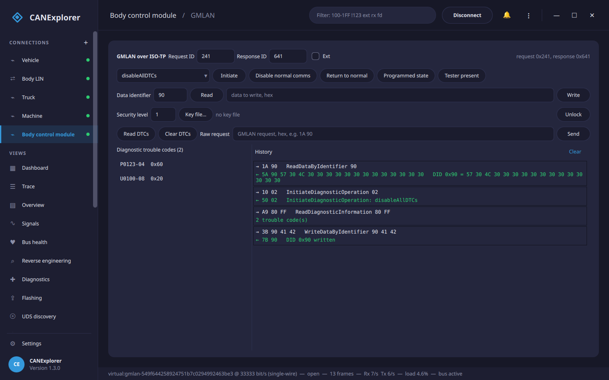

# GMLAN

The **GMLAN** page of a connection speaks **GMLAN (GMW3110)**, the diagnostic protocol of GM, Opel and Vauxhall
vehicles. It is the GM counterpart of the [Diagnostics (UDS)](diagnostics.md) page: GMLAN runs over normal CAN
frames with a transport (USDT) that works like ISO-TP, but the service layer is GM-specific — one-byte data
identifiers, services such as *ReturnToNormalMode* and *ReadDiagnosticInformation*, and the GM DTC format.



Open the connection to the vehicle's bus first, then go to the **GMLAN** page. It is available on any CAN
connection that can send; it is most often used on a [single-wire bus](#single-wire-can-swcan).

## Single-wire CAN (SWCAN)

Many GM/Opel body and comfort modules are on **GMLAN single-wire CAN** — a one-wire bus at **33.3 kbit/s** (with
an 83.3 kbit/s high-speed mode for flashing). Tick **Single-wire CAN (GMLAN)** in the
[new-connection dialog](connections.md) to open such a bus; it sets the bitrate to 33333 and selects the
single-wire transceiver on interfaces that have one (e.g. Kvaser). On SocketCAN the single-wire bitrate is set on
the link; the virtual interface carries the same frames, so a single-wire setup can be tried without hardware.

The frames themselves are ordinary CAN frames, so the whole of CANExplorer — the trace, reverse engineering,
signal plots — works on a single-wire bus as on any other.

## Addressing

GMLAN diagnostics use 11-bit CAN identifiers. Set the **Request ID** the tester sends on and the **Response ID**
the ECU answers on (physical responses are commonly the request id plus 0x400; functional requests to all nodes go
on 0x101). **Ext** uses 29-bit identifiers.

## Services

| Button | GMLAN service |
|---|---|
| **Initiate** | InitiateDiagnosticOperation (0x10): *disableAllDTCs*, *enableDTCsDuringDeviceControl*, *wakeUpLinks* |
| **Disable normal comms** | DisableNormalCommunication (0x28): stop the ECU's normal application messages |
| **Return to normal** | ReturnToNormalMode (0x20) |
| **Programmed state** | ReportProgrammedState (0xA2) |
| **Tester present** | TesterPresent (0x3E), sent periodically to keep diagnostics alive |
| **Read / Write** | ReadDataByIdentifier (0x1A) / WriteDataByIdentifier (0x3B) — GMLAN identifiers are one byte, e.g. 0x90 for the VIN |
| **Unlock** | SecurityAccess (0x27): request a seed on an odd level, send the key from the [key file](diagnostics.md#security-access) |
| **Read DTCs** | ReadDiagnosticInformation (0xA9): the trouble codes, shown as `P0123-04` (code and failure-type byte) with their status |
| **Clear DTCs** | ClearDiagnosticInformation (0x04) |
| **Raw request** | Any service as hex bytes, e.g. `1A 90`; the response is decoded in the log |

!!! warning "Diagnostics change the running ECU"
    Disabling normal communication, security access, writing identifiers and device control change how the ECU
    behaves. Use them on vehicles you own or are authorised to work on, stationary, with a stable supply.

## In scripts

`can_explorer.core.gmlan` drives GMLAN from [test scripts](test-automation.md), over the same transports as UDS
(`IsoTpClient`):

```python
from can_explorer.core.gmlan import GmlanClient
from can_explorer.core.isotp_client import IsoTpClient

client = GmlanClient(IsoTpClient(session, 0x241, 0x641))
print(await client.read_data_by_identifier(0x90))  # VIN
for dtc in await client.read_dtcs():
    print(dtc.text, hex(dtc.status))
await client.clear_dtcs()
```

`can_explorer.core.simulation.GmlanEcuSimulator` is a simulated GMLAN ECU for trying the page and for test scripts.
