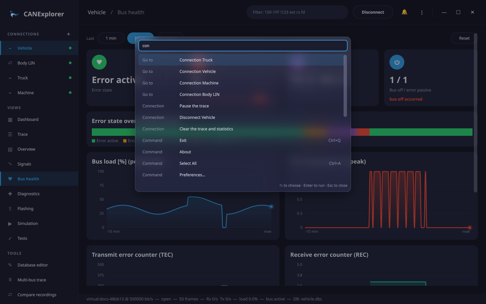
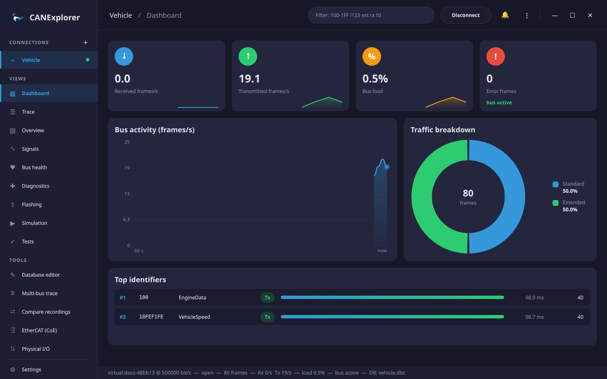
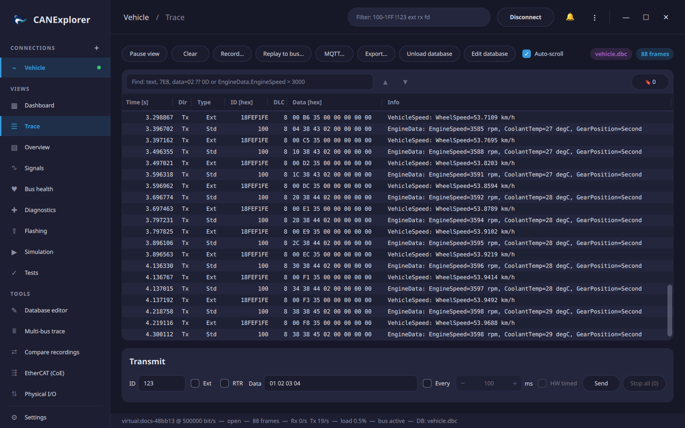

# User guide

The window is laid out as a dashboard:

- The **sidebar** on the left lists the connections (a green dot marks an open bus; **+** adds a connection) and
  the views of the selected connection. **Settings** at the bottom opens the [preferences](preferences.md).
  Drag its right edge to make it wider or narrower (180 to 420 pixels); a double click restores the default
  width, which is remembered.
- The **top bar** shows the current connection and view, the frame [filter](filters.md), the **Connect** /
  **Disconnect** button, the notifications (🔔; errors also pop up briefly at the bottom right) and the
  application menu **⋮** with all commands and their keyboard shortcuts.
- The window has no system title bar. Drag the top bar or the logo to move it, double-click the top bar to
  maximize or restore it, and use the buttons at the top right to minimize, maximize or close it. The window can
  be resized from its edges.
- *Tools* in the sidebar opens the [database editor](database-editor.md), the [multi-bus trace](multi-bus.md),
  [compares recordings](compare-recordings.md), the [EtherCAT master](ethercat.md) (CANopen over EtherCAT) and
  [Physical I/O](physical-io.md) (digital lines and analogue inputs of a USB I/O adapter).
- ++ctrl+k++ opens the **command palette**: type a few letters of any command, view, tool, connection, theme or
  language and press ++enter++. Letters may be skipped (`cmp rec` finds *Compare recordings*), so everything is
  reachable from the keyboard.

    
- The trace, overview and signals views have a toolbar to pause or clear the view, record, export and load a
  signal database.

When no connection is open, the welcome page offers to create a connection, replay a log file, convert a
database or reopen a recent connection.

| View | Purpose |
|---|---|
| **Dashboard** | Frame rates, bus load, error frames, bus activity chart, traffic breakdown and the busiest identifiers |
| **Trace** | Every frame in arrival order |
| **Overview** | One row per identifier with the latest data |
| **Signals** | Live plots of database signals |
| **Bus health** | Error state, error frames, error counters and bus load over up to an hour ([Bus health](bus-health.md)) |
| **Diagnostics** | UDS requests to an ECU (not for log replays) |
| **J1939** | Nodes with their address claims and trouble codes, requests and sending parameter groups ([J1939 connections](j1939.md)) |
| **CANopen** | NMT, SDO access to object dictionaries (EDS/DCF), PDOs and emergencies ([CANopen connections](canopen.md)) |
| **Flashing** | Programming ECUs over UDS from Intel HEX, S-record or binary files ([Flashing](flashing.md), not for log replays) |
| **LIN Schedule** | LIN master schedule tables (LIN connections) |
| **Simulation** | Simulated nodes and QML panels (not for log replays) |
| **Tests** | Automated test scripts with verdicts and reports (not for log replays) |

The status line at the bottom shows the bus, its state, the number of frames, the Rx and Tx frame rates, the
estimated bus load, error frames, the protocol decoder and the loaded database.

## Dashboard

- The four cards show the received and transmitted frames per second, the [bus load](trace-and-overview.md#bus-statistics)
  and the error frames with the bus state. The small chart of each card covers the last minute; the percentage
  compares the latest value with the one ten seconds earlier.
- **Bus activity** plots the received plus transmitted frames per second over the last minute.
- **Traffic breakdown** splits the frames into standard, extended, CAN FD, remote and error frames (headers and
  responses on LIN).
- **Top identifiers** lists the eight most frequent identifiers with their database name, direction, share
  relative to the busiest one, cycle time and frame count.

## Themes

Six colour themes are available under **Settings → Theme**: Dark (default), Purple, Nord, Ocean, Forest and Light.

Dialogs can be moved by dragging their title; they open centred again the next time. Dialogs, menus and popups are
made of frosted glass: the window behind them shows through, blurred and tinted in
the theme colours. The blur needs hardware accelerated graphics (OpenGL, Vulkan, Metal or Direct3D); with Qt's
software renderer (e.g. `QT_QUICK_BACKEND=software`, or in remote sessions without a GPU) they are plain panels.

