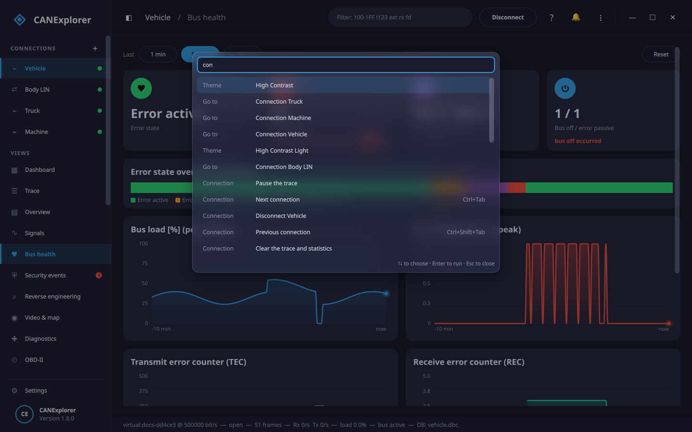
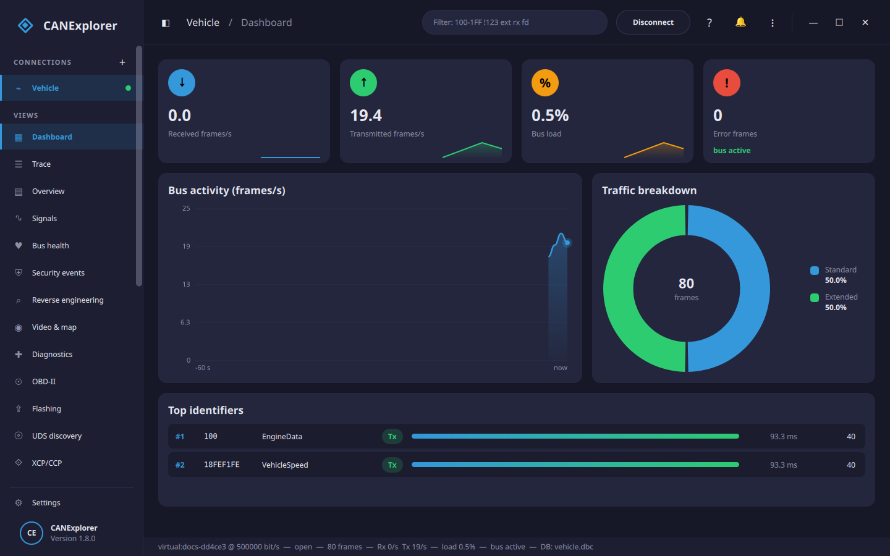
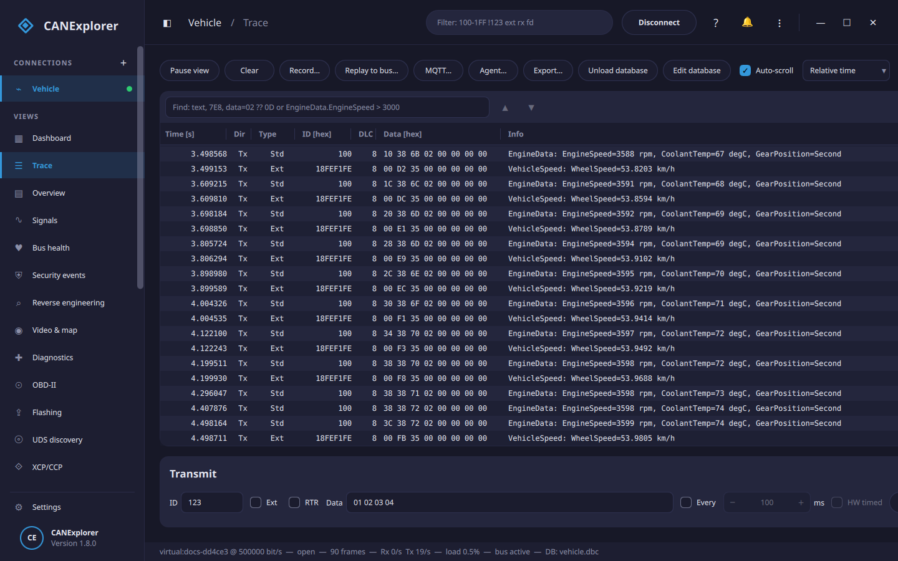

# User guide

The window is laid out as a dashboard:

- The **sidebar** on the left lists the connections and the views of the selected connection; **+** adds a
  connection. A mark after each connection gives its state by its shape as well as its colour (so it reads for
  colour-blind users and in every theme): a filled circle when the bus is open, a hollow ring when it is closed,
  a circle with **!** after an error; hovering names the state. Tools show what they are doing the same way: a
  filled circle while running (a database open in the database editor, the multi-bus trace merging open
  connections, EtherCAT, Physical I/O and DoIP connected, SOME/IP listening, an Ethernet capture, the bus gateway
  forwarding, a comparison), a hollow ring when set up but not running (the multi-bus trace paused, or waiting for
  its connections), a diamond for something to look at (unsaved changes in the database
  editor, gateway rules waiting for their connections, Ethernet security events) and a circle with **!** for an
  error (a SOME/IP or capture error, high-severity Ethernet security events); hovering the tool says which. The views of the connection show what they are doing
  the same way: a filled circle while something runs in them (tester present in Diagnostics or GMLAN, OBD-II live
  values, flashing, a UDS discovery scan, XCP, the LIN schedule, a simulation, the restbus, tests, the camera
  recording), a diamond for a warning (the bus error-warning or error-passive, security events) and a circle with
  **!** for an error (bus off, high-severity security events, a failed test run, flash or scan); hovering the view
  says which. **Settings** at the bottom opens the [preferences](preferences.md).
  Drag its right edge to make it wider or narrower (180 to 420 pixels); a double click restores the default
  width, which is remembered.
- The **top bar** shows the current connection and view, the frame [filter](filters.md), the **Connect** /
  **Disconnect** button, the notifications (🔔; errors also pop up briefly at the bottom right) and the
  application menu **⋮** with all commands and their keyboard shortcuts.
- The window has no system title bar. Drag the top bar or the logo to move it, double-click the top bar to
  maximize or restore it, and use the buttons at the top right to minimize, maximize or close it. The window can
  be resized from its edges.
- *Tools* in the sidebar opens the [database editor](database-editor.md), the [multi-bus trace](multi-bus.md),
  [compares recordings](compare-recordings.md), the [EtherCAT master](ethercat.md) (CANopen over EtherCAT),
  [Physical I/O](physical-io.md) (digital lines and analogue inputs of a USB I/O adapter), [DoIP](doip.md)
  (UDS diagnostics and flashing over Ethernet), [SOME/IP](someip.md) (service discovery and messages on automotive
  Ethernet) and the [bus gateway](bus-gateway.md) (forwarding frames between connections).
- The application menu's **Security Manager…** keeps the keys and certificates for SecOC, DoIP over TLS, UDS
  security access and Authentication, and IPsec/MACsec decryption in a password-protected key store, and loads
  security profiles and key servers that supply them from elsewhere ([security manager](security-manager.md)).
- ++ctrl+k++ opens the **command palette**: type a few letters of any command, view, tool, connection, theme or
  language and press ++enter++. Letters may be skipped (`cmp rec` finds *Compare recordings*), so everything is
  reachable from the keyboard.

    
- The trace, overview and signals views have a toolbar to pause or clear the view, record, export and load a
  signal database.

When no connection is open, the welcome page offers to create a connection, replay a log file, convert a
database or reopen a recent connection.

| View | Purpose |
|---|---|
| **Dashboard** | Frame rates, bus load, error frames, bus activity chart, traffic breakdown and the busiest identifiers |
| **Trace** | Every frame in arrival order |
| **Overview** | One row per identifier with the latest data |
| **Signals** | Live plots of database signals and bit fields |
| **Bus health** | Error state, error frames, error counters and bus load over up to an hour ([Bus health](bus-health.md)) |
| **Reverse engineering** | Bit and byte statistics, automatic analysis, reference signals and markers to find signals, and bit fields to plot or add to a database ([Reverse engineering](reverse-engineering.md)) |
| **Diagnostics** | UDS requests to an ECU (not for log replays) |
| **J1939** | Nodes with their address claims and trouble codes, requests and sending parameter groups ([J1939 connections](j1939.md)) |
| **CANopen** | NMT, SDO access to object dictionaries (EDS/DCF), PDOs and emergencies ([CANopen connections](canopen.md)) |
| **Flashing** | Programming ECUs over UDS from Intel HEX, S-record or binary files ([Flashing](flashing.md), not for log replays) |
| **XCP/CCP** | Measurement and calibration over XCP or CCP, by address or by name from an A2L file ([XCP/CCP](xcp.md)) |
| **GMLAN** | GM/Opel (GMW3110) diagnostics over CAN, on a single-wire (SWCAN) or dual-wire bus ([GMLAN](gmlan.md)) |
| **LIN Schedule** | LIN master schedule tables (LIN connections) |
| **Simulation** | Simulated nodes and QML panels (not for log replays) |
| **Tests** | Automated test scripts with verdicts and reports (not for log replays) |

The status line at the bottom shows the bus, its state, the number of frames, the Rx and Tx frame rates, the
estimated bus load, error frames, the protocol decoder and the loaded database.

## Dashboard

- The four cards show the received and transmitted frames per second, the [bus load](trace-and-overview.md#bus-statistics)
  and the error frames with the bus state. The small chart of each card covers the last minute; the percentage
  compares the latest value with the one ten seconds earlier.
- **Bus activity** plots the received plus transmitted frames per second over the last minute.
- **Traffic breakdown** splits the frames into standard, extended, CAN FD, remote and error frames (headers and
  responses on LIN).
- **Top identifiers** lists the eight most frequent identifiers with their database name, direction, share
  relative to the busiest one, cycle time and frame count.

## Themes

Forty-three colour themes are available under **Settings → Theme** (see [Preferences](preferences.md) for the full
list), among them:

- **Dark (the default) and Light**, and **System**, which follows the light or dark mode of the operating system,
  switching along with it. With System selected, **In light mode** and **In dark mode** choose the theme shown in
  each (by default Light and Dark), e.g. Solarized Light by day and Solarized Dark at night; each lists the themes
  with a light or a dark background respectively.
- **Editor palettes** in dark and light: Solarized Dark and Light, Nord and Nord Light, Catppuccin Mocha and Latte,
  Gruvbox Dark and Light, Tokyo Night, One Dark and Dracula.
- **Colour-blind-safe themes** built on the Okabe-Ito colours: Colour-Safe Dark and Colour-Safe Light at normal
  contrast, High Contrast (white on black) and High Contrast Light (black on white, for bright workshops and laptops
  in sunlight).
- **Night Vision**: dim reds on black, for working in a vehicle or garage at night without losing your dark
  adaptation. It is monochrome: the status colours differ in brightness (errors brightest) rather than hue, and the
  plotted signals are harder to tell apart, so switch theme when comparing many signals.
- **Phosphor**: a green oscilloscope screen, with amber and red kept for warnings and errors.

Each theme in the list shows swatches of its colours, and picking one previews it on the whole window at once:
**OK** keeps it, **Cancel** goes back to the previous theme. Every theme meets the WCAG contrast minimums — 4.5:1
for text, 3:1 for the accent, status and chart colours — and text on accent-coloured buttons and badges is white
or black, whichever is more legible. The colours of plotted signals, and those of OK, warnings and errors, are
checked to differ clearly from each other.

Dialogs can be moved by dragging their title; they open centred again the next time. Dialogs, menus and popups are
made of frosted glass: the window behind them shows through, blurred and tinted in
the theme colours. The blur needs hardware accelerated graphics (OpenGL, Vulkan, Metal or Direct3D); with Qt's
software renderer (e.g. `QT_QUICK_BACKEND=software`, or in remote sessions without a GPU) they are plain panels.

