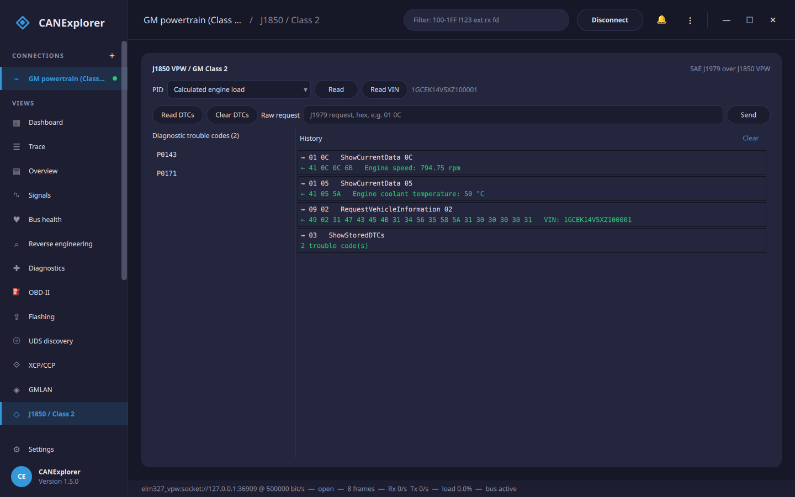

# J1850 VPW / GM Class 2

CANExplorer supports **SAE J1850 VPW**, the **GM "Class 2"** serial data bus of 1996–2007 GM vehicles — the bus the
**P01/P59 powertrain control modules** of 1999–2006 GM trucks, vans and F-bodies talk on. It is not CAN: a
single-wire 10.4 kbit/s bus with a three-byte header (priority, target, source) and an SAE J1850 CRC. CANExplorer
reaches it through an **ELM327/OBDLink adapter** put into J1850 VPW mode.



## Connecting

In the [new-connection dialog](connections.md) choose the **elm327_vpw** interface and give the adapter's serial
port as the channel — a USB port (`COM4`, `/dev/ttyUSB0`), a paired Bluetooth adapter (`/dev/rfcomm0`) or a WiFi
adapter (`socket://192.168.0.10:35000`), exactly as for the
[ELM327 CAN interface](../reference/interfaces.md#elm327-and-obdlink-adapters). The adapter is set to protocol 2
(SAE J1850 VPW) automatically; the bitrate is fixed at 10.4 kbit/s.

Each VPW frame appears in the [trace](trace-and-overview.md) as a frame whose extended identifier holds the three
header bytes (priority, target, source) and whose data is the payload, so the dashboard, [filters](filters.md),
[signal plots](signal-plots.md), [reverse engineering](reverse-engineering.md) and
[recording](recording-and-replay.md) all work on a Class 2 bus as on any other. The adapter is half-duplex, so a
frame on the bus while a diagnostic request is being sent is missed — fine for occasional requests, less so when
polling hard.

## Diagnostics (the J1850 / Class 2 page)

On an `elm327_vpw` connection a **J1850 / Class 2** page appears, running **SAE J1979** (OBD-II) over the bus
through the one shared adapter (no second connection to the dongle):

| Button | Service |
|---|---|
| **Read** (PID) | ShowCurrentData (mode 0x01): the chosen value — engine speed, coolant temperature, vehicle speed, load, throttle… — decoded to physical units |
| **Read VIN** | RequestVehicleInformation (mode 0x09) |
| **Read DTCs** | ShowStoredDTCs (mode 0x03): the trouble codes, shown as `P0143`, `P0171`… |
| **Clear DTCs** | ClearDTCs (mode 0x04): clear the stored codes and turn off the MIL |
| **Raw request** | Any J1979 request as hex bytes, e.g. `01 0C`; the response is decoded in the log |

!!! warning "Clearing codes changes the vehicle"
    Clearing trouble codes turns off the malfunction indicator lamp and erases freeze-frame data. Use it on
    vehicles you own or are authorised to work on.

## In scripts

`can_explorer.core.j1850` drives Class 2 diagnostics from [test scripts](test-automation.md). A `Class2EcuSimulator`
on an in-memory bus allows trying it without a vehicle:

```python
from can_explorer.core.j1850 import J1850Bus, J1850Client, Class2EcuSimulator

bus = J1850Bus()                        # In-memory Class 2 bus (no hardware)
Class2EcuSimulator(bus).start()         # A simulated P01/P59 PCM
client = J1850Client(bus.attach())

print(await client.current_data(0x0C))      # Engine speed (rpm)
print(await client.read_dtcs())             # ['P0143', 'P0171']
print((await client.vehicle_info(0x02)))    # VIN bytes
```

To talk to a real vehicle, swap the in-memory bus for an adapter transport from `can_explorer.core.elm327_vpw`:

```python
from can_explorer.core.elm327_vpw import Elm327VpwTransport
from can_explorer.core.j1850 import J1850Client

transport = Elm327VpwTransport('socket://192.168.0.10:35000')
try:
    client = J1850Client(transport)
    print(await client.current_data(0x0C))
finally:
    transport.close()
```
