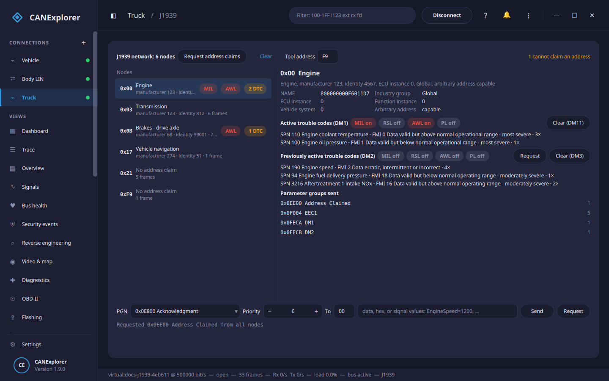

# J1939

Connections with the **J1939** protocol (chosen in the connection dialog or when replaying a log file) have a
**J1939** view in the sidebar. It shows the nodes on the bus with their address claims and trouble codes, and sends
requests and parameter groups. The trace decodes the same messages, see [Protocol decoding](protocols.md).



## Nodes

Every source address seen on the bus is a node. The list shows the address, the function and the NAME's
manufacturer code and identity number from the node's **address claim**, the number of frames, the lamps that are
on and the number of active trouble codes. Nodes that did not claim their address since the view was opened or
cleared show *No address claim*; **Request address claims** asks all nodes to claim again (a request for PGN
0xEE00 to the global address). Claims from the null address 0xFE, sent by nodes that **cannot claim an address**,
are counted at the top right, with their NAMEs in the tooltip.

Selecting a node shows:

- The **NAME**, as a 64 bit value and its fields: industry group, ECU and function instance, vehicle system and
  whether the node can pick another address (*arbitrary address capable*).
- The **active trouble codes** of its last **DM1**, with the states of the malfunction indicator (MIL), red stop
  (RSL), amber warning (AWL) and protect (PL) lamps. Each code shows the suspect parameter number (SPN), with its
  name for common SPNs, the failure mode identifier (FMI) and the occurrence count.
- The **previously active trouble codes** of its last **DM2**. **Request** asks the node for DM2.
- **Clear (DM11)** clears the active and **Clear (DM3)** the previously active trouble codes of the node, by
  requesting DM11 or DM3 from it.
- The parameter groups the node sent, with the number of messages.

DM1 and DM2 messages with more than one trouble code use the transport protocol; they are reassembled first.
**Clear** empties the list; it fills again with the traffic that follows.

## Sending parameter groups

The row at the bottom sends a parameter group from the **tool address** (F9, the off-board diagnostic service
tool, unless changed at the top):

| Field | |
|---|---|
| PGN | A name from the list, such as `CCVS1`, `DM1` or a message of the loaded database, or a number: `0xFEF1` or `65265` |
| Priority | 0 (highest) to 7; 6 is the default of most parameter groups |
| To | Destination address in hex; `FF` sends to all nodes. Selecting a node fills in its address. Parameter groups from 0xF000 (PDU2 format) have no destination and are always sent to all nodes |
| Data | Hex bytes, e.g. `FF 00 50 FF FF FF FF FF`, or signal values of the database message of the PGN, e.g. `WheelSpeed=80, ParkingBrake=1`. Signals not given are sent as *not available* (all bits set), as J1939 prescribes |

**Send** sends up to 8 bytes as one frame. Longer data is sent with the transport protocol: with **BAM** to all
nodes (up to 1785 bytes), or with **RTS/CTS** to a single node, which then controls the flow with clear to send
messages (and may ask for packets again) and confirms the end of the transfer. More than 1785 bytes go to a single
node with the **extended transport protocol** (ETP), which numbers the packets of each block from a data packet
offset. The result, or the error when the node does not answer or aborts (with the reason it gives), appears below
the row.

**Request** asks the destination for the parameter group in the PGN field, e.g. `Vehicle Identification` or
`Software Identification`; its answer appears in the trace and, for address claims and DM2, in the node list. A node
that does not send the group answers with an acknowledgment (NACK), also in the trace.

The sending row is not shown for log replays.

## The tool on the bus

Once the view has sent a request or a parameter group, the tool answers the transport sessions other nodes open to
its address, as every J1939 node must: clear to send for each block of packets (asking again for packets that went
missing), the end of message acknowledgment, and an abort when the sender stops in the middle. That is how a node's
answer of more than 8 bytes to a request from the tool, such as its software identification, gets through.

**Claim** (next to the tool address) claims the tool address with an **address claim** (J1939-81), with the NAME of
an off-board diagnostic service tool (function 129, arbitrary address capable, a random identity number). After the
claim the tool keeps the address: it answers requests for address claims and defends the address against a node with
a lower priority NAME. When a node with a higher priority NAME (a lower value) holds the address, the tool moves to
the first free self-configurable address (0x80 to 0xF7) and the tool address changes to it; the log shows the
outcome. A commanded address (PGN 0xFED8) for the tool's NAME moves it as well. Changing the tool address gives up
the claim. Without a claim the tool sends from its address as before, which most networks accept from a service tool.

## In scripts

`can_explorer.core.j1939_tools` sends and decodes J1939 from [test scripts](test-automation.md):

```python
from can_explorer.core.j1939_tools import J1939Sender, decode_dm, PGN_ADDRESS_CLAIMED

sender = J1939Sender(session)  # session: the connection's bus
sender.request(PGN_ADDRESS_CLAIMED)  # ask every node to claim its address
await sender.send(0xFEF1, bytes(8), source=0xF9)  # send a parameter group (PGN 0xFEF1)
await sender.send(0xD700, image, destination=0x00)  # over 1785 bytes to one node: ETP

message = decode_dm(payload)  # decode a DM1/DM2 payload into trouble codes
for dtc in message.dtcs:
    print(dtc.describe())
```

Requesting a parameter group and waiting for the answers (reassembled from BAM, RTS/CTS or ETP, or the
acknowledgment of a node that does not send it), claiming an address, and answering transport sessions:

```python
from can_explorer.core.j1939_tools import AddressClaimer, J1939Name, TransportResponder, request_pgn

for answer in await request_pgn(session, 0xFEDA, destination=0x00):  # Software Identification of the engine
    print(answer.source, answer.payload or answer.acknowledgment)

claimer = AddressClaimer(session, J1939Name(0x8000_8100_0000_1234), 0x80)
address = await claimer.claim()  # Raises AddressClaimError when it cannot claim one
...
claimer.close()

responder = TransportResponder.attach(session, 0x80)  # Accept RTS/CTS and ETP sessions to 0x80
...
responder.close()
```

`TransportReassembler().on_message(msg)` returns `(pgn, source, destination, payload)` for each complete
parameter group of a trace, single frame or transported.
