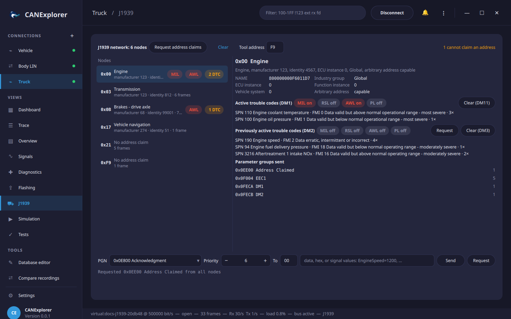

# J1939

Connections with the **J1939** protocol (chosen in the connection dialog or when replaying a log file) have a
**J1939** view in the sidebar. It shows the nodes on the bus with their address claims and trouble codes, and sends
requests and parameter groups. The trace decodes the same messages, see [Protocol decoding](protocols.md).

## Nodes

Every source address seen on the bus is a node. The list shows the address, the function and the NAME's
manufacturer code and identity number from the node's **address claim**, the number of frames, the lamps that are
on and the number of active trouble codes. Nodes that did not claim their address since the view was opened or
cleared show *No address claim*; **Request address claims** asks all nodes to claim again (a request for PGN
0xEE00 to the global address). Claims from the null address 0xFE, sent by nodes that **cannot claim an address**,
are counted at the top right, with their NAMEs in the tooltip.

Selecting a node shows:

- The **NAME**, as a 64 bit value and its fields: industry group, ECU and function instance, vehicle system and
  whether the node can pick another address (*arbitrary address capable*).
- The **active trouble codes** of its last **DM1**, with the states of the malfunction indicator (MIL), red stop
  (RSL), amber warning (AWL) and protect (PL) lamps. Each code shows the suspect parameter number (SPN), with its
  name for common SPNs, the failure mode identifier (FMI) and the occurrence count.
- The **previously active trouble codes** of its last **DM2**. **Request** asks the node for DM2.
- **Clear (DM11)** clears the active and **Clear (DM3)** the previously active trouble codes of the node, by
  requesting DM11 or DM3 from it.
- The parameter groups the node sent, with the number of messages.

DM1 and DM2 messages with more than one trouble code use the transport protocol; they are reassembled first.
**Clear** empties the list; it fills again with the traffic that follows.

## Sending parameter groups

The row at the bottom sends a parameter group from the **tool address** (F9, the off-board diagnostic service
tool, unless changed at the top):

| Field | |
|---|---|
| PGN | A name from the list, such as `CCVS1`, `DM1` or a message of the loaded database, or a number: `0xFEF1` or `65265` |
| Priority | 0 (highest) to 7; 6 is the default of most parameter groups |
| To | Destination address in hex; `FF` sends to all nodes. Selecting a node fills in its address. Parameter groups from 0xF000 (PDU2 format) have no destination and are always sent to all nodes |
| Data | Hex bytes, e.g. `FF 00 50 FF FF FF FF FF`, or signal values of the database message of the PGN, e.g. `WheelSpeed=80, ParkingBrake=1`. Signals not given are sent as *not available* (all bits set), as J1939 prescribes |

**Send** sends up to 8 bytes as one frame. Longer data (up to 1785 bytes) is sent with the transport protocol:
with **BAM** to all nodes, or with **RTS/CTS** to a single node, which then controls the flow with clear to send
messages and confirms the end of the transfer. The result, or the error when the node does not answer or aborts,
appears below the row.

**Request** asks the destination for the parameter group in the PGN field, e.g. `Vehicle Identification` or
`Software Identification`; its answer appears in the trace and, for address claims and DM2, in the node list.

The sending row is not shown for log replays.
