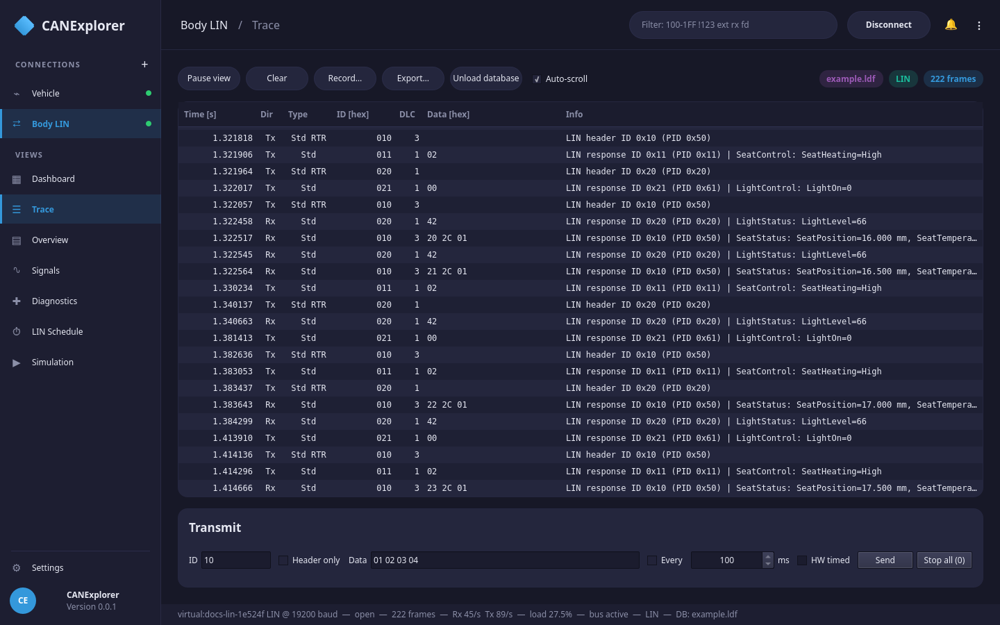
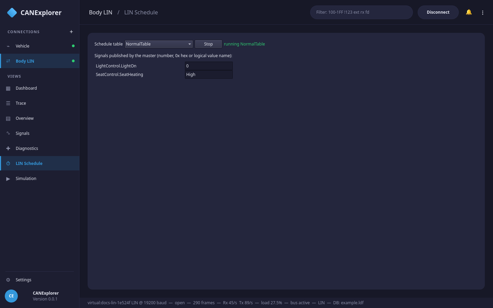

# LIN

CANExplorer accesses LIN (ISO 17987, LIN 2.x) through Linux LIN drivers that present the bus as a SocketCAN
interface, following the convention of [sllin](https://rtime.felk.cvut.cz/gitweb/linux-lin.git):

| CAN frame | LIN |
|---|---|
| Identifier 0x00–0x3F | LIN frame identifier |
| Remote (RTR) frame | Header: sent, the master sends the header and a slave answers; received, a header seen on the bus |
| Data frame | Response: sent by the master, header and response are sent together; received, the response to a header |

See [Installation](../getting-started/installation.md#lin) to set up sllin. With the *VirtualBus* interface LIN works
without hardware, e.g. with the LIN slave simulator.

## LIN connections

Create a connection with bus type **LIN**, interface *SocketcanBus* and the channel of the LIN driver (e.g.
`sllin0`), and the **Baud rate** of the bus (19200 by default). The baud rate is used for the bus load; the driver's
own setting applies to the bus.



The trace shows headers and responses with their protected identifier (PID):

```text
LIN header ID 0x10 (PID 0x50)
LIN response ID 0x10 (PID 0x50) | SeatStatus: SeatPosition=5.000 mm, SeatTemperature=-10.000 degC
LIN master request NAD 0x01 SF: ReadDataByIdentifier F1 90
```

Diagnostic frames (master request 0x3C, slave response 0x3D) are reassembled with the LIN transport layer and their
node configuration (AssignNAD, ReadByIdentifier, …) or UDS services described. Checksums are verified by the driver
and not shown.

## LDF files

Load an LDF (LIN description file) with **Load database…** to decode and [plot](signal-plots.md) the signals.
Physical encodings are shown with units, logical encodings with their texts.

## Master schedule

The **LIN Schedule** view runs the schedule tables of the LDF with CANExplorer as master:



- Frames the master publishes are sent with header and response, using the values of the master signals listed
  below the table. Edit a value to change it: a number (decimal or `0x` hex) or the name of a logical value
  (e.g. `High`).
- For frames published by slaves only the header is sent; the slaves answer.
- Slave response entries poll the slaves; diagnostic requests are sent by the Diagnostics view when needed rather
  than in master request slots.

**Start** and **Stop** control the schedule; disconnecting stops it.

## Transmitting

The transmit panel has **Header only** instead of RTR: it sends a header for a slave to answer. Identifiers are
`00`–`3F`, responses have 1 to 8 bytes.

## Diagnostics

The [Diagnostics](diagnostics.md) view uses the LIN transport layer on LIN connections; set the **NAD** of the slave.
