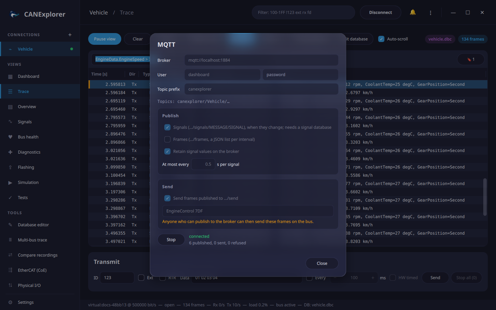

# MQTT

CANExplorer publishes the decoded signals of a connection, and optionally its frames, to an MQTT broker. Dashboards
and home automation (Home Assistant, Node-RED, Grafana, a cloud IoT service) then use the bus data without knowing
anything about CAN. Optionally, other programs send frames on the bus by publishing to a topic.

MQTT works in the application, for a connection, and in [can-server](remote-buses.md#mqtt), which publishes its
buses without a user interface (for example from a Raspberry Pi in a vehicle).

!!! note
    The installers contain MQTT. When running from source, install it with `uv sync --extra mqtt`.

## Publishing a connection

1. [Load a signal database](signal-databases.md): signals are published by their names in the database. Without
   a database, only frames can be published.
2. Click **MQTT…** in the connection's toolbar.
3. Enter the **Broker** (`mqtt://HOST:PORT`, or `mqtts://HOST` for TLS on port 8883), the **User** and password if
   the broker needs them, and the **Topic prefix** (default `canexplorer`).
4. Choose what to publish and click **Start**.



The button then reads **● MQTT**, and the dialog shows the state (*connected*, or the error and the next retry)
and how many messages were published. Publishing pauses while the connection is disconnected and resumes when it
is connected again, until you click **Stop**. CANExplorer remembers the options, but not the password.

## Topics

All topics start with `PREFIX/CONNECTION`, e.g. `canexplorer/Vehicle`. In names, `/`, `+` and `#` become `_`.

| Topic | Payload |
|---|---|
| `…/signals/MESSAGE/SIGNAL` | The signal's value as JSON: a number (`2400.0`), or the name of a value with a choice (`"Second"`) |
| `…/frames` | Optional: the frames of each interval, as a JSON list of `[timestamp, id, flags, data hex, dlc]` |
| `…/status` | `online` or `offline` (retained; the broker publishes `offline` itself when the connection drops) |
| `…/send` | Optional: frames other programs want to send (see below) |
| `…/errors` | Why a send request was refused: `{"error": "…"}` |

A signal is published when its value changes, at most once per interval (**At most every**, default 0.1 s). With
**Retain signal values**, the broker keeps the last value of every signal for new subscribers.

`flags` in frames are bits: 1 extended identifier, 2 remote frame, 4 CAN FD, 8 bit rate switch, 16 error state
indicator, 32 error frame, 64 received (not sent by this computer).

Try it with the Mosquitto command line tools:

```bash
mosquitto_sub -h localhost -t 'canexplorer/#' -v
```

```text
canexplorer/Vehicle/status online
canexplorer/Vehicle/signals/EngineData/EngineSpeed 2400.0
canexplorer/Vehicle/signals/EngineData/GearPosition "Second"
```

## Sending frames

With **Send frames published to …/send**, frames published to the `send` topic are sent on the bus. Only the
messages and identifiers in the allow list are sent; `*` allows all. The connection must be able to transmit.

```bash
# A database message by name; signals that are not given keep their initial value
mosquitto_pub -t canexplorer/Vehicle/send -m '{"message": "EngineControl", "signals": {"TargetSpeed": 2000}}'
# Raw data; identifiers above 7FF are extended, or set "extended": true
mosquitto_pub -t canexplorer/Vehicle/send -m '{"id": "7DF", "data": "02 01 0D"}'
```

!!! warning "Sending is remote control of the bus"
    Anyone who can publish to the broker can send the allowed frames on the bus, for example in a vehicle. Keep
    the allow list short, use a broker with users and access control lists (so that only trusted clients may
    publish to `…/send`), and use TLS (`mqtts://`) outside a trusted network.

## Home Assistant

With Home Assistant's MQTT integration, a signal becomes a sensor:

```yaml
mqtt:
  sensor:
    - name: "Engine speed"
      state_topic: "canexplorer/Vehicle/signals/EngineData/EngineSpeed"
      unit_of_measurement: "rpm"
      availability_topic: "canexplorer/Vehicle/status"
      payload_available: "online"
      payload_not_available: "offline"
```

## Limits

- MQTT is made for values, not for every frame of a busy bus. Publish frames only on quiet buses or with a local
  broker; frames that pile up faster than they are published (more than 20 000 per interval) are dropped and
  counted.
- Signals are published at most once per interval, so short spikes between two publications are not seen.
  Record the bus for exact data.
- The connection to the broker is restored automatically; values that changed in the meantime are published
  then (only the latest value of each signal).
