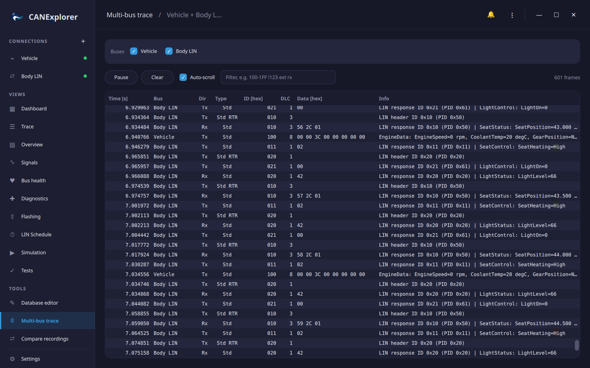

# Several buses

Vehicles and test benches have several networks, often joined by gateways: a powertrain CAN, a body CAN, LIN
sub-buses. CANExplorer opens one connection per bus; the **Multi-bus trace** shows several of them on one
timeline, and simulated **gateways** forward frames between them.

## Multi-bus trace

**Multi-bus trace** under *Tools* in the sidebar merges the traces of the connections you tick, ordered by time,
with the connection in the **Bus** column. It shows which frame on one bus caused which reaction on another, e.g. a
CAN request and the LIN frames a gateway sends for it.



- Ticking a connection merges the frames its trace still holds; new frames follow while the connections receive.
  The view holds the latest 200 000 frames.
- The **Info** column decodes each frame with the protocol and database of its own connection.
- The filter field takes the [display filter](filters.md) syntax and applies to all buses. **Pause** stops
  following; **Clear** empties the view (the connections keep their traces).
- Copy and Select All (++ctrl+c++, ++ctrl+a++) work as in the trace of a connection.

Times are relative to the earliest start of the selected connections. Frames of different connections are ordered
by their timestamps, so connections should use the same clock: live connections on one computer do; a log file
replay has the timestamps of its recording.

## Gateways and nodes on several buses

A [simulation](simulation.md) runs on its connection's bus, but its nodes can also receive and send on the other
connections, named as in the sidebar:

```python
from can_explorer.scripting import Node, on_message, on_signal


class SeatModule(Node):
    @on_signal('EngineData', 'EngineSpeed', bus='Powertrain')  # Decoded with the Powertrain database
    def engine(self, rpm, msg):
        self.send('SeatStatus', Heating=1 if rpm > 0 else 0, bus='Body LIN')

    @on_message(0x7DF, bus='Powertrain')
    def request(self, msg):
        self.send(0x7E8, [0x02, 0x7E, 0x00], bus='Powertrain')
```

`bus=` is accepted by `@on_message`, `@on_signal`, `send` and `message`; without it, the simulation's own
connection is meant. Message names are looked up in the database of that connection.

`Gateway` is a ready-made node forwarding frames from one bus to another:

```python
from can_explorer.scripting import Gateway


class BodyGateway(Gateway):
    source = 'Powertrain'              # '' is the simulation's own connection
    target = 'Body'
    ids = ['EngineData', 0x3E0]        # Identifiers or database names; None forwards everything
    both_directions = False            # Also forward these identifiers from Body to Powertrain

    def transform(self, msg, to_bus):  # Optional: change or drop (return None) frames on the way
        frame = super().transform(msg, to_bus)
        if msg.id == 0x3E0:
            frame.arbitration_id = 0x3E1
        return frame
```

Only received frames are forwarded, never those sent on a bus (by the gateway or another node), so two-way
gateways do not loop. `forwarded` counts the frames a gateway sent. Starting a simulation that names a connection
which does not exist fails with the names of the existing ones.
