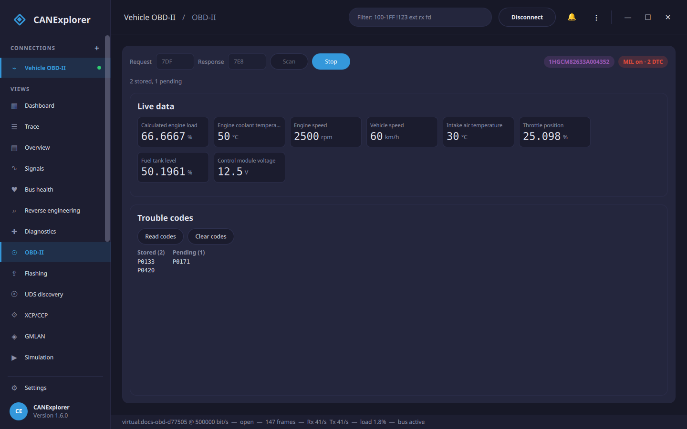

# OBD-II

The **OBD-II** page reads a vehicle's emissions diagnostics (SAE J1979 over ISO 15765-4): the live values the ECU
publishes, its trouble codes, and the VIN. It is the standard, manufacturer-independent interface every car built
since the mid-2000s exposes on its OBD-II port — a 500 kbit/s CAN bus.



The page appears for CAN connections that can transmit (it sends requests). Connect to the vehicle, then press
**Scan**.

## Connecting

Requests go to **7DF**, the OBD-II functional broadcast that every ECU answers, and answers come from **7E8** (the
first ECU). If a vehicle does not respond to the broadcast, address one ECU directly by setting the request and
response identifiers to **7E0** and **7E8** (7E1/7E9 for the second ECU, and so on).

**Scan** reads:

- the **VIN** (service 09),
- the **MIL** (the "check engine" lamp) and the number of stored trouble codes (service 01 PID 01), and
- the **supported values** — the PIDs the ECU offers (service 01 PID 00/20/…), of those CANExplorer can decode.

## Live data

**Live** polls the supported values continuously and shows each as a tile — engine speed, vehicle speed, coolant
and intake temperatures, engine load, throttle position, fuel level, control-module voltage and more, in their
physical units. **Stop** ends the polling.

The same values can be recorded as references for reverse engineering from the [Reference signals](reverse-engineering.md#reference-signals)
tab, to match them to the raw traffic.

## Trouble codes

**Read codes** reads the **stored** codes (service 03, the ones that lit the MIL) and the **pending** codes
(service 07, seen once but not yet confirmed), decoded to their `P`/`C`/`B`/`U` form — for example `P0133`.

**Clear codes** sends service 04: it clears the stored codes and turns the MIL off. As the standard intends, this
also clears freeze-frame data and resets the readiness monitors, so the car may need a drive cycle before it is
ready to pass an emissions test again.

## Scripting

The same OBD-II client is available as a library, so you can read a vehicle from a script without the GUI. Open a
bus with python-can, wrap it in the ISO-TP and UDS transports, and call `ObdClient` — its methods are coroutines, so
run them on an event loop:

```python
import asyncio

from can_explorer.core.obd import ObdClient, FUNCTIONAL_REQUEST, ECU_RESPONSE
from can_explorer.core.isotp_client import IsoTpClient
from can_explorer.core.session import BusSession
from can_explorer.core.sources import BusConfig, LiveSource
from can_explorer.core.uds import UdsClient


async def main():
    # Open the OBD-II bus (a 500 kbit/s CAN bus); use the interface and channel of your adapter
    session = BusSession(LiveSource(BusConfig("socketcan", "can0")))
    session.start()
    # Requests go to the functional address 7DF, answers come from 7E8 (the first ECU)
    obd = ObdClient(UdsClient(IsoTpClient(session, FUNCTIONAL_REQUEST, ECU_RESPONSE)))

    print("VIN:", await obd.read_vin())
    status = await obd.status()
    print("MIL on:", status.mil_on, "stored DTCs:", status.dtc_count)

    for pid in await obd.supported_pids():          # The PIDs this ECU offers
        value = await obd.read_value(pid)
        if value is not None:
            print(f"  {value.name}: {value.value:g} {value.unit}")

    print("stored:", [dtc.code for dtc in await obd.read_dtcs()])
    print("pending:", [dtc.code for dtc in await obd.read_dtcs(pending=True)])
    session.stop()


asyncio.run(main())
```

To address a single ECU instead of the broadcast, pass its identifiers — `IsoTpClient(session, 0x7E0, 0x7E8)`.
`ObdClient` methods raise `UdsError` (or `UdsNegativeResponse`) when a request fails, and `clear_dtcs()` sends
service 04. An AI agent can do the same over the [MCP interface](mcp.md) with the `obd_*` tools (grant
`--allow-diagnostics`).

## Limits

- Only the common service-01 PIDs are decoded into values; the rest of the (large) PID set and manufacturer-specific
  PIDs are not built in.
- Freeze frame (service 02), on-board monitor results (service 06) and the other service-09 items beyond the VIN
  are not read.
- OBD-II runs over CAN; the page is not shown for LIN connections. For deeper, manufacturer-specific diagnostics
  use the [UDS diagnostics](diagnostics.md) page.
