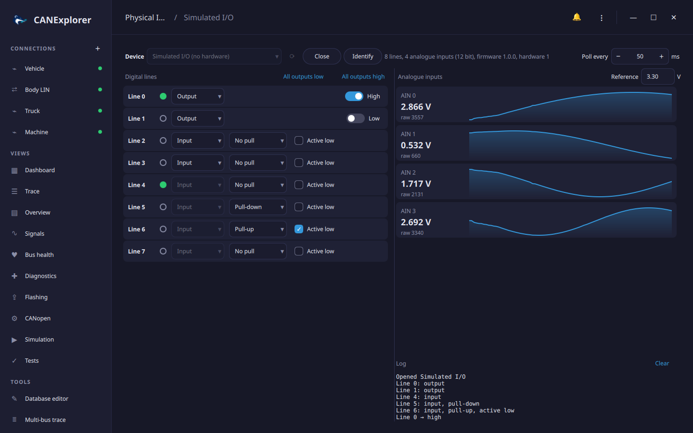

# Physical I/O

The **Physical I/O** tool in the sidebar switches the digital outputs of a USB I/O adapter and shows its digital
inputs and analogue values, e.g. to switch an ECU's ignition or wake-up line with a relay while you watch its bus,
or to check a sensor voltage. Test scripts can use the same device (see [below](#in-scripts)).



## Devices

| Device | What it offers |
|---|---|
| aio_usb adapters | The I/O interface of STM32 CAN/LIN/I/O adapter firmware (USB `1d50:606f`): up to 32 digital lines and up to 16 analogue inputs, as many as the adapter reports |
| Simulated I/O | Eight lines (0–3 can be outputs) and four 12 bit analogue inputs; lines 4–7 are wired back to lines 0–3, so switching an output changes the input next to it. Works without hardware |

USB adapters need the optional pyusb and libusb packages. Run CANExplorer from source with the `io` extra; the
installers offer only the simulated device:

```bash
uv sync --extra io
```

| System | Access to the adapter |
|---|---|
| Linux | A udev rule: `SUBSYSTEMS=="usb", ATTRS{idVendor}=="1d50", ATTRS{idProduct}=="606f", MODE="0666", TAG+="uaccess"` in `/etc/udev/rules.d/70-aio-usb.rules`, then `sudo udevadm control --reload` and plug the adapter in again. The CAN interface of the same adapter stays with the kernel's `gs_usb` driver |
| Windows | The I/O interface uses the WinUSB driver (installed automatically by firmware that announces it; otherwise with [Zadig](https://zadig.akeo.ie/)) |
| macOS | No setup |

A plain candleLight adapter has the same USB ID but no I/O interface and is not listed.

## Using the tool

Choose a **Device** and click **Open**. The details next to it show the number of lines and analogue inputs, the
ADC resolution and the firmware version. **Identify** makes the adapter show itself (e.g. blink its LED), to tell
several apart. The device is read every 50 ms; **Poll every** changes that (20 to 1000 ms).

**Digital lines.** Each line shows its level (filled green: high) and is an **Input** or an **Output**; lines that can
only be one of the two cannot be changed.

- Inputs have **No pull**, a **Pull-up** or a **Pull-down**, and can be **Active low** (the level shown is inverted).
- Outputs start low when a line is made an output; the switch drives it **High** or **Low**. **All outputs low** and
  **All outputs high** switch every output at once.

**Analogue inputs** show the value in volts and the raw ADC value, with the last few seconds as a small chart. The
volts are computed with the **Reference** voltage, the voltage of the full ADC scale (3.3 V by default; set it to the
adapter's reference, including any voltage divider in front of the inputs).

The log lists the changes and errors, e.g. *Line 6 cannot be an output*. When the adapter is unplugged, the tool
reports that it stopped answering and closes it.

## In scripts

`can_explorer.core.physical_io` opens the same devices from [test scripts](test-automation.md) and simulations,
e.g. to switch the ignition before a test:

```python
from can_explorer.core.physical_io import LineConfig, list_devices, open_device

print(list_devices())                        # [('aio:0042', 'aio_usb I/O adapter 0042'), ('simulated', …)]
io = open_device('aio:0042')
io.configure_line(0, LineConfig(output=True))
io.set_outputs(mask=0b1, values=0b1)         # Line 0 high: ignition on
status = io.read_status()
print(status.level(4), status.analog_volts(io.info, reference=3.3))
io.close()
```

A device can only be open in one place at a time: close it in the tool before a script opens it.
