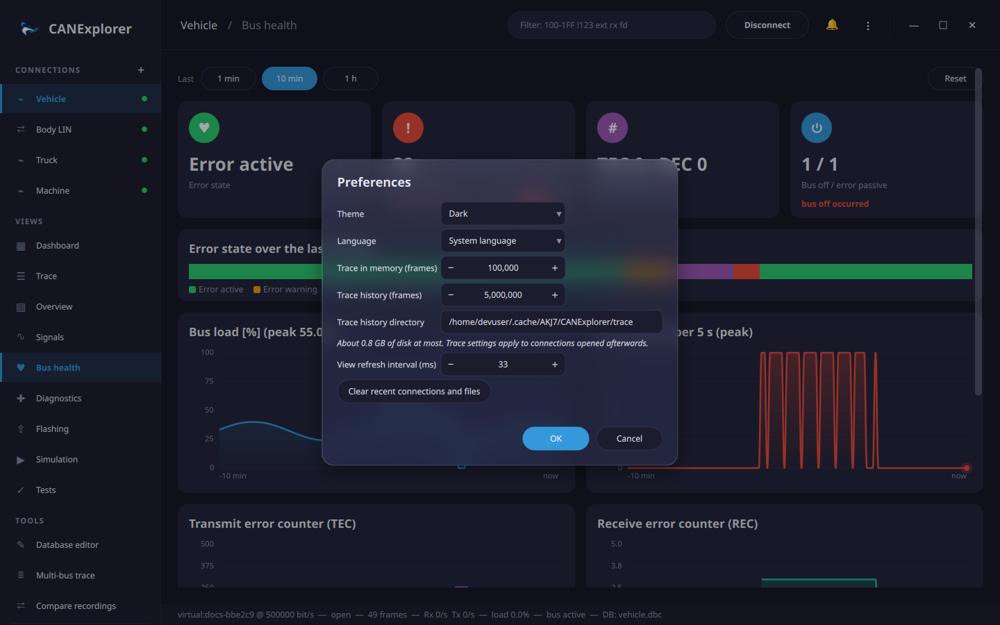

# Preferences and settings

## Preferences

**Settings** in the sidebar (or **⋮ → Preferences…**) opens the preferences:

| Setting | Default | Range | Description |
|---|---|---|---|
| Theme | Dark | Dark, Purple, Nord, Ocean, Forest, Light, Dracula, Solarized Dark, High Contrast, Cyberpunk, Rosé | Colours of the user interface; applies immediately |
| Language | System language | English, Deutsch, Français, 中文, 日本語 | Language of the user interface; applies immediately. Texts without a translation stay in English; see [Translations](../development/translations.md) to add a language |
| Trace in memory (frames) | 100 000 | 1 000 – 2 000 000 | The most recent frames of the trace, kept in memory |
| Trace history (frames) | 5 000 000 | 0 – 50 000 000 | Frames of the trace kept in total, the older ones on disk (about 160 bytes each); 0 keeps only those in memory. See [long recordings](trace-and-overview.md#long-recordings) |
| Trace history directory | the cache directory | | Where the temporary files of the history go, e.g. `~/.cache/AKJ7/CANExplorer/trace` on Linux |
| Updates: check at start | On | | Look for new releases on GitHub each time CANExplorer starts; see [Updates](updates.md) |
| Updates: pre-releases | Off | | Also offer release candidates and other pre-releases |
| View refresh interval (ms) | 33 | 16 – 1 000 | How often new frames are shown; longer intervals reduce the CPU load on busy buses |

The trace settings apply to connections opened afterwards.

**Clear recent connections and files** empties the recent lists (connections, log files, workspaces) of the **⋮**
menu and the welcome page.

## Stored state

CANExplorer remembers the recent connections and log files, the preferences, the theme, the width of the sidebar and the window position and size. They
are stored with Qt's settings mechanism:

| Platform | Location |
|---|---|
| Linux | `~/.config/AKJ7/CANExplorer.conf` |
| Windows | Registry, `HKEY_CURRENT_USER\Software\AKJ7\CANExplorer` |
| macOS | `~/Library/Preferences/com.akj7.CANExplorer.plist` |

## Application settings

Logging and other application settings are read from `CANEXPLORER_*` environment variables, a `.env` file in the
working directory and the command line; see [Command line](../reference/command-line.md).
