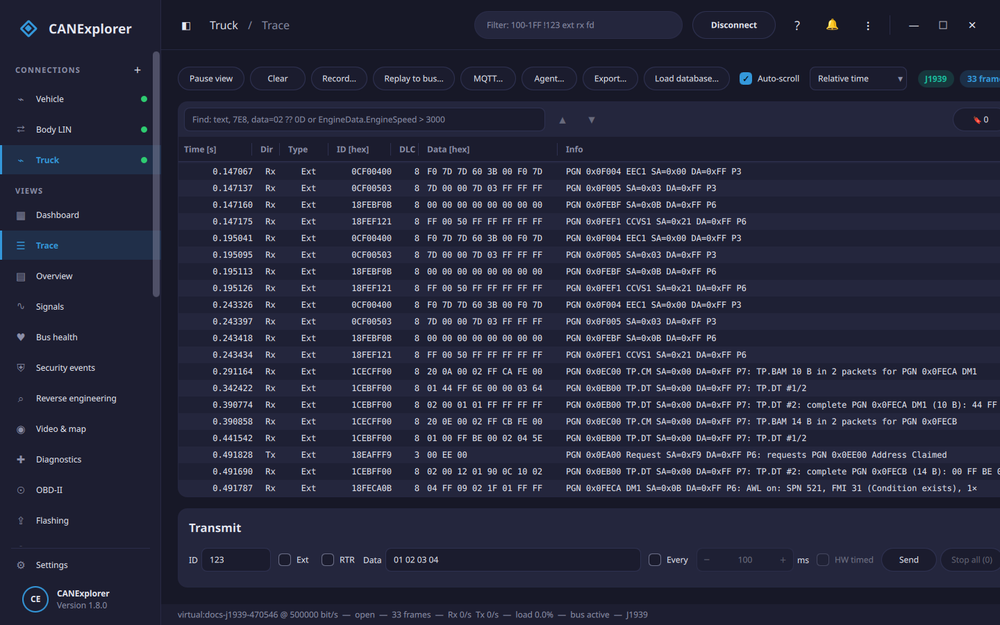

# Protocol decoding

The protocol chosen for a connection decodes the frames passively into the *Info* column. Decoding runs for every
frame in arrival order, so multi-frame transfers are reassembled.

| Protocol | Decodes |
|---|---|
| Raw | Nothing (only the signal database) |
| ISO-TP | ISO 15765-2 single, first, consecutive and flow control frames; reassembled payloads |
| UDS | ISO-TP, plus the UDS services in the reassembled payloads |
| KWP2000 | ISO-TP, plus the Keyword Protocol 2000 (ISO 14230) services — the diagnostic protocol that preceded UDS, in vehicles from roughly 1996–2006; same ISO-TP transport and request/response convention, the older ISO 14230-3 service set |
| K-Line | KWP2000 (ISO 14230) and OBD-II/J1979 services on a [K-Line bus](../reference/interfaces.md#k-line-iso-9141-2-iso-14230) (the `elm327_kline` interface), where each frame already carries one bare service payload (no ISO-TP). Use this rather than KWP2000, which expects ISO-TP on CAN |
| J1939 | Priority, PGN with names of common PGNs, source and destination address, requests, address claims with the NAME, DM1/DM2 lamps and trouble codes, transport protocol (BAM and RTS/CTS) with reassembly; see also the [J1939 view](j1939.md) |
| J1939-22 | SAE J1939-22 (J1939-FD): J1939 on CAN FD. Single-PG frames decode like J1939 on the longer FD payload; the FD transport (FD.TP) and multiplexed-PG (Multi-PG) frames are recognised and labelled |
| NMEA 2000 | The marine protocol, built on J1939: PGN with names of common marine PGNs, source address, Fast Packet reassembly, and fields of the common PGNs (engine, position, COG/SOG, heading, wind, depth, speed, battery) in marine units |
| CANopen | NMT, SYNC, EMCY, TIME, PDOs, SDO requests and responses, heartbeat and node guarding; with an object dictionary loaded in the [CANopen view](canopen.md), SDO object names and PDO values |
| LIN | Headers and responses, diagnostic frames, see [LIN](lin.md) |
| J1587 | SAE J1587 messages (MID and PIDs) of the older heavy-truck bus, with common parameters scaled. J1587 runs over J1708, a 9600-baud serial bus (**not** CAN); decode a live capture through the [J1708 interface](../reference/interfaces.md#sae-j1708), a serial log, or a gateway. Each frame's data is one J1587 message |
| NM | AUTOSAR Network Management (CAN-NM / UDP-NM): the source node id, the control-bit flags (Repeat Message, Active Wakeup, Sleep Ready, PN Learning) and, when the Partial Network Information bit is set, the requested partial-network clusters. Point it at the bus's NM identifiers; the node-id and control-vector positions are configurable |
| SecOC | AUTOSAR Secure Onboard Communication: splits a secured PDU into the authentic payload, the truncated freshness value and the truncated MAC. Verifying the MAC (CMAC/AES-128) needs the key and configuration — available as a library (`can_explorer.core.secoc`) |

!!! tip "Choose the protocol of the traffic"
    ISO-TP and UDS interpret the first byte of every frame as a transport protocol header. On a bus that also
    carries ordinary signal frames these are labelled as ISO-TP as well; use **Raw** there, or a filter such as
    `7E0-7EF` to look at the diagnostic traffic.

Examples:

```text
ISO-TP complete (20 B): 62 F1 90 57 44 42 … | UDS Positive response to ReadDataByIdentifier: F1 90 57 44 42 …
PGN 0x0FECA DM1 SA=0x00 DA=0xFF P6: TP.DT #2: complete PGN 0x0FECA DM1 (10 B): 01 02 03 …
PGN 127488 Engine Parameters, Rapid Update SA=35 P2: engine 0: 2400 rpm
SDO response node 5: read response 0x1018:01 = 78 56 34 12
ISO-TP SF (2 B): 10 81 | KWP StartDiagnosticSession 81
PGN 0x02500 Multi-PG SA=0x00 DA=0x00 P6: multiplexed PGs, 32 bytes (contained PGs not expanded)
MID 128 Engine #1, PID 84 Road Speed 60 mph, PID 190 Engine Speed 1500 rpm
NM node 0x12 [ActiveWakeup] PN requests #0, #2
SecOC: authentic 11 22 33 44 | freshness 05 | MAC AABBCCDD
```

With a [diagnostic description](diagnostics.md#diagnostic-descriptions-cdd-odxpdx), UDS (and LIN diagnostics) decode
ReadDataByIdentifier data into fields.



## Decoding in scripts

The decoders work on any frames, e.g. those of a log file. Each keeps the state of multi-frame transfers, so feed it
the frames in order (and `reset()` it between logs):

```python
import can

from can_explorer.core.protocols import PROTOCOL_DECODERS

uds = PROTOCOL_DECODERS['UDS']()  # The names of the protocol list: 'ISO-TP', 'J1939', 'CANopen', …
with can.LogReader('diagnostics.asc') as log:
    for msg in log:
        text = uds.describe(msg)  # None for frames the decoder has nothing to say about
        if text:
            print(f'{msg.timestamp:8.3f}  {msg.arbitration_id:03X}  {text}')
```

```text
   0.000  7E0  ISO-TP SF (2 B): 10 03 | UDS DiagnosticSessionControl 03
   0.010  7E8  ISO-TP SF (6 B): 50 03 00 32 01 F4 | UDS Positive response to DiagnosticSessionControl: 03 00 32 01 F4
   1.000  7E0  ISO-TP SF (3 B): 22 F1 90 | UDS ReadDataByIdentifier F1 90
   1.010  7E8  ISO-TP FF (total 20 B)
   1.020  7E0  ISO-TP FC CTS BS=0 STmin=0x00
   1.030  7E8  ISO-TP CF sn=1 (13/20 B)
   1.040  7E8  ISO-TP complete (20 B): 62 F1 90 57 44 42 31 32 … | UDS Positive response to ReadDataByIdentifier: F1 90 …
   2.000  7E0  ISO-TP SF (2 B): 27 01 | UDS SecurityAccess 01
   2.010  7E8  ISO-TP SF (3 B): 7F 27 35 | UDS Negative response to SecurityAccess: invalidKey
```

## Limits

- ISO-TP: normal addressing; the extended and mixed addressing formats are not decoded.
- J1939: names are known for common PGNs and SPNs; signals of J1939 messages are decoded with a DBC.
- J1939-22: single-PG frames are decoded; expanding a Multi-PG frame into its contained PGs and reassembling the
  FD transport (FD.TP) need the C-PG / FD-TP byte layout from the SAE J1939-22 standard (which is not public), so
  those frames are recognised and labelled but not expanded.
- NMEA 2000: names for common PGNs, fields for the most common ones; the full PGN catalogue is not built in.
- CANopen: the predefined connection set (default COB-IDs).
- J1587: a subset of MIDs and PIDs is named and the well-known parameters are scaled; others are shown as raw
  bytes. A live J1708 bus is captured through the [J1708 interface](../reference/interfaces.md#sae-j1708); the
  decoder works on each frame's J1587 message bytes.
- K-Line: the named KWP2000 and OBD-II/J1979 services are described; an unrecognised payload is left blank. It
  expects a bare service payload (as the `elm327_kline` interface delivers), not ISO-TP frames.
- NM: AUTOSAR NM (the PDU shared by CAN-NM and UDP-NM); the older OSEK/VDX direct NM is not decoded.
- SecOC: the decoder shows the secured-PDU structure of any frame, with byte-aligned trailer lengths it is given.
  With an ARXML database, the secured PDUs it describes are checked (MAC and freshness) with the keys of the
  [security manager](security-manager.md#secoc-in-the-trace), whichever decoder is selected.
