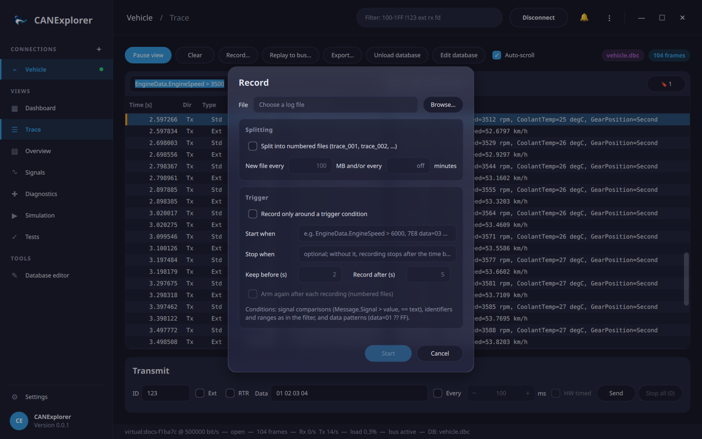
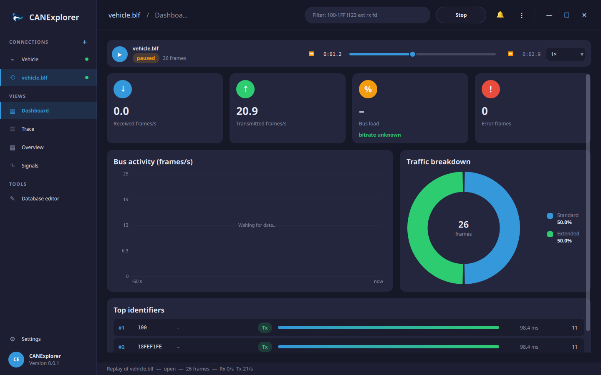
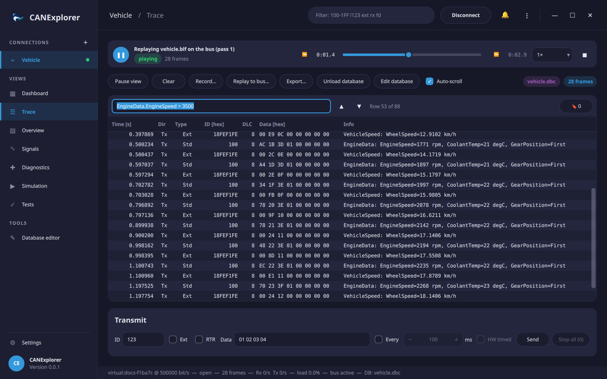

# Recording, replay and export

## Log file formats

CANExplorer reads and writes the log formats of python-can, chosen by the file extension. Every format can be
recorded and exported as well as replayed, also on a bus:

| Extension | Format |
|---|---|
| `.asc` | Vector ASCII |
| `.blf` | Vector binary logging format |
| `.csv` | Comma separated values |
| `.log` | can-utils `candump -l` |
| `.trc` | PEAK trace |
| `.db` | SQLite |
| `.mf4` | ASAM MDF 4 (with the optional `mf4` extra, see [File formats](../reference/file-formats.md#log-files)) |
| `.asc.gz`, `.csv.gz`, `.log.gz`, `.trc.gz` | The text formats, gzip compressed |

The file dialogs list each format; when no extension is typed, the one of the chosen format is added.

## Recording

**Record…** opens the recording dialog. A recording contains every frame of the connection from its start on,
independent of the display filter and of **Pause view**; a **● REC** pill in the toolbar and the status line show
it. **Stop recording**, disconnecting or closing the connection ends it.

### Splitting into several files

With **Split into numbered files**, a new file is started every given number of megabytes and/or minutes:
`trace.blf` becomes `trace_001.blf`, `trace_002.blf`, … The duration counts in frame time, so a replay is split
the same way as the live recording was. Long recordings stay in files of a manageable size.

### Triggered recording

**Record only around a trigger condition** records only what happens around an event:

| Option | Description |
|---|---|
| Start when | The trigger [condition](filters.md#conditions), e.g. `EngineData.EngineSpeed > 6000` or `7E8 data=03 7F` (a negative diagnostic response) |
| Stop when | Optional second condition that ends the recording |
| Keep before (s) | The frames of this time before the trigger are written too |
| Record after (s) | Recording continues this long after the stop condition, or after the trigger without one |
| Arm again | After each recording, wait for the next trigger and write the next numbered file |

While waiting, the toolbar shows **armed:** and the condition; trigger events appear in the status line. The
frames before the trigger are kept in memory only for the given time.

If writing fails, e.g. because the disk is full, the recording stops and an error is shown; the connection
keeps running.

## Replay

**⋮ → Replay Log File…** (++ctrl+o++) or the welcome page opens a recording as a new connection:

- **Protocol**: protocol decoder for the *Info* column.
- **Speed**: 1× plays the frames with their recorded timing; 0.25× to 10× slow it down or speed it up, and
  *As fast as possible* reads the file at once, e.g. to analyse a long recording.

The replay starts immediately. The playback bar above the views shows the file, its state, the position and
length of the recording and the number of frames, and controls the replay while it runs:

| Control | Action |
|---|---|
| ▶ / ❚❚ | Pause and resume the replay (unlike **Pause view**, no frames are read while paused); ▶ plays a finished replay again |
| Position slider | Drag to another point of the recording; the replay continues there when the slider is released |
| ⏪ / ⏩ | 10 seconds back or forward |
| Speed | Change the speed at any time |

Jumping forward passes the frames in between at once, so the trace, overview and statistics stay complete. Jumping
back clears the views and reads the recording again from its beginning up to the new position. **Replay from
here** in the context menu of a trace row jumps to that frame; jumping in a finished replay starts it again.

**Stop** in the top bar ends the replay and **Replay** starts it again. Replays can be filtered, plotted, decoded
with databases and exported like live connections, but nothing can be transmitted. **⋮ → Recent Log Files**
reopens recent replays with their settings.

## Replaying on the bus

**Replay to bus…** in the toolbar of a connected bus transmits the frames of a log file on that bus with their
recorded timing, e.g. to reproduce a situation for an ECU on the bench:

| Option | Description |
|---|---|
| File | Any of the log formats above |
| Speed | 0.25× to 10× the recorded timing, or as fast as possible |
| Frames | Empty for all frames, or a [display filter](filters.md) selecting them, e.g. `rx !7DF` sends only the frames received in the recording, except 7DF |
| Repeat until stopped | Start over at the end of the file |

Error frames are not sent. The transmitted frames appear as Tx frames in the trace, overview and statistics, and
can be recorded. A playback bar shows the progress (and the pass when repeating); pause, resume, change the
speed and jump within the recording there — the frames jumped over are not sent —, **■** stops and **✕** closes
the bar. Disconnecting stops the replay; if transmitting fails, it
stops with a notification.

## Export

**Export…** saves frames of the trace to a log file: the selected rows, or all rows currently displayed (which
honours the filter) when nothing is selected.
