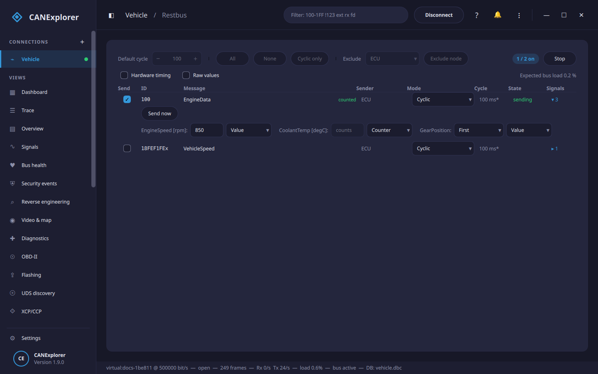

# Restbus simulation

**Restbus simulation** sends the messages of a signal database the way their nodes would, so an ECU on the bench
sees the rest of the bus it expects — the other nodes — even though they are not present. It is the counterpart of
the [diagnostics and ECU simulators](simulation.md): where those answer requests, this keeps the bus traffic alive.

It is a view of a connection that can transmit: open **Restbus** in the connection's view list in the sidebar.

## Using it

1. **Open a connection** that can transmit and load a signal database (DBC, ARXML, KCD, SYM or DBF) on it, as for
   [signal decoding](signal-databases.md). The **Restbus** view then lists the database's messages with their
   identifier, name, sending node, send mode, cycle time and state. (Load or change the database at any time — the
   view follows it, and keeps your choices for the messages the new database still has.)
2. Every message that has a cycle time (the DBC `GenMsgCycleTime`, or the ARXML cycle) is **enabled** by default;
   the others are listed but off. Tick or untick the **Send** box to choose what to transmit, or use **All**,
   **None** and **Cyclic only** — also while the simulation runs.
3. To simulate the rest of the bus around **the ECU you are testing**, pick that ECU next to **Exclude** and press
   **Exclude node**: every message that node sends is switched off, leaving the messages of the other nodes.
4. Press **Start**. Each enabled message is sent according to its [send mode](#send-modes). The frames appear in
   the connection's trace like any other transmitted frame. Press **Stop** to end.

The **State** column shows what each message is doing: *sending*, *on change* (waiting for a value to change),
*inactive* (an if-active message whose values are inactive), or *stopped* — it could not start or its transmission
ended, for example on a send error or a bus-off; hover it for the reason. A pill next to **Stop** counts the stopped
messages. **Expected bus load** estimates the share of the bus the enabled messages take, from the connection's
bitrate (without bit stuffing, which adds up to about 20 %); it turns orange above 50 % and red above 70 %.

## Send modes

Each message has a send mode, taken from the database and changeable in the **Mode** column:

| Mode | Sent |
|---|---|
| **Cyclic** | Every cycle time; messages without one at the **Default cycle** (100 ms unless you change it, marked `*`) |
| **On change** | When one of its values is edited, then repeated `GenMsgNrOfRepetition` times |
| **Cyclic + on change** | Both: every cycle time, and at once when a value changes |
| **If active** | Every `GenMsgCycleTimeFast` (else its cycle time) while the message is *active*, not at all while inactive |

The DBC `GenMsgSendType` attribute chooses the mode: `Cyclic` → cyclic; `Spontaneous`, `OnChange`, `OnWrite` and
their *with repetition / with delay* variants → on change; `CyclicAndSpontaneous` (and *with delay*) → cyclic + on
change; `IfActive`, `CyclicIfActive` → if active. A message marked `NoMsgSendType` (not sent by its node) is listed
off. Without a send type — and for ARXML, KCD, SYM and DBF databases — messages are cyclic.

The timing attributes are used where the database has them:

- `GenMsgStartDelayTime` delays a message's first frame after **Start**;
- repetitions of an on-change send are spaced by `GenMsgCycleTimeFast` (else `GenMsgDelayTime`, else 10 ms);
- `GenMsgDelayTime` is also kept as the minimum gap between on-change frames of a message.

An **if-active** message is active while one of its signals differs from its inactive value: the DBC
`GenSigInactiveValue` (its default when a signal has none); for a database that does not define that attribute, a
signal's default value. Changing a value starts or stops it. Counter and checksum signals do not count.

**Send now** (in an expanded message) sends a message at once with its repetitions, whatever its mode — as an
on-change message does when a value changes.

## Configuring the sent values

The payload of each message is encoded from its signals' initial values (or their minimum, or zero). Click a
message's **signal count** to expand it and edit those values; the change takes effect on the next frame, including
while the simulation runs.

- Signals with a **value table** offer its choices by name.
- **Raw values** switches all editors to raw (unscaled) numbers; hex (`0x1F`) is accepted.

Each signal can also be computed for every frame instead, in the box next to its value:

- **Counter** — counts up by one per frame and wraps after its maximum (the database's range when it gives one,
  e.g. 0…14 when 15 is reserved; else the whole bit range). Signals named like counters (`…Counter`, `…_Cnt`,
  `…_CTR`, `…_SQC`, `…Alive…`) are counters by default; set them back to **Value** to send a fixed value.
- **Checksum** — computed over the other bytes of the frame, in byte order, for every frame: CRC-8 SAE J1850
  (AUTOSAR), CRC-8H2F (AUTOSAR), CRC-8 (SMBus), CRC-8 Maxim, CRC-8 CDMA2000, the XOR or the sum of the bytes, or
  the inverted sum, each with its standard start value and final XOR. A **constant** is folded in (XORed into a
  CRC or XOR, added to a sum) for checksums that include a fixed value such as a data ID. Checksums are one whole
  byte: a byte-aligned 8-bit signal. OEM checksums vary; the [reverse-engineering](reverse-engineering.md)
  analysis finds which of these algorithms a recorded checksum byte uses.

A message whose frames change this way is marked *counted* in the table.

## Computed for every frame

Some messages are built afresh for every transmission without any setup:

- **Multiplexed messages** take turns through their multiplexer pages, one page per frame. Untick pages under
  **Multiplexer pages** to leave them out; with one page, that page is sent every time.
- **AUTOSAR E2E** protected PDUs of an ARXML (profiles 2, 5 and 22, from its `END-TO-END-PROTECTION-SET`) get a new
  E2E counter and CRC in every frame (marked *E2E P05* etc. in the table). A protection whose profile is not
  implemented, or whose configuration is incomplete, is sent unprotected; the badge turns orange and says why.
- AUTOSAR **SecOC** secured PDUs of an ARXML are secured, with a new freshness value and MAC in every frame and
  the key from the [security manager](security-manager.md#sending-secured-pdus) (marked *SecOC* in the list).
  Without a key they are not sent, and the list says why. A secured PDU that is also E2E protected is protected
  first, then secured.

The frames are built in this order: counters, the multiplexer page, the encoding, checksums, E2E, SecOC.

## Timing

The cyclic messages do not all start at once: their first frames are spread 1 ms apart (within each message's
period, after its start delay), so their frames do not all fall on the same instant and burst the bus every
period.

Frames are timed by CANExplorer. With **Hardware timing**, frames that never change are handed to the interface's
own periodic transmission instead, where the interface has one (less jitter; marked *HW*). Frames that change every
time — counters, checksums, E2E, SecOC, rotated multiplexer pages — are always timed by CANExplorer. Frames the
interface sends appear in the trace only when the interface reports its own transmissions.

**CAN FD**: messages the database defines as CAN FD frames (DBC `VFrameFormat` `StandardCAN_FD` /
`ExtendedCAN_FD`, or longer than 8 bytes) are sent as CAN FD frames, with bit rate switching per the DBC
`CANFD_BRS` attribute — or, without one, when the connection has a data bitrate (marked *FD·BRS*). The connection
must be opened for CAN FD.

## Workspaces

A [workspace](workspaces.md) saves the restbus setup of each connection — what differs from the database: the
enabled messages, send modes, values, counters and checksums, multiplexer pages, the default cycle and hardware
timing — and whether it was running. Opening the workspace restores it and starts the simulation again once the
connection is connected.

## Limits

- Only the top-level multiplexer of a message takes turns through its pages.
- The send modes follow the DBC attributes as described above; other interaction-layer behaviour of a vendor tool
  (e.g. signal-level send types) is not simulated.
- A container message whose default values do not form a valid layout is sent as all-zero bytes of the right
  length, so the identifier is still present on the bus.
- Network management (NM) messages are sent like any other message; there is no NM state machine.
- Transmission needs a connection that is connected and can send (not a replayed log file).
