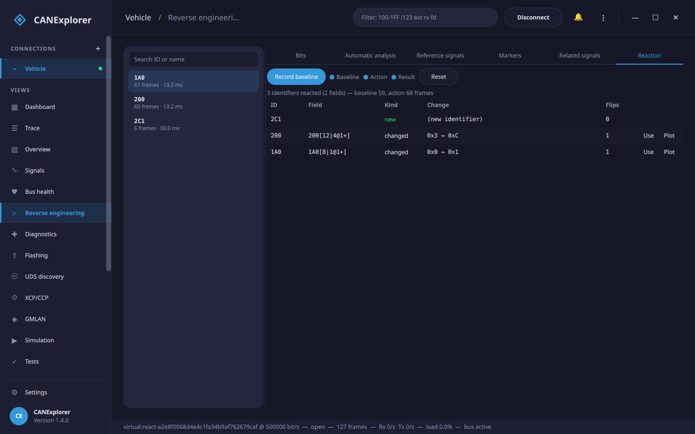

# Reverse engineering

The **Reverse engineering** view of a connection helps to find signals in traffic without a signal database:
which bits of an identifier change, how often and when, which bits change when you do something in the vehicle,
and what a group of bits looks like as a number over time. Fields you identify can be plotted right away and added
to a database.


For diagnostics instead of broadcast traffic, the [UDS discovery](uds-discovery.md) page finds the services and
data identifiers an ECU answers to.

Its tabs:

| Tab | Purpose |
|---|---|
| **Bits** | The bits and bytes of an identifier, the notch, and the bit field form |
| **Activity** | A raster of every bit of one identifier across the whole capture, to see its structure at a glance |
| **Automatic analysis** | Checksums, counters, multiplexers, values, states and flags of every identifier, found automatically |
| **Reference signals** | The fields following a known value: a database signal, a CSV file (e.g. GPS) or OBD-II values |
| **Markers** | The bits changing each time you mark that something happened |
| **Related signals** | Fields carrying the same signal on several messages, grouped |
| **Reaction** | Diff a baseline against an action to find what a control or an event changes on the bus |
| **Console** | An interactive Python console over the captured frames, with the reverse-engineering primitives |

The view works on live buses and on replayed log files. The bit statistics start when it is first opened,
including the frames already in the trace, and follow the bus from then on; **Clear** in the trace toolbar and
**Reset** start again. The other tabs work on the newest million frames of the trace when you start them.

## Identifiers

The list on the left shows every identifier with its frame count, cycle time and the message name when a database
describes it. Select one to see its bits and bytes.

## Bits

The bit grid shows the bits of the selected identifier as in a DBC file: one row per byte, bit 7 on the left.

- The number in a cell is the bit's value in the last frame.
- **Blue** cells change; the stronger the tint, the more often (on a logarithmic scale, so a bit changing in one
  frame in a thousand is still visible). Grey cells never changed.
- A cell flashes **orange** when the bit changes and fades out over a second.
- The tooltip gives the share of the frames with the bit set, the share of the frames in which it changed, and
  when it last changed.

Counters show up as a staircase: the lowest bit changes in every frame, the next one in every second frame and so
on. Physical values such as speeds look similar but slower and less regular, and flags change rarely.

## Temporal replay (scrubbing)

**Replay** in the Bits toolbar plays the selected identifier's captured frames back over time. A scrubber bar
appears: drag the slider to any moment, or press play to watch the frames stream by. While replaying, the bit grid,
the byte values and the bit field value show the payload **at that moment**, and bits that just changed light up and
fade — so you can watch the data flow and catch exactly when and how bits move.

- **Play / pause** runs the capture at its recorded pace; **Speed** scales it from 0.1× to 10×.
- **«** and **»** step one frame back or forward; the slider and the `frame N / M` readout show where you are.
- Scrub to the instant something happened and read off which bits and bytes changed into it.

Leave replay (toggle **Replay** off, or select another identifier) to return the grid to the live, latest frame.

## Activity map

The **Activity** tab shows a bit-transition raster of the selected identifier: every bit of its payload across the
whole capture at once, so its structure jumps out where the frame-at-a-time grid and replay cannot show it. Each
**row is a bit** (byte 0 at the top, the most significant bit of each byte first) and each **column is a frame**
over time; **Refresh** rebuilds it from the frames captured so far.

A cell is blue for a steady 1, dark for a steady 0, and orange where the bit changed. The patterns name themselves:

- a **counter** ramps as diagonal stripes, its low bits busier than its high bits;
- a **constant** byte is flat (dark or blue);
- a **physical value** drifts, its high bits slow and its low bits noisy;
- a **toggle** (a flag, a blinker) is a column of orange that comes and goes;
- a **multiplexer** switches whole regions of the payload on and off.

Read off which bytes carry something and what kind, then switch to **Bits** to define the field or **Automatic
analysis** to have it found.

## Timing graphs

Two buttons in the Bits toolbar plot the selected identifier on the [Signals](signal-plots.md) page, from the
frames in the trace so far on:

- **Plot Δt** graphs the **inter-frame interval** (the time between consecutive frames, in milliseconds) over
  time. A flat line is a cyclic message; steps and spikes reveal gateways, bursts and event-triggered messages
  (a frame sent only when something happens). The cursors, statistics (min/max/mean interval) and CSV export of
  the signal plots all apply.
- **Plot bytes** graphs **each payload byte** as a value over time, one chart per byte — a quick look at which
  bytes move and how, without defining a bit field first.

## Finding the bits of an action: the notch

1. Let the traffic run for a while without doing anything, so that the bits that change by themselves are
   counted.
2. Press **Notch**. Every bit that changed so far is hidden (dimmed).
3. Do the action, e.g. press a button, open a door or switch on the lights.
4. Bits that change now are outlined in orange. The identifiers with such bits show how many (e.g. **2 bits**),
   identifiers that appeared only after the notch are marked **new**, and **Only changed since the notch** shows
   just those.

Press **Notch again** to hide these bits as well (e.g. to separate two buttons), and **Clear notch** to show all
bits again.

!!! tip
    A slowly changing value can reach bits it did not use before the notch (e.g. the upper bits of the engine
    speed when you accelerate), and these bits stand out too. Keep the rest of the vehicle as steady as possible
    while doing the action, and repeat it a few times: the bits of the action change every time.

## Bytes

The table below the bit field gives for each byte its value in the last frame, how many distinct values it had,
its minimum and maximum, its entropy (0 bits: constant, 8 bits: every value equally often) and a histogram of its
values from 00 to FF.

## Bit fields

A bit field is a group of bits read as a number, like a signal in a database:

- Click a bit in the grid to start a field there, and Shift+click another bit to extend the field to it. Click a
  byte label to select the whole byte.
- **Byte order**: *Intel* (little endian) fields start at their least significant bit and continue upwards, so a
  16 bit value with its low byte first spans byte 0 and byte 1. *Motorola* (big endian) fields start at their
  most significant bit; a 16 bit value with its high byte first spans byte 0 bit 7 to byte 1 bit 0. Choose the
  byte order before selecting the bits.
- **Signed** reads the field as a two's complement number; **Factor** and **Offset** convert it to a physical
  value (`value = raw × factor + offset`), with a **Unit**.

The title shows the field in DBC notation, e.g. `1A0[16|8@1+]` (start bit, length, `1` Intel or `0` Motorola, `+`
unsigned or `-` signed), and the value in the last frame is shown below the form.

**Plot** shows the field on the [Signals](signal-plots.md) page, with its values in all frames of the trace so
far, next to database signals. A smooth curve means the field is right; a curve jumping between two ranges
usually means the byte order, the signedness or a boundary is wrong. Plotted fields are saved in
[workspaces](workspaces.md), and stay when a database is unloaded.

**Add to database** adds the field as a signal to the [database editor](database-editor.md), together with a
message for the identifier when the database has none (named `Message_1A0`), and opens the editor. Without a
database open in the editor, the connection's database is opened, or a new one started. Save the database and load
it into the connection to decode the signal everywhere.

## Automatic analysis

**Analyse all identifiers** (or only the selected one) looks at the frames of each identifier and lists the fields
it finds, with their kind and how sure it is:


| Kind | How it is recognised |
|---|---|
| **Checksum** | A byte that is a CRC-8 (SAE J1850 / AUTOSAR, 8H2F, SMBus, Maxim, CDMA2000), XOR or sum of the other bytes, with any start value, final XOR, data ID or added constant; also AUTOSAR E2E profile 2 style data IDs depending on a counter |
| **Counter** | Changes by the same step from frame to frame and runs through its whole range (alive counters) |
| **Multiplexer** | A byte or nibble taking a few values: grouping the frames by its value makes many other bits much calmer. The fields are then found per multiplexer value and shown with their condition, e.g. `if 600[0\|2@1+] = 1` |
| **Value** | Changes smoothly (physical values: speeds, temperatures, voltages); signed when that is smoother, i.e. when it crosses zero |
| **State** | A few values, rarely changing (gear, mode) |
| **Flag** | A single bit |
| **Constant** | Bits that never changed (shown with **Constant bits**) |
| **Unknown** | Changes irregularly: noise, or several fields that could not be told apart |

Field boundaries come from how often each bit changes: within a field, the less significant a bit, the more often
it changes, so a bit changing much less often than the one above it starts a new field. This is done in both Intel
and Motorola bit order, and fields next to each other are told apart by whether one part changes only when the
other wraps around (one field) or independently (two fields). As messages normally use one bit order, the bit
order giving the more plausible fields is kept.

!!! tip "Getting good results"
    The analysis can only find bits that change. Record while the values move through a good part of their range
    (drive, accelerate, steer, switch things on and off) for a minute or more. Bits that never change are reported
    as constant, so a value that never went negative is found as unsigned, and one that stayed below 256 as 8 bits.

**Use** shows a field in the **Bits** tab (for a multiplexed field with its condition, see below); **Plot** plots it
on the Signals page right away.

**Promote to database** turns the whole result into a draft database in one step: every found field except the
constant bits becomes a signal in the [database editor](database-editor.md), each message is created as needed, and
each field's kind, multiplexer condition and details are kept as the signal's comment. Where two interpretations
claim the same bits, the more confident one is used, so the signals never overlap. It is a starting point to
review — rename the signals, set units and scaling, drop what is noise — and then **Save as** a `.dbc` file.

## Reference signals

When you know a value from elsewhere, the field carrying it can be found by comparing:

- **Database signal**: a signal of the connection's database, e.g. to find the same value in another message or
  on another bus (its own message is left out).
- **CSV file**: a file with the time in seconds in the first column and values in the others, for example from a
  GPS logger or a data logger. Headers like `speed [km/h]` give the unit (the CSV export of the signal plots has
  this layout). Times below 10⁹ are taken as seconds from the first frame of the trace, larger ones as absolute
  timestamps.
- **OBD-II values** (live connections that can transmit): choose values such as the engine speed or vehicle
  speed, and **Start polling** while you record. The OBD-II service 01 requests go to the functional address
  `7DF` (`18DB33F1` with **29 bit identifiers**) one after the other, and the answers become references.


**Find matching fields** samples every field candidate (the fields of the automatic analysis, and every byte
aligned 8 and 16 bit field in both bit orders, unsigned and signed) at the times of the reference and ranks them by
their correlation with it. A straight line fit gives the **factor** and **offset** converting the field into the
reference's unit, and the **lag** is the delay between them (up to **Max. lag**) giving the best match.
Correlations near 1 (or −1) are good matches; when no field comes close the view says so: the value may not be on
this bus, or it was too steady while recording. **Use** fills the bit field form with the factor, offset, unit and
a name.

!!! warning "OBD-II requests"
    Polling sends diagnostic requests on the bus. Only poll on a vehicle you may send to, and stop when you are done.
    The requests and answers (`7DF`, `7E0`–`7EF`, `18DB33F1`, `18DAF1xx`) are left out of the analysis.

## Markers

Markers tell the view when something happened, so the bits changing at that moment can be found, also when they
are not the only bits changing:

1. Type a label, e.g. *door opened*, and press **Mark now** (or ++ctrl+m++) each time you do the action, e.g.
   five times opening the door. Several labels can be used, e.g. *door opened* and *door closed*.
2. **Find changing bits** (for all markers or those with one label) lists the fields whose bits changed within
   the window around most markers (**Seconds before** and **after** the marker, so a marker set a little late
   still counts) but rarely otherwise. **Markers hit** shows at how many markers, **Otherwise** how often the bits
   change elsewhere, and **Changes** the values before and after, e.g. `0 → 1`.


The time of a marker is that of the newest frame, so markers also work while replaying a log file at normal speed.

## Related signals

Vehicles often carry the same quantity on several messages — a gateway re-broadcasts wheel speed, engine speed or a
pedal position from one bus onto another, sometimes scaled or delayed. **Related signals** finds these without any
reference: every value and state field found by the automatic analysis is compared with all the other fields, and
those that follow one another are grouped.

**Find related signals** lists the groups. Each group's first field is the **reference** the others are compared
with; every other member shows its **Correlation** to it, the **Factor** and **Offset** converting its raw value to
the reference's, and the **Lag** (how far it trails the reference, e.g. a gateway re-broadcasting after 20 ms).
**Minimum correlation** sets how closely two fields must match to be grouped, and **Max lag** how far apart in time
a copy may be.

This labels unknowns cheaply: once one member of a group is identified (here, or against a database or GPS log in
**Reference signals**), the others are the same signal elsewhere. **Use** a member to load it into the bit field
form, or **Plot** it.


## Capture reaction

**Reaction** answers "I did X — what changed?" the safe way: it records the bus while steady, then while you perform
an action, and diffs the two. It never transmits — it only watches — so it is the right tool for finding which
message controls something (a relay, a light, a door) without sending unknown frames at the vehicle.

1. **Record baseline** — leave the bus steady (do nothing) for a few seconds.
2. **Start action** — now perform the action (press the button, open the door) once.
3. **Capture reaction** — the action window is diffed against the baseline.

The results list, most reactive first:

- **new** identifiers that appeared only during the action (an ECU started transmitting), and
- **changed** fields: runs of bits that were stable throughout the baseline but changed during the action, with
  their **Change** (value before → after) and how many times they flipped.

Fields that were already moving on their own during the baseline (counters, live sensors) are left out, so what
remains is what the action caused. **Use** a result to load it into the bit field form, or **Plot** it.

Having found the controlling message, confirm it by replaying that captured frame back onto the bus with
**Replay to bus…** or the transmit panel — replaying a real, observed message, not a guessed one.



## Scripting console

The **Console** tab is an interactive Python console over the frames captured so far — an ad-hoc frame processor
or field hunt with the same primitives the tools use, for when a point-and-click tool does not cut it. Type a
snippet in the syntax-highlighted editor and press **Ctrl+Enter** (or **Run**); the value of a trailing expression
is shown like a Python REPL, `print()` output is captured, and errors are reported instead of raised. Variables persist between
runs; **Clear** empties the transcript and forgets them. Type `HELP` for the available names.

In scope:

- `messages` — the captured frames (`can.Message`); `frames` — `collect(messages)`, keyed by `(id, extended)`;
  `analyses` and `fields` — the results of the **Automatic analysis** tab.
- Helpers `ids()` and `frames_of(id)` (the identifier as an int or a hex string).
- The `can_explorer.core.reverse` primitives: `collect`, `analyse`, `analyse_all`, `BitField`, `candidates`,
  `signal_groups`, `correlate` and `read_reference_csv`.

For example, `[(f.field.key, f.kind) for f in analyse(frames_of('100')).fields]` lists the fields found in `100`,
and `{hex(i): len(f.payloads) for (i, e), f in frames.items()}` counts the frames of each identifier. This is the
same scriptable surface the [MCP interface](mcp.md) exposes to an AI agent, at the keyboard.

!!! note
    The console runs Python in the application's own process — it is not a sandbox. It is for exploring your own
    capture, so do not paste scripts you do not trust.

## Multiplexed fields

A field found for one multiplexer value carries a condition: the bit field form shows *only if
600[0|2@1+] = 1*, and plotting it takes only the frames with that multiplexer value. Click the condition to use all
frames again. **Add to database** adds the field as a plain signal with the condition in its comment.

## Trying it without a vehicle

`tools/synthetic_traffic.py` writes a log file with traffic from a signal database, with smooth, constant,
counting, toggling or noisy signals, and steps at given times:

```bash
uv run python tools/synthetic_traffic.py examples/simulation/vehicle.dbc traffic.asc --duration 30 \
    --behaviour EngineData.GearPosition=step:10
```

Replay `traffic.asc` at normal speed, open **Reverse engineering**, select `100`, press **Notch** before 10 seconds
and watch bits 24 to 27 when the gear position changes. Then run the automatic analysis: it finds the engine speed,
coolant temperature and wheel speed fields, and the gear position as a state.

The tests use `tests/data/reverse.dbc` (a CRC, an alive counter, Intel and Motorola values, signed values, flags
and a multiplexer) with the same generator, and check that the analysis finds every field whose bits change.
