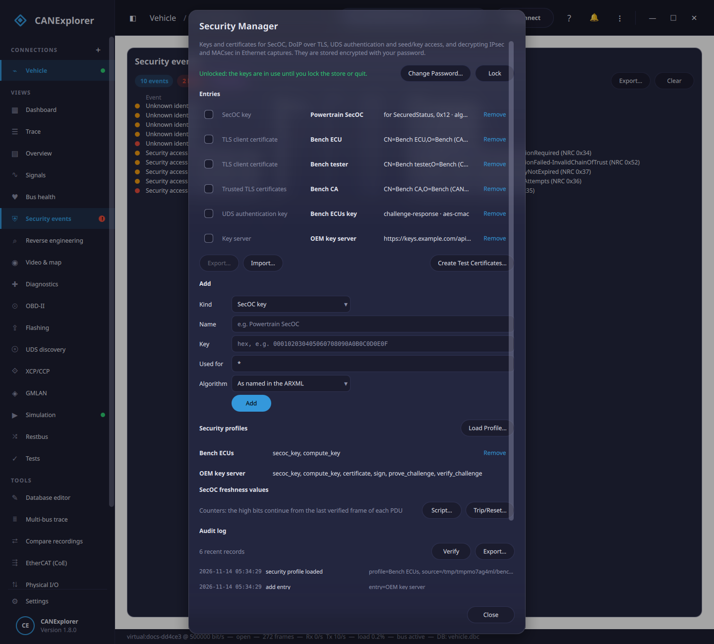
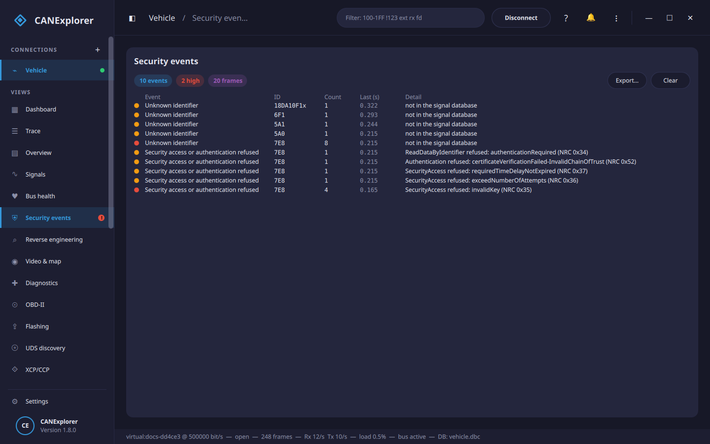

# Security manager

The **Security Manager** (menu → **Security Manager…**, or the command palette) keeps the keys and certificates
that the secured parts of a vehicle network need, in one password-protected key store:

| Entry | Used for |
|---|---|
| SecOC key | Checking AUTOSAR SecOC secured PDUs in the [trace](#secoc-in-the-trace), and [securing the ones sent](#sending-secured-pdus) |
| TLS client certificate | Presenting a client certificate to a [DoIP](doip.md) entity (mutual TLS), and UDS [Authentication](diagnostics.md#authentication-0x29) by certificate exchange |
| Trusted TLS certificates | Verifying a DoIP entity's certificate, and an ECU's certificate in bidirectional UDS Authentication |
| Revocation list | Refusing [revoked certificates](#revocation-lists) in DoIP TLS and UDS Authentication |
| IPsec ESP association | Decrypting IPsec ESP packets in an [Ethernet capture](ethernet.md) |
| MACsec association | Decrypting MACsec (IEEE 802.1AE) frames in an Ethernet capture |
| Seed/key algorithm | UDS [security access](#seedkey-algorithms) in the Diagnostics, Flashing and GMLAN views |
| UDS authentication key | UDS [Authentication by challenge-response](diagnostics.md#challenge-response) with a key shared with the ECUs |
| Key server | A [remote provider](#key-servers) of SecOC keys, seed/key, certificates and signatures |

Keys and algorithms can also come from [security profiles](#security-profiles-and-key-servers): manufacturer plug-ins
and key servers, so the secrets need not be on this computer.



Certificates that expired or expire within 30 days are announced in the notifications (🔔) when CANExplorer starts
and when they are added.

## The key store

The first time, choose a password and **Create Key Store**. After that, **Unlock** it with the password when you
need the keys; they stay in use until you **Lock** it or quit. The list of entries (names, what they are for,
SPIs, certificate subjects and expiry dates) is shown even while the store is locked; the keys themselves are not
readable without the password, and never appear in logs, the system report or the [MCP interface](mcp.md).

The store is one file per user, `keystore.json` in the application's settings folder (`~/.config/CANExplorer` on
Linux, `%APPDATA%\CANExplorer` on Windows, `~/Library/Application Support/CANExplorer` on macOS); the dialog shows
its path. The `CANEXPLORER_KEYSTORE` environment variable chooses another file, and for headless runs
(`can-test`, scripts) `CANEXPLORER_KEYSTORE_PASSWORD` unlocks it at start.

How it is protected: a key is derived from the password with scrypt, and each entry's secrets are encrypted with
AES-256-GCM under it. Each entry's name, purpose and settings are bound into its encryption, so an entry edited in
the file (e.g. a SecOC key widened to all PDUs) no longer decrypts. The file is readable by its owner only.
Forgotten passwords cannot be recovered: delete the file and create a new store.

**Change Password…** re-encrypts every entry under a new password.

**Remember** (next to **Unlock**) keeps the password in the operating system's keychain — Windows Credential
Manager, the macOS Keychain or the Secret Service of the Linux desktop — so the key store unlocks when CANExplorer
starts. **Forget Password** removes it from the keychain again; a kept password that no longer unlocks the store
(changed elsewhere) is forgotten. The option is missing where no keychain is available. Anyone who can use your
login can then use the keys, as with any password the keychain keeps.

### Moving entries to another computer

Tick entries in the list and **Export…** them to a *key bundle* (`.ckb`): a file encrypted with a passphrase of its
own (scrypt and AES-256-GCM, like the store), to give a colleague or another bench. **Import…** adds the entries of
a bundle, keeping existing entries with the same name unless **Replace existing** is ticked. The bundle holds the
keys themselves, so keep the passphrase apart from the file.

### Revocation lists

A *revocation list* entry (a CRL, PEM or DER) names certificates their issuer has withdrawn. CANExplorer applies it
when its issuer is one of the trusted certificates in use and its signature verifies: a DoIP entity whose
certificate it lists is refused (TLS checks the entity's own certificate against the lists of its issuer), and so is
an ECU certificate in bidirectional [UDS Authentication](diagnostics.md#authentication-0x29). Revocation lists are
public: they are readable while the store is locked. Keep them current — a list past its *next update* date still
applies, but no longer knows about recent revocations.

### Test certificates

**Create Test Certificates…** makes a small PKI for benches and simulators: a certificate authority, and a tester
and an ECU certificate signed by it (EC P-256 or P-384, Ed25519, or RSA; valid for the days you choose; the ECU
certificate names the addresses you give, for TLS host name checks). They are added as *<name> CA* (trusted
certificates), *<name> tester* and *<name> ECU* (certificates with their private keys), ready for
[DoIP over TLS](#tls-for-doip) and [UDS Authentication](diagnostics.md#authentication-0x29); the CA's key is not kept.
`can_explorer.core.test_pki.create_test_pki` does the same in scripts, and can write the certificates and keys as
PEM files (for a DoIP entity or another tool). These certificates are for testing, not for vehicles.

## SecOC in the trace

When a connection's database is an ARXML system description with **secured PDUs** (`SECURED-I-PDU`), the trace
checks every received frame of those PDUs with the key store's keys and adds the result to its description:

```text
[SecOC ok, FV 1042]
[SecOC MAC ERROR, FV 1043]
[SecOC FRESHNESS ERROR, FV 1040 not newer than 1042]
[SecOC: not checked (no key for SecuredStatus (Data ID 0x12) in the key store)]
```

The toolbar of the connection shows *SecOC: n of m checked*, and *n failed* in red once frames failed
verification; its tooltip lists each secured PDU with its Data ID, the key it uses (or why it is not checked) and
the counts of frames verified, MAC errors, freshness errors and frames sent secured since the connection started.
Clicking it opens the Security Manager. The [MCP interface](mcp.md) reports the same with `secoc_status`.

What is read from the ARXML: the Data ID, the length of the authentic payload, the lengths of the full and the
transmitted freshness value and of the transmitted MAC, and the names of the algorithms. The trailer is read bit by
bit, so truncated lengths that are not whole bytes work.

**Keys.** A SecOC key is used *for* `*` (every secured PDU) or for PDU names and Data IDs separated by commas,
e.g. `EngineData, 0x12`. A key named for the PDU wins over one for its Data ID, which wins over `*`.

**Algorithm.** AUTOSAR leaves the algorithm to the manufacturer; the ARXML only names it. Names containing
*CMAC* are checked as CMAC with AES (NIST SP 800-38B, the AES-128 key size being the usual one) and names
containing *HMAC* and *SHA256* as HMAC-SHA-256. For any other name, choose the algorithm on the key; a PDU whose
algorithm is neither recognised nor chosen is shown as *not checked*, never checked with a guess.

**Freshness values.** By default the freshness value is treated as a counter per Data ID. When only its low bits
are sent, the high bits are taken from the last verified frame of the PDU, incremented when the low bits wrapped.
Until a frame of a PDU has verified, its high bits are unknown and assumed to be zero, so a failure is shown as
*freshness not synchronised yet*; a counter that starts at zero verifies from the first frame. A frame whose full
freshness value is not newer than the last verified one is a *FRESHNESS ERROR* (a replay). Each connection keeps
its own freshness state, which starts over when the connection is opened (or a log replayed) again and when the
database is loaded again.

**Trip/Reset…** uses the freshness value of the AUTOSAR SecOC specification built from several counters (SWS
SecureOnboardCommunication R23-11, Annex A, §11.4, "multiple freshness counters, truncated freshness value"): a
**trip counter** and a **reset counter** kept by an FV management master and sent in a synchronisation message
(*TripResetSyncMsg*: trip counter | reset counter | authenticator), and a **message counter** per secured PDU. The
freshness value is trip counter | reset counter | message counter | reset flag (the low bits of the reset counter);
a secured PDU sends the low bits of the message counter and the reset flag. Enter the bit lengths of the counters
and the name of the database's secured PDU carrying the synchronisation message. Verified synchronisation messages
update the trip and reset counters (an older one is a *FRESHNESS ERROR*; around the trip counter's wrap, values
within the *clear acceptance window* are accepted); the frames of the other secured PDUs are verified with the
freshness values the specification constructs from them, each candidate in turn (its table 9: the received reset
flag matched to the latest reset counter ± 0, 1 or 2), and secured with its table 8 when sent. This scheme is an
application hint of the specification, not a mandatory part of AUTOSAR: check that your network uses it. One
synchronisation message for all secured PDUs (a single FV management master) is supported.

Other manufacturer schemes (time-based values, other counter layouts) are proprietary, so give them as a Python
file with **Script…**:

```python
def freshness(pdu: str, data_id: int, truncated: int, tx_bits: int, full_bits: int) -> int:
    """The full freshness value of a received frame, from the bits it carries."""
    return (current_trip_counter() << tx_bits) | truncated


def accepted(pdu: str, data_id: int, value: int) -> None:  # Optional: a frame with this value verified
    ...


def next_value(pdu: str, data_id: int, full_bits: int) -> int:  # Optional: to send secured PDUs
    ...


def reset() -> None:  # Optional: the connection started again
    ...
```

The file is executed: load only files you trust. **Counters** goes back to the built-in counter.

## Sending secured PDUs

Secured PDUs sent by CANExplorer get a new freshness value and MAC in every frame, with the key store's key:

- **Transmit**: frames with the identifier of a secured PDU are secured when **SecOC** is ticked (it shows when the
  database has secured PDUs). Type the authentic payload; the trailer is computed. Untick it to send the data
  exactly as typed. Periodic sending secures each frame afresh, so it needs software timing (not *HW timed*).
- **Restbus simulation**: secured PDUs are marked *SecOC* and secured in every period; without a key they are not
  sent, and the mark says why. Their freshness and authenticator pseudo-signals are not offered for editing.
- **Test scripts**: `t.send('SecuredStatus', AliveCounter=3)` secures a secured PDU sent by name; frames given as an
  identifier and bytes are sent as given unless `secure=True`.

The freshness values sent continue from the highest one sent or verified on the connection (or come from the
freshness script's `next_value`).

## Testing SecOC

[Test scripts](test-automation.md) check that an ECU's secured frames verify, and that it rejects frames it must
not accept:

```python
class SecOcTests(TestModule):
    @testcase
    async def frames_verify(self, t):
        await t.expect_secoc_ok('SecuredStatus')  # The next frame verifies (MAC and freshness)
        t.check(t.secoc_status('SecuredStatus')['mac_errors'] == 0, 'no MAC errors so far')

    @testcase
    async def rejects_replays(self, t):
        t.send('BrakeRequest', Pressure=10)  # A genuine secured frame first
        await t.expect_signal('BrakeStatus.Pressure', 10)
        t.send_secoc_attack('BrakeRequest', 'replay', Pressure=10)
        await t.expect_no_message('BrakeStatus', 0.5)  # How the ECU shows a rejection is up to it
```

`send_secoc_attack` sends a manipulated frame of a secured PDU:

| Attack | The frame |
|---|---|
| `replay` | The last secured frame sent, again, unchanged |
| `stale_freshness` | A valid MAC over a freshness value that was used already |
| `wrong_mac` | A fresh freshness value with the last bit of the MAC flipped |
| `payload_bitflip` | A correctly secured frame with one payload bit flipped afterwards |

`replay` and `stale_freshness` need a secured frame of the PDU sent first. What counts as a rejection (no reaction,
an error response, a DTC, an intrusion detection report) depends on the ECU, so the test checks it. Run these
tests only on ECUs and benches you are authorised to test.

### Securing PDUs in scripts

`can_explorer.core.secoc_check` builds secured PDUs for scripts and simulations:

```python
from can_explorer.core.decoding import DbcDecoder
from can_explorer.core.secoc_check import SecOcVerifier, StaticSecOcKeys, secoc_config_of

database = DbcDecoder('system.arxml').database
config = secoc_config_of(database.get_message_by_name('SecuredStatus'))
verifier = SecOcVerifier(StaticSecOcKeys({'*': (bytes.fromhex('000102030405060708090A0B0C0D0E0F'), '')}))
data = verifier.secure(config, payload=b'\x05\x00')  # Payload, truncated freshness and truncated MAC
```

`KeyStoreSecOcKeys(KeyStore())` takes the keys from the (unlocked) key store instead.

## TLS for DoIP

With **TLS** ticked in the [DoIP](doip.md) tool, two lists appear:

- **Not verified** / trusted certificates: verify the entity's certificate chain against a *Trusted TLS
  certificates* entry (one or more PEM certificates, e.g. the OEM's or the test lab's CA). The entity's host name
  is not checked: DoIP entities are reached by IP address and their certificates rarely name it. Without trusted
  certificates the connection is encrypted but the entity is not verified.
- **No client certificate** / a client certificate: present a *TLS client certificate* entry when the entity asks
  for one (mutual TLS). Add it with its PEM certificate (optionally followed by its chain) and its PEM private key;
  an encrypted key file needs its password once, when it is added. Using it needs the store unlocked.

The top bar shows *TLS, entity verified* when the entity's certificate was verified. TLS 1.2 or newer is used.

To decrypt a DoIP TLS session in a capture (e.g. in Wireshark), set the `SSLKEYLOGFILE` environment variable
before starting CANExplorer: the session secrets are appended to that file in the NSS key log format. Anyone with
the file can read those sessions.

## TLS in Ethernet captures

**TLS key log…** in the [Ethernet capture](ethernet.md) tool decrypts TLS sessions of the capture — DoIP over TLS
on port 3496, or any other — with a key log in the `SSLKEYLOGFILE` format (`CLIENT_RANDOM` lines for TLS 1.2, the
`*_TRAFFIC_SECRET` lines for TLS 1.3), as CANExplorer writes for its own DoIP sessions, and as browsers, curl and
other OpenSSL/NSS programs write. Packets that complete records show what they carried, e.g.
`[TLS decrypted] diagnostic message`, and the details pane lists the records with a preview of the plaintext.
Without a key log, TLS packets are shown as *TLS* with their record type.

Supported: TLS 1.2 and 1.3 with AES-GCM or ChaCha20-Poly1305 (the AEAD suites, which TLS 1.3 requires and DoIP
uses), and TLS 1.3 key updates. The capture must include the session's handshake (its ClientHello and ServerHello).
A session the key log has no secrets for, or that uses another suite, is reported, not guessed.

## Seed/key algorithms

UDS security access needs the manufacturer's seed/key algorithm (see [Diagnostics](diagnostics.md#security-access)).
Add the Python file defining `compute_key(level, seed)` as a *Seed/key algorithm*: it is checked to compile and to
define `compute_key`, then kept encrypted in the key store (the algorithm and its constants are secrets). In the
Diagnostics and GMLAN views, **From Security Manager** chooses it instead of a file; the store must be unlocked when
it is used. The same button lists the security profiles that compute keys (`profile:<name>`). Scripts can load
either with `can_explorer.core.uds.load_key_source('keystore:<name>')` or `load_key_source('profile:<name>')`.

## Security profiles and key servers

A **security profile** supplies manufacturer-specific security from outside the key store: SecOC keys or complete
authenticators, freshness values, seed/key, and the certificates and signatures of UDS Authentication. It may hold
the secrets itself (a plug-in delivered by the manufacturer), or fetch or compute them elsewhere — a key server or a
hardware security module — so they never reach this computer. The **Security profiles** section of the Security
Manager lists the loaded profiles with what each can do.

Where they are used:

- **SecOC**: the profiles are asked for a PDU's key before the key store; the first one with an answer is used. A
  profile computing the authenticator itself verifies and secures frames without giving out the key.
- **Freshness values**: a profile's freshness value manager replaces the counters (or the trip/reset counters).
- **Seed/key**: **From Security Manager** in the Diagnostics and GMLAN views (and so flashing).
- **UDS Authentication**: a profile with a certificate appears in the **Certificate** list, signing the proof of
  ownership itself; profiles that prove challenges, or sign, appear in the **Key** list of
  [challenge-response](diagnostics.md#challenge-response).

Using a profile's keys and signatures is recorded in the [audit log](#audit-log).

### Writing a profile

**Load Profile…** loads a Python file defining `profile` (an object) or `create_profile()` (returning one). It is
loaded again at the next start, until **Remove**. The object has a `name`, optionally a `description`, and any of
these methods; the ones it lacks are not offered:

```python
class Profile:
    name = 'OEM bench'
    description = 'Keys of the bench ECUs'

    def secoc_key(self, pdu: str, data_id: int | None):
        """(key, algorithm) for a secured PDU: algorithm 'cmac-aes', 'hmac-sha256' or '' for the ARXML's; or None."""
        return (bytes.fromhex('000102030405060708090A0B0C0D0E0F'), '') if pdu == 'SecuredStatus' else None

    def secoc_authenticator(self, pdu: str, data_id: int | None, data: bytes) -> bytes | None:
        """The full MAC over the data to authenticate (instead of secoc_key: the key stays here)."""

    def freshness(self):
        """A freshness value manager, as in core/secoc_check.py (e.g. TripResetFreshness), or None."""

    def compute_key(self, level: int, seed: bytes) -> bytes | None:
        """UDS security access."""

    def certificate(self):
        """The tester certificate for UDS Authentication (a cryptography x509.Certificate)."""

    def sign(self, data: bytes, scheme: str) -> bytes:
        """The proof of ownership: the signature over the ECU's challenge, e.g. scheme 'ecdsa-sha256'."""

    def prove_challenge(self, challenge: bytes, algorithm_indicator: bytes) -> bytes | None:
        """The proof for authentication by challenge-response (None: sign the challenge instead)."""

    def verify_challenge(self, challenge: bytes, proof: bytes, algorithm_indicator: bytes) -> bool | None:
        """Whether the ECU's proof over our challenge verifies (bidirectional challenge-response)."""


profile = Profile()
```

A method answering `None` has no answer for that request, and the next source is tried. Errors are raised as
`can_explorer.core.security_profiles.SecurityProfileError` and shown as the reason. Installed packages can register
a profile factory in the entry point group `can_explorer.security_profiles`; those load at start and are not removed
from the dialog.

!!! warning
    Loading a profile executes its code with your permissions. Only load profiles you trust.

### Key servers

A **Key server** entry (in **Add**) connects to a server over HTTPS: its **URL**, the bearer **token** it expects
(kept encrypted with the other secrets) and, optionally, *trusted certificates* its HTTPS certificate is checked
against (otherwise the system's certificates are used). While the key store is unlocked, each key server is a
security profile of the same name. Seed/key, certificates, signatures and challenge-response proofs are computed by
the server at each use, so the private keys and algorithms stay with it. SecOC keys cannot wait for a server on
every frame: they are fetched once, when first needed, and kept in memory only (never written to disk) until the
store is locked or the keys change.

The server answers this REST API (JSON bodies, bytes as hex); it implements the endpoints it supports and answers
404 for the others:

| Request | Body | Answer |
|---|---|---|
| `GET /secoc/keys` | | `{"keys": [{"scope": "*", "key": "<hex>", "algorithm": ""}]}`, scopes as for [SecOC keys](#secoc-in-the-trace) |
| `POST /uds/key` | `{"level": 1, "seed": "<hex>"}` | `{"key": "<hex>"}` |
| `GET /auth/certificate` | | `{"certificate": "<PEM>"}` |
| `POST /auth/sign` | `{"data": "<hex>", "scheme": "ecdsa-sha256"}` | `{"signature": "<hex>"}` |
| `POST /auth/prove` | `{"challenge": "<hex>", "algorithm_indicator": "<hex>"}` | `{"proof": "<hex>"}` |
| `POST /auth/verify` | `{"challenge": "<hex>", "proof": "<hex>", "algorithm_indicator": "<hex>"}` | `{"valid": true}` |

Each request carries `Authorization: Bearer <token>` when a token is set. A server without `/auth/prove` makes
challenge-response proofs with `/auth/sign`. Use `https://`; `http://` is accepted for local test servers only.
`can_explorer.core.security_profiles.KeyServerProfile(name, url, token)` is the same client for scripts.

### A minimal key server

The standard library is enough for a key server on a bench; it answers SecOC keys and seed/key, and 404 for the
other endpoints. Put it behind HTTPS (a reverse proxy, or `ssl.SSLContext.wrap_socket` on its socket) before the
token crosses a network:

```python
"""A minimal key server for a bench: SecOC keys and seed/key, behind a bearer token (standard library only)."""

import json
import os
from http.server import BaseHTTPRequestHandler, ThreadingHTTPServer

TOKEN = os.environ['KEY_SERVER_TOKEN']
SECOC_KEYS = [{'scope': '*', 'key': '000102030405060708090A0B0C0D0E0F', 'algorithm': 'cmac-aes'}]


def compute_key(level: int, seed: bytes) -> bytes:
    return bytes(b ^ 0xFF for b in seed)  # Your algorithm stays on the server


class KeyServer(BaseHTTPRequestHandler):
    def answer(self, code: int, body=None):
        data = json.dumps(body or {}).encode()
        self.send_response(code)
        self.send_header('Content-Type', 'application/json')
        self.send_header('Content-Length', str(len(data)))
        self.end_headers()
        self.wfile.write(data)

    def authorised(self) -> bool:
        if self.headers.get('Authorization') == f'Bearer {TOKEN}':
            return True
        self.answer(401)
        return False

    def do_GET(self):
        if not self.authorised():
            return
        if self.path == '/secoc/keys':
            return self.answer(200, {'keys': SECOC_KEYS})
        self.answer(404)  # Endpoints a server does not offer

    def do_POST(self):
        if not self.authorised():
            return
        body = json.loads(self.rfile.read(int(self.headers['Content-Length'])))
        if self.path == '/uds/key':
            key = compute_key(body['level'], bytes.fromhex(body['seed']))
            return self.answer(200, {'key': key.hex()})
        self.answer(404)


ThreadingHTTPServer(('127.0.0.1', 8443), KeyServer).serve_forever()
```

Add it in the Security Manager as a key server with the URL `http://127.0.0.1:8443` (on this computer) and the
token, and choose it with **From Security Manager** for security access.

## Security events

The **Security events** page of a connection collects what suggests an attack or a misbehaving node, as frames
arrive:



| Event | When |
|---|---|
| SecOC verification failed | A secured PDU's MAC or freshness value does not verify |
| E2E check failed | The CRC of an E2E-protected signal PDU of an ARXML does not match |
| Unknown identifier | A frame the signal database does not define (only with a database) |
| Frames faster than their cycle time | A database message arrives in less than half its cycle time after the previous one — typically injected frames competing with the real sender |
| Security access or authentication refused | A (single-frame) negative response refusing security access or authentication: securityAccessDenied, invalidKey, exceedNumberOfAttempts, requiredTimeDelayNotExpired, authenticationRequired, or an Authentication NRC — repeated ones suggest someone trying keys or certificates |

Events of the same kind and identifier are counted together, with the time of the first and the last; an event
repeating 3 times within a second becomes *high* severity. Frames CANExplorer sends itself are not counted.
**Export…** writes the events as CSV or JSON, e.g. as evidence for a cybersecurity test report. This is a monitor
for benches and analysis, not an intrusion detection system: it records, it does not react.

E2E and SecOC are also checked for the PDUs inside container frames (ARXML container I-PDUs); the event names the
container's identifier and the contained PDU.

The [Ethernet capture](ethernet.md) tool has its own **Security events** (in its toolbar), from the packets of the
capture:

| Event | When |
|---|---|
| E2E check failed | A SOME/IP message with an [E2E protection](someip.md#end-to-end-protection-e2e) fails its check |
| IPsec or MACsec integrity check failed | A protected packet the key store has an association for does not verify (a wrong key, or a changed packet) |
| TLS record failed to decrypt | A record of a session the key log has secrets for does not decrypt |
| DoIP routing activation refused | A DoIP entity refuses a tester's routing activation |
| Security access or authentication refused | A UDS response over DoIP refusing security access or authentication |
| SOME/IP service not offered | A SOME/IP message of a service Service Discovery never offered (only once SD was seen) |

## Audit log

The security manager keeps an audit log of what it was used for: creating, unlocking and locking the key store,
entries added, removed, exported and imported, keys used to secure or check SecOC frames, TLS client certificates,
seed/key algorithms and authentication certificates used, security profiles loaded and the keys, seed/key and
signatures they supplied (a profile's SecOC key once per PDU), UDS authentications, security access tests, SecOC attack
frames sent, and revocation lists applied. The Security Manager shows the latest records; **Verify** checks the
log, **Export…** copies it (JSON lines).

Each record is chained to the one before with an HMAC-SHA-256 under a key kept encrypted in the key store, so a
record that was changed, removed or moved shows when the log is verified (with the store unlocked). Records written
while the store is locked — a failed unlock, for instance — cannot be signed; they are chained with SHA-256 only and
counted as *unsigned*. The log shows that its recorded history was not altered; it cannot prove that nothing was cut
off its end, nor that nothing happened that was not recorded. It is stored next to the key store
(`keystore-audit.jsonl`).

## IPsec and MACsec in Ethernet captures

With IPsec or MACsec associations in an unlocked key store, the [Ethernet capture](ethernet.md) tool decrypts the
protected packets it has keys for and decodes what they carried (SOME/IP, DoIP, …): the packet list shows the
inner packet with a note such as `[ESP SPI 0x00001000 (Lab ESP) decrypted]`, and the details pane adds a
**Decrypted** branch dissecting it. A packet that cannot be decrypted says why (no association for its SPI, an
integrity check that failed — usually a wrong key). The toolbar shows how many associations are in use; unlocking
the store decrypts an already opened capture again.

**IPsec ESP** associations are selected by SPI. Supported:

| Encryption | Key | Integrity |
|---|---|---|
| `aes-gcm` (RFC 4106, 16-byte ICV) | 16, 24 or 32 bytes followed by the 4-byte salt | none (built in) |
| `aes-cbc` (RFC 3602) | 16, 24 or 32 bytes | `hmac-sha256-128` (RFC 4868) or `hmac-sha1-96` (RFC 2404) |
| `null` (RFC 2410) | none | `hmac-sha256-128` or `hmac-sha1-96` |

Tunnel mode (an inner IPv4 or IPv6 packet) and transport mode both work. On Linux, `ip xfrm state` shows the
SPIs and keys of the associations of a test setup (`aead rfc4106(gcm(aes)) 0x<key and salt> 128` for AES-GCM).

**MACsec** associations take the SAK (16 bytes for GCM-AES-128, 32 for GCM-AES-256) and optionally the SCI (the
sender's MAC address and port, 16 hex digits) to use it for one secure channel only. Encrypted and integrity-only
frames are both handled. A frame without an SCI from an end station uses the sender's address and port 1; other
frames without an SCI need an association with the SCI entered.

Nothing here sets up IPsec or MACsec connections: IKE and MKA, which negotiate these keys, are the job of the
operating system or the network equipment. The keys are entered by hand. The capture does show the **MKA** (MACsec
Key Agreement, EAPOL) frames that negotiate them — the key server, the secure channel (SCI), the message number and
the parameter sets such as *Distributed SAK* — but the keys they distribute are wrapped and stay unreadable.

## Limitations

- SecOC: the authentication and freshness algorithms are manufacturer-specific; CMAC/AES and HMAC-SHA-256 are
  built in, and freshness schemes other than a counter need a script. Secured PDUs inside container frames are
  checked but not secured when sent, and hardware-timed periodic sending cannot secure frames.
- TLS: the entity's host name is not checked; the DoIP tool's simulated entity does not use TLS. Captured TLS: no
  CBC suites, early data (0-RTT), renegotiation or sessions whose handshake was not captured.
- IPsec: extended sequence numbers (ESN), ESP after IPv6 extension headers, AH, and algorithms other than those
  listed are not supported; AES-GCM expects a 16-byte ICV.
- MACsec: the extended packet number (XPN) cipher suites and a VLAN tag in front of the SecTAG are not supported.
- One key store per user; it is not part of a [workspace](workspaces.md) (move entries with key bundles).
- Security profiles: one profile answers a request (the first able to); there is no built-in PKCS#11 module support
  (wrap one in a profile). Key servers are reached synchronously, with a 5-second timeout.
- Trip/reset freshness: the multi-master method (several synchronisation messages) and the scheme with a complete
  (not truncated) freshness value (Annex A §11.5) are not built in; use a freshness script.
