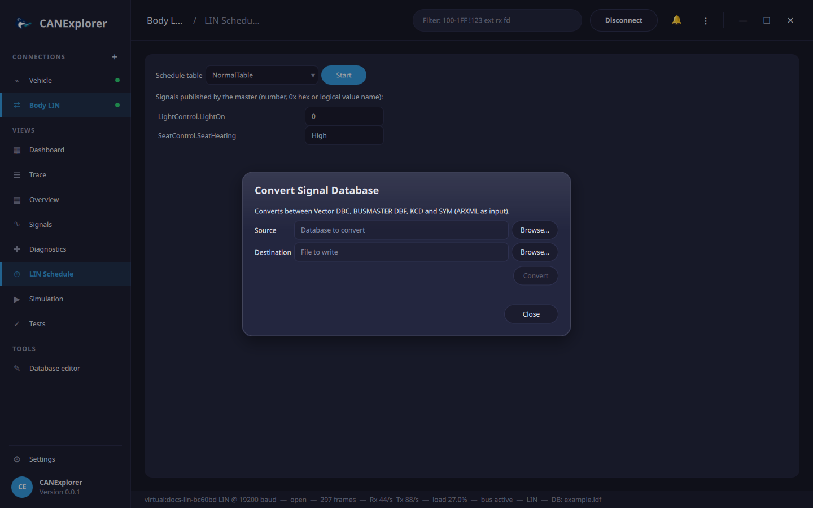

# Signal databases

A signal database names the messages and signals of a bus. With a database loaded, the *Info* column shows the
decoded signals, signals can be [plotted](signal-plots.md), and [simulation scripts](simulation.md) can send and
receive by name.

## Supported formats

| Extension | Format | Load | Convert to |
|---|---|:---:|:---:|
| `.dbc` | Vector CANdb++ DBC | ✓ | ✓ |
| `.dbf` | BUSMASTER database | ✓ | ✓ |
| `.arxml` | AUTOSAR system description (3.x and 4.x) | ✓ | |
| `.kcd` | Kayak KCD | ✓ | ✓ |
| `.sym` | PEAK PCAN Symbol | ✓ | ✓ |
| `.ldf` | LIN description file | ✓ | |
| `.cdd` | Vector CANdelaStudio diagnostic description | ✓ ([Diagnostics](diagnostics.md#diagnostic-descriptions-cdd)) | |

DBC, ARXML, KCD and SYM are read with [cantools](https://cantools.readthedocs.io/), DBF and CDD with readers of
CANExplorer, LDF with [ldfparser](https://pypi.org/project/ldfparser/).

## Loading a database

**Load database…** in the toolbar loads a database for the current connection; **Unload database** removes it.
Each connection has its own database. A `.cdd` file loaded this way becomes the diagnostic description of the
connection and leaves the signal database unchanged.

The *Info* column then shows, for example:

```text
EngineData: EngineSpeed=3200 rpm, CoolantTemp=60 degC, GearPosition=Second
```

Value tables are shown with their texts (`GearPosition=Second`), multiplexed messages with the signals of the
active multiplexer value.

## Databases with several buses

ARXML system descriptions and KCD files may describe several buses (clusters) that reuse the same identifiers. A
connection decodes with the messages of one bus:

- When exactly one bus has the bitrate of the connection, that bus is selected when the database is loaded.
- Otherwise, or to change it, pick the bus in the selector next to **Unload database**. *All buses* uses the first
  definition of each identifier.

## ARXML container frames

Container I-PDUs (several PDUs with headers in one, usually CAN FD, frame) are decoded into their contained PDUs:

```text
Bundle [EnginePdu: EngineSpeed=500 rpm, GearPosition=First; StatusPdu: AliveCounter=7]
```

The signals of contained PDUs are listed and plotted under the PDU name, e.g. `StatusPdu.AliveCounter`.

## Editing databases

The [database editor](database-editor.md) changes the messages, signals and nodes of DBC, DBF, KCD and SYM files
(and of ARXML files, saved in one of those formats). **Edit database** in the toolbar opens the database of the
connection; saving it updates the decoding.

## Converting databases

**⋮ → Convert Signal Database…** (also on the welcome page) converts between the formats with ✓ in the table above. Choose the source
and the destination file; the format follows the extension.



The summary lists what the target format cannot hold, for example:

- several buses merged into one, with identifiers that clash,
- container frames written without their contained PDUs,
- cycle times and attributes that BUSMASTER DBF does not store.

The same is available on the command line, including converting a single bus; see
[can-db-convert](../reference/command-line.md#can-db-convert).
