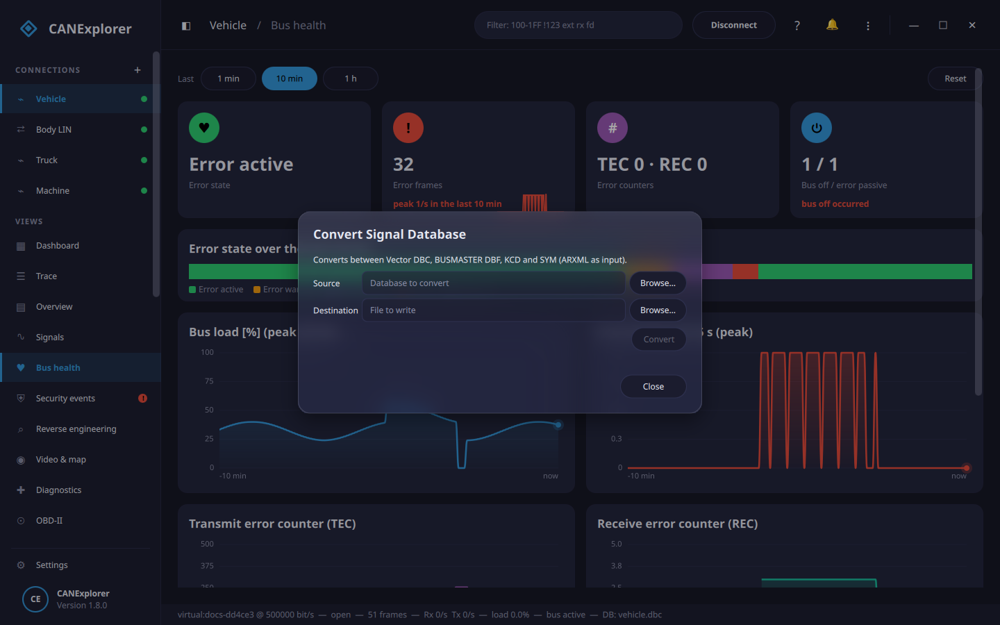

# Signal databases

A signal database names the messages and signals of a bus. With a database loaded, the *Info* column shows the
decoded signals, signals can be [plotted](signal-plots.md), and [simulation scripts](simulation.md) can send and
receive by name.

## Supported formats

| Extension | Format | Load | Convert to |
|---|---|:---:|:---:|
| `.dbc` | Vector CANdb++ DBC | ✓ | ✓ |
| `.dbf` | BUSMASTER database | ✓ | ✓ |
| `.arxml` | AUTOSAR system description (3.x and 4.x) | ✓ | |
| `.kcd` | Kayak KCD | ✓ | ✓ |
| `.sym` | PEAK PCAN Symbol | ✓ | ✓ |
| `.ldf` | LIN description file | ✓ | |
| `.cdd` | Vector CANdelaStudio diagnostic description | ✓ ([Diagnostics](diagnostics.md#diagnostic-descriptions-cdd-odxpdx)) | |
| `.odx`, `.odx-d`, `.pdx` | ASAM ODX / packaged ODX diagnostic description | ✓ ([Diagnostics](diagnostics.md#diagnostic-descriptions-cdd-odxpdx)) | |

DBC, ARXML, KCD and SYM are read with [cantools](https://cantools.readthedocs.io/), DBF, CDD and ODX/PDX with
readers of CANExplorer, LDF with [ldfparser](https://pypi.org/project/ldfparser/).

## Loading a database

**Load database…** in the toolbar loads a database for the current connection; **Unload database** removes it.
Each connection has its own database. A `.cdd`, `.odx`, `.odx-d` or `.pdx` file loaded this way becomes the diagnostic description of
the connection and leaves the signal database unchanged.

The *Info* column then shows, for example:

```text
EngineData: EngineSpeed=3200 rpm, CoolantTemp=60 degC, GearPosition=Second
```

Value tables are shown with their texts (`GearPosition=Second`), multiplexed messages with the signals of the
active multiplexer value.

## Databases with several buses

ARXML system descriptions and KCD files may describe several buses (clusters) that reuse the same identifiers. A
connection decodes with the messages of one bus:

- When exactly one bus has the bitrate of the connection, that bus is selected when the database is loaded.
- Otherwise, or to change it, pick the bus in the selector next to **Unload database**. *All buses* uses the first
  definition of each identifier.

## ARXML container frames

Container I-PDUs (several PDUs with headers in one, usually CAN FD, frame) are decoded into their contained PDUs:

```text
Bundle [EnginePdu: EngineSpeed=500 rpm, GearPosition=First; StatusPdu: AliveCounter=7]
```

The signals of contained PDUs are listed and plotted under the PDU name, e.g. `StatusPdu.AliveCounter`.

## ARXML end-to-end protection (E2E)

When an ARXML system description protects PDUs with AUTOSAR **E2E** (an `END-TO-END-PROTECTION-SET`), the trace
checks the CRC of every received frame of those PDUs and adds the result to its description:

```text
EngineData: EngineSpeed=833 rpm, GearPosition=7 [E2E P05 ok, counter 7]
EngineData: EngineSpeed=833.25 rpm, GearPosition=7 [E2E P05 CRC ERROR 0x0D05, expected 0x0D04, counter 7]
```

**Profiles 2, 5 and 22** are checked (with the AUTOSAR CRC routines, verified against the worked examples of the
AUTOSAR E2E Protocol Specification). The toolbar shows *E2E: n of m checked*; its tooltip lists each protected
message. A protection is shown as *not checked*, with the reason, when its profile is not implemented (e.g.
profiles 1, 4, 7 and 11), when the profile cannot be told from its `CATEGORY` (CANExplorer does not guess it from
the number of Data IDs: 16 fit both profiles 2 and 22), or when its Data IDs do not fit the profile.

Each frame is checked on its own: the counter is shown, but gaps in the counter sequence (lost or repeated frames)
are not tracked, and the PDUs inside container frames are not checked.

## ARXML secured PDUs (SecOC)

Secured PDUs (`SECURED-I-PDU`, AUTOSAR SecOC) of an ARXML are checked in the trace too — their MAC and freshness
value, with keys from the [security manager](security-manager.md#secoc-in-the-trace). The toolbar shows *SecOC: n
of m checked*.

## Editing databases

The [database editor](database-editor.md) changes the messages, signals and nodes of DBC, DBF, KCD and SYM files
(and of ARXML files, saved in one of those formats). **Edit database** in the toolbar opens the database of the
connection; saving it updates the decoding.

## Converting databases

**⋮ → Convert Signal Database…** (also on the welcome page) converts between the formats with ✓ in the table above. Choose the source
and the destination file; the format follows the extension.



The summary lists what the target format cannot hold, for example:

- several buses merged into one, with identifiers that clash,
- container frames written without their contained PDUs,
- cycle times and attributes that BUSMASTER DBF does not store.

The same is available on the command line, including converting a single bus; see
[can-db-convert](../reference/command-line.md#can-db-convert).

## Databases in scripts

`DbcDecoder` loads any of the formats above and decodes frames as the trace does; its `database` is a
[cantools](https://cantools.readthedocs.io/) database, which encodes them:

```python
import can

from can_explorer.core.database_io import convert_database
from can_explorer.core.decoding import DbcDecoder

database = DbcDecoder('vehicle.dbc')  # Also .dbf, .arxml, .kcd and .sym
engine = database.database.get_message_by_name('EngineData')  # A cantools message
data = engine.encode({'EngineSpeed': 2400, 'CoolantTemp': 90, 'GearPosition': 'Second'})
msg = can.Message(arbitration_id=engine.frame_id, data=data, is_extended_id=False)
print(database.describe(msg))  # As in the Info column of the trace
print(database.decode(msg))

report = convert_database('vehicle.dbc', 'vehicle.kcd')  # As can-db-convert does
print(report.messages, report.signals, report.warnings)  # 2 4 []
```

```text
EngineData: EngineSpeed=2400 rpm, CoolantTemp=90 degC, GearPosition=Second
{'EngineSpeed': 2400.0, 'CoolantTemp': 90, 'GearPosition': 'Second'}
```

Simulation and test scripts get the connection's database without loading it: see
[simulation](simulation.md) and [test automation](test-automation.md).
