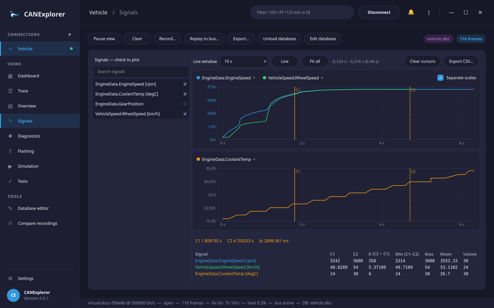

# Signal plots

The **Signals** view plots database signals over time, with cursors, statistics and export. Bit fields from the
[Reverse engineering](reverse-engineering.md) view are plotted here too, also without a database.



1. [Load a signal database](signal-databases.md).
2. Tick the signals to plot in the list on the left; the search field filters the list.

Only frames carrying a ticked signal are decoded for plotting, so plotting does not slow down the rest of the
traffic. Each signal keeps its most recent 200 000 to 400 000 values. Signals with value tables are plotted with
their numeric values.

## Charts

Each ticked signal starts in a chart of its own. The legend above a chart lists its signals; the menu of a signal
moves it into another chart, into a chart of its own, or stops plotting it. Signals in one chart share a value
scale, unless **Separate scales** is ticked: then each is scaled to its own range, and the axis shows the first
signal's values. Charts with signals of different units start with separate scales.

## Time axis

All charts share one time axis, in seconds since the start of the session:

| Action | |
|---|---|
| **Live window** | Follow the newest values, showing the last 5 to 300 seconds |
| Mouse wheel | Zoom in or out around the mouse pointer |
| Drag | Move the visible range |
| **Fit all** | Show everything recorded for the plotted signals |
| **Live**, or a double click | Follow the newest values again |

Zooming or moving stops following the newest values; the range above the charts shows what is visible.
**Pause view** freezes the plots as well.

## Cursors

A click on a chart sets cursor **C1**, a click with ++shift++ or a right click sets **C2**; both are shown in all
charts. The table below the charts lists for each plotted signal:

| Column | |
|---|---|
| C1, C2 | The value at the cursor: of the last frame at or before it, as signals keep their value between frames |
| Δ | C2 − C1 |
| Min, Max, Mean, Values | Statistics of the values between the cursors, or of the visible range without two cursors |

The time of both cursors and their distance are shown above the table. **Clear cursors** removes them.

## Export

**Export CSV…** writes the plotted signals to a CSV file: the visible range when zoomed or moved, everything
otherwise. Each row is a time at which a signal changed, in seconds since the start of the session, with one
column per signal (named with its unit); signals keep their last value in the rows of the other signals' frames.

```text
time_s,EngineData.EngineSpeed [rpm],VehicleSpeed.WheelSpeed [km/h]
0.000000,824,
0.000412,824,0
0.100107,989,0
```
