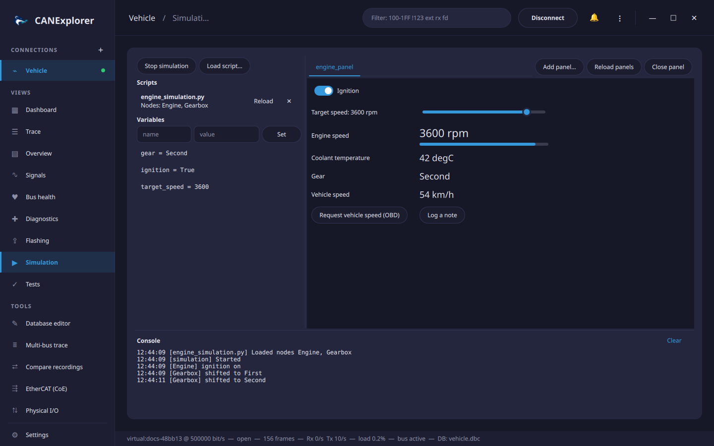

# Simulation and scripting

CANExplorer simulates bus nodes with Python scripts and controls them with QML panels, similar to CANoe's CAPL
nodes and panels. Everything runs in the **Simulation** view of a live connection.



!!! warning "Scripts and panels are code"
    They run with the permissions of CANExplorer. Only load files you trust.

## Running a simulation

1. Connect (e.g. on a *VirtualBus* channel to work without hardware).
2. Optionally [load a signal database](signal-databases.md) (DBC, DBF, ARXML, KCD, SYM or LDF) to send and receive
   messages by name. Loading or changing the database while the simulation runs restarts it, so that the nodes
   start with the new messages.
3. **Load script…** one or more Python files. The list shows the nodes of each script, or the error if it could not
   be loaded; **Reload** reads a script again after editing it, **✕** removes it.
4. **Start simulation**: the nodes start and react to the bus until **Stop simulation** or disconnecting.
5. **Add panel…** QML panels to control and watch the simulation. **Reload panels** reloads them after editing,
   **Close panel** removes the current one.

The **Variables** list shows the shared variables; click one to edit it, or enter a name and value and press
**Set** (numbers, `0x` hex, `true`/`false` or text). The **Console** shows the messages of the nodes and panels and
the errors of scripts, with the line where they occurred. A failing handler does not stop the simulation.

`examples/simulation` contains a complete example: `vehicle.dbc`, the nodes in `engine_simulation.py` and the panel
`engine_panel.qml` (see the [quick start](../getting-started/quick-start.md)).

## Writing nodes

A script defines one or more subclasses of `Node`; each class becomes one simulated node. Handlers are methods
marked with decorators:

```python
from can_explorer.scripting import Node, on_message, on_signal, on_start, on_stop, on_variable


class Engine(Node):
    @on_start
    def start(self):
        self.status = self.message('EngineData')  # Signal values of a database message
        self.every(0.1, self.send_status)         # Timer, stopped with the simulation

    def send_status(self):
        self.status.EngineSpeed = self.variables.get('target_speed', 800)
        self.send(self.status)

    @on_message('EngineControl', 0x7DF)          # Database names and/or identifiers
    def received(self, msg):
        self.log(msg.name, msg.signals)

    @on_signal('VehicleSpeed', 'WheelSpeed')      # When a decoded value changes
    def speed(self, value, msg):
        self.variables['speed'] = value

    @on_variable('ignition')                      # When a shared variable changes
    def ignition(self, on):
        self.log('ignition', on)

    @on_stop
    def stop(self):
        self.log('stopped')
```

| Decorator | Called with | When |
|---|---|---|
| `@on_start` | – | The simulation starts, or the script is loaded while it runs |
| `@on_stop` | – | The simulation stops |
| `@on_message(*selectors)` | `ReceivedMessage` | A frame with one of the identifiers (`int`) or database names (`str`) is on the bus; without selectors, every frame |
| `@on_signal(message, signal)` | `value, ReceivedMessage` | A signal is first received or its value changes |
| `@on_variable(name)` | `value` | A shared variable changes |

Nodes receive the frames of the other nodes and of the bus, but not their own. Sending:

```python
self.send(self.status)                       # A MessageBuffer from self.message(name)
self.send('EngineData', EngineSpeed=1000)    # By name; other signals keep their initial value
self.send(0x123, b'\x01\x02')                # Raw data; extended identifiers above 0x7FF
self.send(0x18FEF100, [1, 2], extended=True, fd=True)
self.send(0x10, remote=True)                 # Remote frame (a header on LIN)
```

The complete Python API is in the [scripting API reference](../reference/scripting-api.md).

## Several buses

Nodes can receive and send on the other connections too (`bus='Body'`), and `Gateway` forwards frames between two
buses; see [Several buses](multi-bus.md#gateways-and-nodes-on-several-buses).

## Writing panels

A panel is a QML file whose root object declares `property var panel`. Through it, the panel shows live signal and
variable values, changes variables (which the nodes react to with `@on_variable`), sends frames and logs:

```qml
import QtQuick 2.15
import QtQuick.Controls 2.15

Column {
    property var panel
    readonly property var speed: panel.signal("EngineData.EngineSpeed")

    Label { text: speed.text }                               // e.g. "1000 rpm"
    ProgressBar { from: 0; to: 4000; value: speed.number }
    Switch {
        checked: panel.variable("ignition").value === true
        onToggled: panel.set_variable("ignition", checked)
    }
    Button { text: "Request"; onClicked: panel.send("EngineControl", { TargetSpeed: 2000 }) }
}
```

Panels can use all QtQuick modules; errors in a panel are shown in the console. The complete API is in the
[QML panel API reference](../reference/panel-api.md).

## Timing

Timers and handlers run on the application's event loop. Periodic timers do not drift, but their precision is about
a millisecond and depends on the load of the application; for hardware accurate cycles use the
[HW timed](transmitting.md#application-and-hardware-timing) periodic transmission.

## Packaged builds

In the standalone bundles, scripts can import CANExplorer, python-can, cantools and the standard library modules
the application itself uses. For scripts that need other packages, run CANExplorer from source (`uv run canexplorer`).
