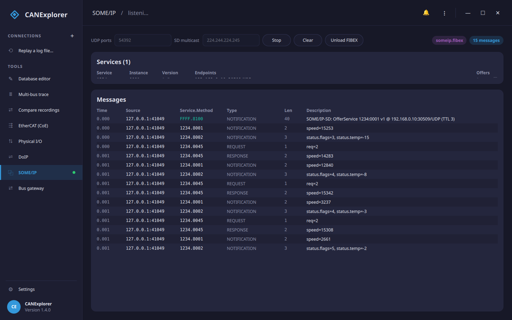

# SOME/IP

**SOME/IP** (Scalable service-Oriented MiddlewarE over IP) is the service-oriented middleware of automotive
Ethernet. The **SOME/IP** tool listens on UDP, discovers the services offered on the network through SOME/IP-SD
(Service Discovery) and shows the decoded messages.

## Listening

Enter the **UDP ports** to listen on (comma separated; `30490` is the usual Service Discovery port) and the
**SD multicast** group to join (the ASAM default is `224.244.224.245`; leave it empty to listen on unicast only),
then **Listen**. **Stop** closes the sockets and **Clear** empties the tables.

!!! note "What a socket sees"
    A plain UDP socket receives the multicast groups it joins and the traffic addressed to this host. To capture
    *all* SOME/IP on the wire — unicast between other ECUs — the computer needs to sit on a network tap or a
    switch mirror port; passive packet capture is not done by the tool itself.

## Services

Every service announced with **OfferService** in Service Discovery is listed with its **Service** and **Instance**
IDs, its **Version** (major.minor), the **Endpoints** it offers (address, port and transport), and how many offers
have been seen. A service whose offer expires (TTL 0, **StopOfferService**) is removed.

## Messages

Each SOME/IP message is shown with the time (relative to the first message), the **Source** (sender address and
port), the **Service.Method** ID, the message **Type**, the payload length and a decoded **Description**:

- **REQUEST**, **REQUEST_NO_RETURN**, **RESPONSE**, **ERROR** (with the return code) and **NOTIFICATION** (events,
  whose method id has the top bit set), and their segmented `_TP` variants.
- **SOME/IP-SD** messages (service `FFFF`, method `8100`) are expanded into their entries: OfferService,
  FindService, SubscribeEventgroup and the acknowledgements, with the service, version, endpoints and TTL.

## Decoding payloads (FIBEX)

Load a **FIBEX** file (**FIBEX…**) describing the SOME/IP service interfaces to decode the message payloads into
named signals: the **Description** column then shows the decoded values (for example `speed=4000` or
`status.flags=3, status.temp=-15`) instead of the payload length. A method's request and response are decoded with
their own parameters.

A subset of FIBEX 4 is read: service interfaces with their methods (input and return parameters) and events, and
the data types they use — scalars, fixed and dynamic arrays, length-prefixed and fixed strings, and nested
structures. Unions, optional (TLV) members and bit fields are not read; a message whose type uses one keeps its
generic description. ARXML SOME/IP service interfaces are a different format and are not read here.

SOME/IP over TCP is not decoded yet; the tool reads UDP.
