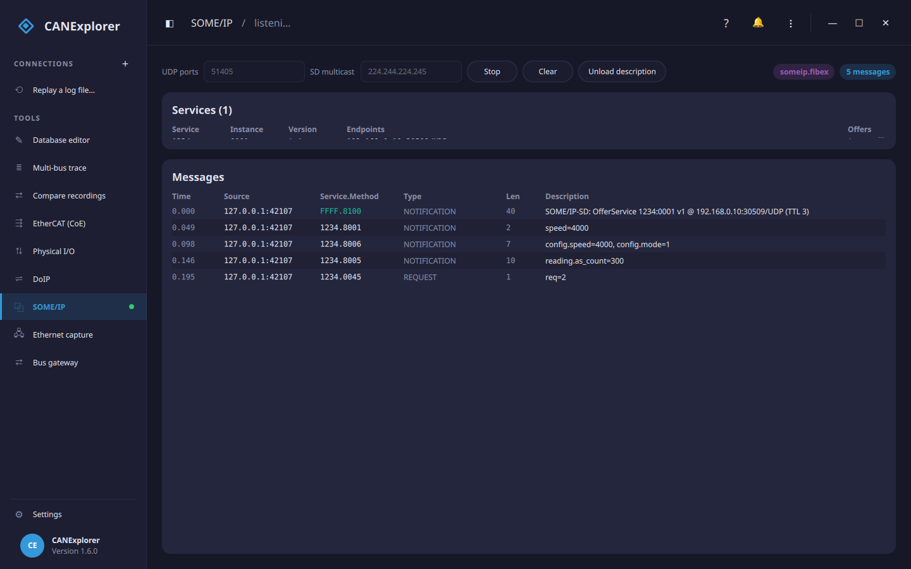

# SOME/IP

**SOME/IP** (Scalable service-Oriented MiddlewarE over IP) is the service-oriented middleware of automotive
Ethernet. The **SOME/IP** tool listens on UDP, discovers the services offered on the network through SOME/IP-SD
(Service Discovery) and shows the decoded messages.

## Listening

Enter the **UDP ports** to listen on (comma separated; `30490` is the usual Service Discovery port) and the
**SD multicast** group to join (the ASAM default is `224.244.224.245`; leave it empty to listen on unicast only),
then **Listen**. **Stop** closes the sockets and **Clear** empties the tables.

!!! note "What a socket sees"
    A plain UDP socket receives the multicast groups it joins and the traffic addressed to this host. To capture
    *all* SOME/IP on the wire — unicast between other ECUs — the computer needs to sit on a network tap or a
    switch mirror port; passive packet capture is not done by the tool itself.

## Services

Every service announced with **OfferService** in Service Discovery is listed with its **Service** and **Instance**
IDs, its **Version** (major.minor), the **Endpoints** it offers (address, port and transport), and how many offers
have been seen. A service whose offer expires (TTL 0, **StopOfferService**) is removed.

## Messages

Each SOME/IP message is shown with the time (relative to the first message), the **Source** (sender address and
port), the **Service.Method** ID, the message **Type**, the payload length and a decoded **Description**:

- **REQUEST**, **REQUEST_NO_RETURN**, **RESPONSE**, **ERROR** (with the return code) and **NOTIFICATION** (events,
  whose method id has the top bit set), and their segmented `_TP` variants.
- **SOME/IP-SD** messages (service `FFFF`, method `8100`) are expanded into their entries: OfferService,
  FindService, SubscribeEventgroup and the acknowledgements, with the service, version, endpoints and TTL.

## Decoding payloads (FIBEX / ARXML)

Load a **FIBEX** or AUTOSAR **ARXML** file (**FIBEX / ARXML…**) describing the SOME/IP service interfaces to decode
the message payloads into named signals: the **Description** column then shows the decoded values (for example
`speed=4000` or `status.flags=3, status.temp=-15`) instead of the payload length. A method's request and response
are decoded with their own parameters. The format is chosen by the file extension (`.arxml` for ARXML, otherwise
FIBEX).

A subset of each is read: service interfaces with their methods (input and return parameters) and events, and the
data types they use — scalars, fixed and dynamic arrays, length-prefixed and fixed strings, and nested structures.
From ARXML the SOME/IP service/method/event ids come from the `SOMEIP-SERVICE-INTERFACE-DEPLOYMENT` elements, which
reference the service interfaces. Unions, optional (TLV) members and bit fields are not read; a message whose type
uses one keeps its generic description.

The live SOME/IP tool reads UDP. SOME/IP carried over **TCP** (reassembled across segments) and **SOME/IP-TP**
segmented messages are decoded when you open a capture in the [Ethernet capture](ethernet.md) tool.

## End-to-end protection (E2E)

AUTOSAR **E2E** protection (the CRC and sequence counter that guard a PDU against corruption, loss, repetition and
reordering) is available as a library for scripts — `can_explorer.core.e2e` provides the AUTOSAR CRC routines
(`crc8`, `crc8h2f`, `crc16`, `crc32`, `crc32p4`) and E2E **Profile 2** protect/check. Validating a live PDU needs
its E2E configuration (profile, Data IDs, offset) from the ARXML, which the UI does not read yet.
