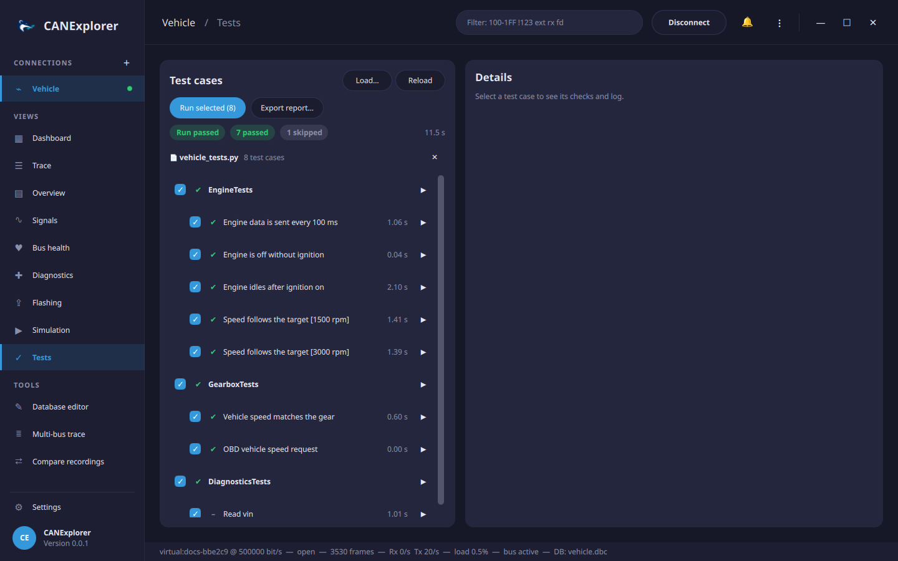

# Test automation

Test scripts check the behaviour of ECUs on the bus automatically: they send frames and signals, wait for the
responses, check values and cycle times, run diagnostic requests and give each test case a verdict. They run in the
**Tests** view of a connection, or headless with [`can-test`](#running-on-the-command-line) on a build server.



## Test scripts

A test script is a Python file with `TestModule` classes. Their methods marked with `@testcase` are the test
cases; they run in the order they are defined and get the test context `t`:

```python
from can_explorer.testing import TestModule, testcase


class EngineTests(TestModule):
    """Engine control unit: cyclic status and speed control."""

    async def setup(self, t):                      # Before the first test case of the module
        t.variables['ignition'] = False

    @testcase
    async def engine_data_is_sent_every_100_ms(self, t):
        await t.expect_cycle_time('EngineData', 100, tolerance=0.1)

    @testcase(title='Speed follows the target', timeout=10)
    async def speed(self, t):
        t.variables['ignition'] = True
        t.variables['target_speed'] = 3000
        rpm = await t.expect_signal('EngineData.EngineSpeed', lambda rpm: rpm > 2900, timeout=4)
        t.log('reached', rpm, 'rpm')
        await t.expect_signal('EngineData.GearPosition', 'Second')   # Value table texts work too


class GearboxTests(TestModule):
    @testcase
    async def obd_vehicle_speed(self, t):
        t.send(0x7DF, [0x02, 0x01, 0x0D, 0, 0, 0, 0, 0])
        response = await t.expect_message(0x7E8, timeout=0.5)
        t.require(response is not None, 'response received')       # Ends the test case when it fails
        t.check_equal(response.data[1:3], bytes([0x41, 0x0D]), 'positive response')
```

The complete example, [`examples/testing/vehicle_tests.py`](https://github.com/AKJ7/CANExplorer/blob/develop/examples/testing/vehicle_tests.py),
tests the engine and gearbox of the [simulation example](simulation.md).

### What the test context offers

| Area | Methods |
|---|---|
| Checks | `check(condition, text)`, `check_equal(actual, expected, text, tolerance=0)`, `check_range(value, minimum, maximum, text)`; `require(...)` and `fail(text)` end the test case, `skip(reason)` skips it |
| Sending | `send('Message', Signal=value)`, `send(buffer)` with `message('Message')`, `send(0x123, data)` |
| Frames | `wait_for_message(selector, timeout, condition)`, `expect_message(...)`, `expect_no_message(selector, duration)`, `collect(selector, duration)` |
| Signals | `wait_for_signal('Message.Signal', expected, timeout)`, `expect_signal(...)` — `expected` is a value, a value table text or a function |
| Timing | `measure_cycle_time(selector, duration)`, `expect_cycle_time(selector, expected_ms, tolerance, duration)`, `sleep(seconds)`, `elapsed` |
| Diagnostics | `t.uds`: a UDS client on the module's `uds_request_id` and `uds_response_id` |
| Simulation | `t.variables`: the shared variables of the connection's simulation |
| Log | `log(*values)` |

A *selector* is a frame identifier (`0x7E8`), a database message name (`'EngineData'`), a function of the received
message, or `None` for any frame. See the [test API reference](../reference/test-api.md) for all parameters.

### Verdicts

| Verdict | When |
|---|---|
| passed | The test case ended and all its checks passed |
| failed | A check failed (the test case continues after `check`, ends after `require` or `fail`) |
| error | The test case raised an exception or exceeded its timeout (30 s unless set with `@testcase(timeout=…)`), or the setup of its module failed |
| skipped | The test case called `t.skip(reason)` |

A failing `teardown` turns the last test case of the module into an error. Skipped test cases do not fail a run.

### Waiting for frames

Waits see the frames that arrive after they start. Responses can arrive while the test is still sending (simulated
nodes answer immediately), so the first wait after `t.send` also sees the frames that arrived since the send.
Frames the test sent itself are never seen.

## Parameters and requirements

`params` runs a test case once per parameter set; each run is a test case of its own, named after its parameters
(or `ids`), with its own verdict:

```python
@testcase(params=[800, 2000, 4000])
async def engine_reaches(self, t, speed): ...           # engine_reaches[800], engine_reaches[2000], ...

@testcase(params=[{'target': 1500, 'gear': 'First'}, {'target': 3000, 'gear': 'Second'}], ids=['low', 'high'])
async def gear_for_speed(self, t, target, gear): ...    # gear_for_speed[low], gear_for_speed[high]
```

A dict is passed as keyword arguments, a tuple as positional arguments, anything else as one argument after `t`.

`requirements` names the requirements a test case verifies, for traceability; `requirements` of a `TestModule`
applies to all its test cases:

```python
class EngineTests(TestModule):
    requirements = 'REQ-ENG-001'

    @testcase(requirements=['REQ-ENG-002', 'REQ-GBX-001'])
    async def speed_follows_the_target(self, t): ...
```

The HTML report has a *Requirements* table with the verdict of every requirement (failed when any of its test cases
failed or had an error), JUnit XML lists them as `requirement` properties of the test cases, the Tests view shows
them with the test case, and `can-test -r REQ-ENG-002` runs only the test cases of a requirement.

## Running in the application

The **Tests** view is available for connections that can transmit.

1. **Load…** a test script (several can be loaded); **Reload** reads them again after editing.
2. Select the test cases to run with the check boxes and press **Run selected**, or run one test case or module
   with its **▶** button (or a double click). **Stop** ends the run.
3. The list shows the verdict and duration of each test case. Selecting one shows its log: checks (✔/✘), frames
   sent (→), log lines and errors.
4. **Export report…** saves the results as an HTML report or as JUnit XML.

Tests use the connection's signal database, and `t.variables` are the variables of its simulation, so tests can
drive simulated nodes as well as real ECUs. Disconnecting stops a run.

## Running on the command line

`can-test` runs test scripts without the user interface, e.g. on a build server, and returns 0 when all test cases
passed:

```bash
uv run can-test examples/testing/vehicle_tests.py \
    --database examples/simulation/vehicle.dbc \
    --simulation examples/simulation/engine_simulation.py \
    --report report.html --junit results.xml
```

```text
PASS  EngineTests.engine_data_is_sent_every_100_ms (1.00 s)
PASS  EngineTests.engine_is_off_without_ignition (0.10 s)
PASS  EngineTests.engine_idles_after_ignition_on (2.10 s)
PASS  EngineTests.speed_follows_the_target[1500 rpm] (1.40 s)
PASS  EngineTests.speed_follows_the_target[3000 rpm] (1.40 s)
...
SKIP  DiagnosticsTests.read_vin (1.00 s)

8 test cases: 7 passed, 0 failed, 0 errors, 1 skipped in 7.7 s

7 requirements:
PASS  REQ-ENG-001 (5 test cases)
PASS  REQ-COM-010 (1 test case)
...
SKIP  REQ-DIAG-002 (1 test case)
```

With `--simulation`, simulated nodes run on the same bus, so the tests run without hardware; for a real bus give
the interface, e.g. `--interface socketcan --channel can0 --bitrate 500000`. All options are listed in the
[command line reference](../reference/command-line.md#can-test).

## Continuous integration

The JUnit XML file is understood by GitHub Actions, GitLab CI, Jenkins and most other build servers, and
`--markdown` appends a summary with the requirements and the failed checks to a file, such as the job summary of
GitHub Actions:

```yaml
- run: >
    uv run can-test tests/ecu_tests.py --interface socketcan --channel can0
    --junit results.xml --report report.html --markdown "$GITHUB_STEP_SUMMARY"
- uses: actions/upload-artifact@v4
  if: always()
  with:
    name: test-results
    path: |
      results.xml
      report.html
```

CANExplorer's own build workflow runs the example test suite against the example simulation this way on every
push (the *Example ECU tests* job), so the reports of a run show what the example covers.
