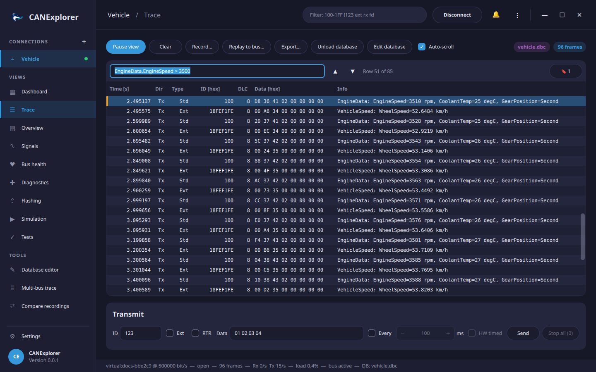
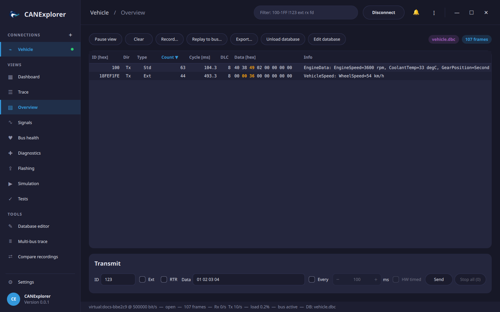

# Trace and overview

## Trace

The trace lists every received (Rx) and transmitted (Tx) frame in arrival order.

| Column | Content |
|---|---|
| Time [s] | Time since the first frame of the session |
| Dir | `Rx` or `Tx` |
| Type | `Std` or `Ext` identifier, plus `FD`, `RTR` (remote frame) and `ERR` (error frame) |
| ID [hex] | Identifier, 3 digits for standard and 8 for extended identifiers |
| DLC | Data length code |
| Data [hex] | Data bytes |
| Info | Protocol decoding and decoded signals of the loaded database |

With **Auto-scroll** the trace follows new frames unless rows are selected.

### Long recordings

The most recent frames, 100 000 by default, are kept in memory. Older frames move to temporary files on disk,
up to the *trace history* (5 million frames by default), so the trace can be scrolled, filtered, searched and
exported through millions of frames with little memory; beyond the history the oldest frames are dropped. The
files are in the cache directory of the user (not in the system's temporary directory, which is often in
memory) and are deleted when the connection is cleared or closed. Both limits and the directory are set in the
[preferences](preferences.md); a history of 0 keeps only the frames in memory. If the disk becomes full, the
trace continues with the frames in memory and says so.

### Search

The find bar above the trace searches the rows (++ctrl+f++ focuses it; ++enter++ or ++f3++ finds the next,
++shift+f3++ the previous match; the search wraps around at the ends):

| Search for | Example |
|---|---|
| A [condition](filters.md#conditions) | `EngineData.EngineSpeed > 3500`, `7E8`, `7E8 data=03 7F ??`, `ext rx` |
| Any text of the row: identifier, data or info | `GearPosition=Second`, `41 0D` |
| Text that also looks like a condition, in quotes | `"BEEF"` (without quotes: the identifier 0xBEEF) |

The search runs in the background, also through frames on disk; ++escape++ in the find field cancels it. Pause
the view to search a fast changing trace.

### Bookmarks

++ctrl+b++ (or **Bookmark** in the context menu of a row) bookmarks the selected rows, or removes their bookmarks;
bookmarked rows have an orange mark. The **🔖** button lists the bookmarks with their time, identifier and
information; click one to jump to it, add a note, or remove it. Bookmarks of frames that left the trace remain in
the list, marked as no longer available.

### Context menu

A right click on a row offers bookmarking, copying the selected rows, finding, and — in replays — **Replay from
here**.

## Overview

The overview has one row per identifier and direction, sorted by identifier.

| Column | Content |
|---|---|
| Count | Number of frames |
| Cycle [ms] | Time since the previous frame of the identifier |
| Data [hex] | Latest data; bytes that differ from the previous frame of the identifier are highlighted in **bold orange** (the warning colour of the theme) |

Click a column header to sort the overview by that column, click it again to reverse the order, and a third time
to return to the identifier order. The sorted column is marked with ▲ or ▼. Rows move as their values change
(e.g. when sorted by count), and selected rows stay selected.

## Toolbar

The **Connect** / **Disconnect** button (Replay / Stop for log files) and the filter field are in the top bar;
the trace, overview and signals views have these buttons:

| Button | Action |
|---|---|
| Pause view | Freeze the views; frames are still received, recorded and counted, and appear when the view is resumed |
| Clear | Remove all frames, statistics and plot data of the connection |
| Record… | Record to a log file, see [Recording, replay and export](recording-and-replay.md) |
| Replay to bus… | Transmit a log file on the bus, see [Replaying on the bus](recording-and-replay.md#replaying-on-the-bus) |
| Export… | Save the selected trace rows, or all displayed rows, to a log file |
| Load database… | Load a signal database or a CDD diagnostic description, see [Signal databases](signal-databases.md) |
| Bus selector | Shown for databases describing several buses |
| Auto-scroll | Keep the newest frame of the trace visible |

## Column widths

Drag the right edge of a column header to make the column wider or narrower; double-click the edge to restore its
width. The last column (*Info*) takes the remaining width. This works in the trace, the overview and the multi-bus
trace.

## Selecting and copying

Click rows to select them; ++shift++ and ++ctrl++ extend the selection. **⋮ → Copy Selected Rows**
(++ctrl+c++) copies them as tab separated text with a header line, e.g. to paste into a spreadsheet.
**⋮ → Select All** (++ctrl+a++) selects all rows of the current view.

## Bus statistics

The dashboard and the status line are updated every second:

- **Rx/Tx** frame rates in frames per second.
- **Load**: estimated share of time the bus is busy, computed from the frame sizes and the bitrate (and the
  data bitrate for CAN FD frames with bitrate switch). Bit stuffing is not included, so the real load can be up
  to about 20 % higher. For LIN, headers and responses are counted at the LIN baud rate. Not shown for replays.
- **Error frames** received.
- **Bus state** (`active`, `passive`, `error` for bus off) where the interface reports it.
