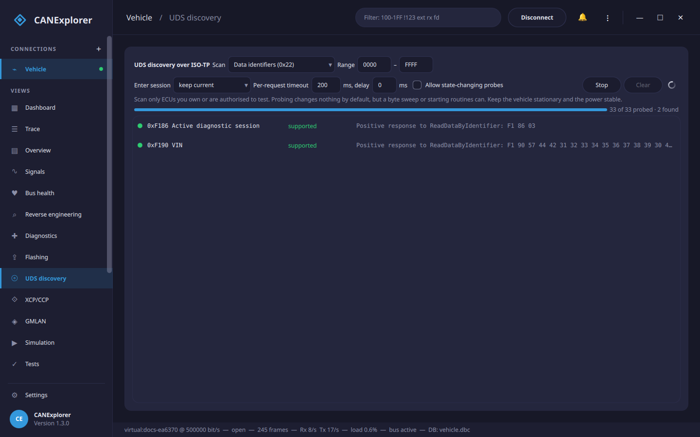

# UDS discovery

The **UDS discovery** page of a connection probes an ECU to find what diagnostic services, data identifiers,
subfunctions and routines it exposes, when the documentation does not list them. It is an interactive UDS scanner
for reverse engineering: it sends a request for every value in a range and lists the ones the ECU answers,
classified so a positive response, a locked item and a wrong-session rejection stand out from the plain
*not supported* replies.



!!! warning "Only scan ECUs you are allowed to test"
    Run this against ECUs you own or have permission to test. A scan sends many requests in a short time; keep the
    vehicle stationary and the power supply stable. The service, DID, subfunction and routine *request-results*
    scans only read, but a byte sweep or **starting** routines can change the ECU, so those stay behind the
    **Allow state-changing probes** box.

It uses the transport and addressing of the [Diagnostics](diagnostics.md) view (ISO-TP on CAN, the LIN transport
layer, or [DoIP](doip.md) over Ethernet), so set the ECU's identifiers or address there first.

## Scans

| Scan | What it sends | An item is listed when |
|---|---|---|
| **Services** | Each service identifier (the known UDS ones, or every SID `00`–`FF`) | the ECU answers anything but *serviceNotSupported* |
| **Data identifiers** | ReadDataByIdentifier (0x22) for each DID in the range | the DID returns data, or is locked behind security access |
| **Subfunctions** | A service with each subfunction `00`–`7F` | the subfunction is accepted or rejected for a reason other than *subFunctionNotSupported* |
| **Routines** | RoutineControl (0x31) for each routine identifier | the routine exists (by default with *request results*, which starts nothing) |
| **Sweep one byte** | A request template with one byte (or two) replaced by each value in the range | always listed when the answer is interesting; a free-form fuzz of a known request |
| **Fuzz** | Mutated requests (bit flips, boundary bytes, truncation, extension) from seed requests or random ones | a positive response to a malformed request, an unusual rejection, or the ECU going unresponsive |

Each found item is coloured by its answer:

- **supported / present** (green): a positive response. For a DID the response data is shown.
- **locked** (amber): *securityAccessDenied* and similar — the item exists but needs [security access](diagnostics.md#security-access).
- **wrong state/session** (blue): the ECU rejected the request for the current session or state (e.g.
  *serviceNotSupportedInActiveSession*). **Enter session** changes the session before scanning to reach these.
- **rejected** (grey): any other negative response, which still proves the service or identifier is handled (for
  example *incorrectMessageLengthOrInvalidFormat* to a bare service probe).
- **no response (hang?)** (red, fuzzing only): the ECU stopped answering — a periodic liveness check (TesterPresent)
  no longer gets a reply, which may mean a hang or a crash. Fuzzing stops there so the cause can be found.

Items that answer *serviceNotSupported* or *requestOutOfRange*, and those that do not answer at all, are counted
but not listed.

## Fuzzing

**Fuzz** is a robustness test: it mutates requests and sends many of them to see how the ECU copes. Give it one or
more **Seeds** (requests to mutate, `;` separated; empty fuzzes random requests from the known services), the number
of **Iterations** and a **Seed** number that makes the run reproducible — so a request that upset the ECU can be
found again by re-running with the same number. Every so often it checks the ECU still answers a TesterPresent; if
it does not, the run reports *no response (hang?)* and stops.

Fuzzing sends arbitrary, state-changing requests, so it needs **Allow state-changing probes** and is for ECUs you
own or are authorised to test, on a bench, with the vehicle stationary and the power supply stable.

## Running a scan

1. Choose the **Scan** and its **Range** (hexadecimal). For subfunctions, set the **Service**; for routines, the
   control type; for a sweep, the request **Template**, the **Byte** to replace and its width; for a fuzz, the
   **Seeds**, **Iterations** and reproducibility **Seed**.
2. Optionally **Enter session** (e.g. *extended*) before scanning, raise the **Per-request timeout** for a slow
   ECU, or add a **delay** between requests to go easier on the bus.
3. **Start**. The progress shows how many values were probed and how many were found; **Stop** ends it early.

Click a found row to send that request again in the [Diagnostics](diagnostics.md) view, where its full response and
decoding appear in the history and you can follow up on it (read the DID, run the routine, and so on).

The table keeps up to 2000 found items; narrow the range if a scan finds more.

## In scripts

`can_explorer.core.uds_scan` runs the same scans over any UDS transport from [test scripts](test-automation.md), as
async iterators of `ScanResult`:

```python
from can_explorer.core.isotp_client import IsoTpClient
from can_explorer.core.uds import UdsClient
from can_explorer.core.uds_scan import scan_services, scan_data_identifiers

client = UdsClient(IsoTpClient(session, 0x7E0, 0x7E8), timeout=0.2)

async for result in scan_services(client):
    if result.interesting:
        print(f'service 0x{result.identifier:02X}: {result.summary}')

async for result in scan_data_identifiers(client, 0xF180, 0xF1FF):
    if result.category == 'positive':
        print(f'{result.identifier:04X} = {result.response[3:].hex()}')
```

`scan_subfunctions`, `scan_routines` and `sweep` work the same way. Each takes an optional `delay` and an
`asyncio.Event` `stop` to end the scan. Over Ethernet, build the client on a [DoIP](doip.md) transport
(`UdsClient(client.transport(0x1001))`).
