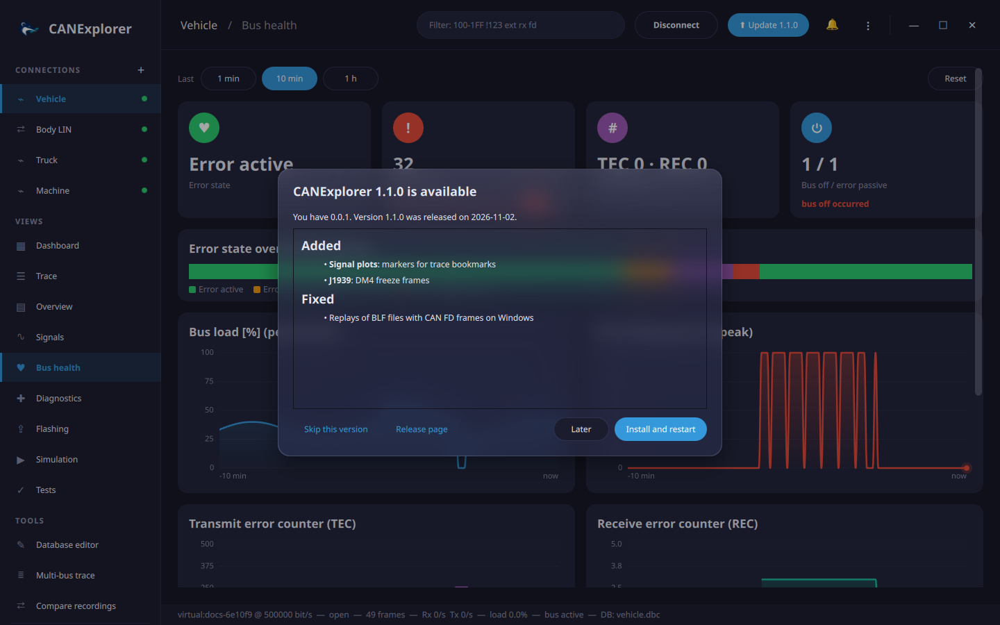

# Updates

CANExplorer finds new versions on its [GitHub releases](https://github.com/AKJ7/CANExplorer/releases) and installs
them from within the application.

## Finding updates

- **At start**, CANExplorer looks for a new release, at most once a day and a few seconds after the window opened.
  When it finds one, a notification and the **⬆ Update** button in the top bar announce it.
- **⋮ → Check for Updates…** (or *Check for updates* in the command palette, or **Check now** in the
  preferences) looks at once and shows the result.

The dialog shows the new version, its release date and its release notes. **Skip this version** stops the
automatic check from announcing it (a manual check still offers it, and newer versions are announced again);
**Later** closes the dialog; **Release page** opens the release on GitHub.

In **Preferences → Updates**, **Check at start** turns the automatic check off, and **Pre-releases** also offers
release candidates and other pre-releases (versions such as `1.1.0-rc1`).

## Installing

**Install and restart** downloads the new version, verifies it and installs it the way this copy was installed:

| Installed from | The update |
|---|---|
| Windows setup (`setup.exe`) | The new setup runs silently into the same folder, for the current user or for all users as before (all users asks for administrator rights), closes CANExplorer and starts the new version |
| AppImage | The AppImage file is replaced by the new one and started |
| Debian package (`.deb`) | The new package is installed with `pkexec apt-get install`, which asks for your password, and the new version is started |
| macOS disk image (`.dmg`) | After CANExplorer quit, the app in its folder (usually *Applications*) is replaced by the one of the new disk image and started |
| Zip archive, or from source | Not installed automatically: the dialog offers the release page (from source: `git pull` and `uv sync`) |

Every download is checked against the `SHA256SUMS.txt` of the release before it is installed, so incomplete or
damaged downloads are never installed. Downloads only come from GitHub. Settings, workspaces and recent files are
kept, as they are not stored with the application.

Close open connections and save your work before installing: CANExplorer quits to let the update replace it.

!!! note "Offline and restricted networks"
    The check needs access to `api.github.com` and the download to `github.com` and
    `objects.githubusercontent.com`. Without them, the automatic check fails silently and a manual check shows
    the error. Behind a proxy, set `HTTPS_PROXY` (e.g. `https://proxy.example.com:8080`) before starting
    CANExplorer.
