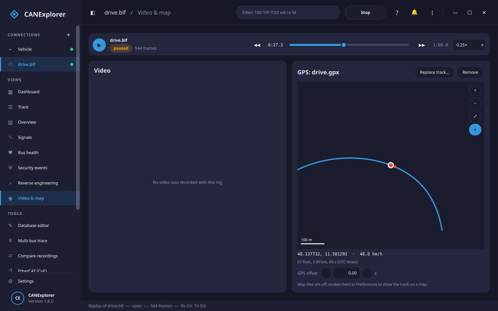

# Video and GPS map

The **Video & map** view of a connection shows a camera video and a GPS track in step with a recording: while
you replay a log file, the video plays at the replay speed, and the map marks where the vehicle was at that
moment. Pausing, seeking and changing the speed of the replay move the video and the map along.

## Recording with a camera

In the [Record dialog](recording-and-replay.md), choose a camera under **Camera** (any webcam, USB camera or
capture card the system offers). The video is recorded while the CAN recording runs, and saved next to the log
with the same name: recording to `drive.blf` writes `drive.mp4`. While recording, *Video & map* shows the camera
picture and the codec used.

The video is encoded with H.264 when the graphics hardware can encode it (VA-API on Linux, NVENC); the FFmpeg
bundled with Qt has no software H.264 encoder. When the hardware encoder cannot be opened, the recording switches
to MPEG-4 Part 2, a software encoder that works everywhere, before the first frame (the log may show the failed
attempt once). After a failure, later recordings go straight to MPEG-4 Part 2 until CANExplorer is restarted.

When the recording stops, a small file named after the log, `drive.blf.media.json`, is written next to it. It
records how the video lines up with the log. CANExplorer finds it again when the log is replayed, also for the
numbered files of a [split or triggered recording](recording-and-replay.md) (`drive_002.blf` uses
`drive.blf.media.json`). Keep the three files together when moving a recording.

### How the video is synchronised

CAN interfaces stamp frames with their own clock, which need not be the computer's clock. While recording,
CANExplorer measures the difference between the two (the smallest difference seen, which has the least delivery
delay), and notes the time of the video's first frame. Together these place every log file of the recording on
the video's timeline, whatever time format the log format stores.

The alignment is typically within a few tens of milliseconds. Cameras add their own latency (often 50–200 ms),
and the measured offset is approximate; correct the remainder with **Video offset** under the video, in steps of
0.1 s. A positive offset shows later video. The offset is saved in the `.media.json` file.

If the recording stopped before any frame was recorded, the video cannot be placed on the log's timeline and the
view says so.

## GPS tracks

GPS positions come from a track file recorded alongside, e.g. by a GPS logger or a phone app. While replaying a
log, click **Attach GPS track…** in *Video & map* and choose:

| File | Content used |
|---|---|
| GPX (`.gpx`) | Track points (`trkpt`), else route points (`rtept`), with their times and elevations |
| NMEA 0183 log (`.nmea`, `.txt`, `.log`) | `RMC` sentences (time, date, position, speed, course) and `GGA` sentences (time, position, altitude), from any talker (`GP`, `GN`, `GL`, …). Sentences with bad checksums or without a fix are skipped; text before the `$` of a line (e.g. a logger's timestamp) is ignored |

The track is saved in the log's `.media.json` file (relative to it, when it is in the same directory or below),
so it is shown again on the next replay. **Remove** detaches it.

### Alignment

Tracks with dates (GPX, and NMEA logs with `RMC` sentences) are aligned by UTC time:

- with the log's `.media.json` file of a camera recording, by the measured clock;
- otherwise by the log's own timestamps, when they are wall-clock times (as in BLF files recorded from live
  interfaces).

Tracks without dates (NMEA logs with only `GGA` sentences), and logs whose timestamps start at zero, are aligned
at their starts: the first fix belongs to the first frame. Shift the track with **GPS offset**; the offset is
saved with the track.

Below the map, the position, speed and altitude at the replay time are shown; between fixes they are
interpolated. Speeds and directions missing from the file are derived from neighbouring fixes.

## The map

The track is drawn with the position at the replay time, pointing in the direction of travel. Drag to pan,
scroll to zoom. The buttons zoom, show the whole track (⤢) and follow the position (⌖); panning stops following.
A scale bar shows distances.

### Map tiles

Without map tiles the track is drawn on a plain background: nothing is downloaded. To draw it on a map, tick
**Show map tiles** under *GPS map* in the [preferences](preferences.md). Tiles come from OpenStreetMap by default;
the tile server then sees which map area you look at. Another tile server can be set with a URL containing
`{z}`, `{x}` and `{y}`; follow its usage policy. Tiles are cached on disk (up to 200 MB, in the user's cache
directory), and requests identify CANExplorer, as
[OpenStreetMap's tile usage policy](https://operations.osmfoundation.org/policies/tiles/) asks. The map shows
the attribution of OpenStreetMap's data.

## Notes

- Video recording and playback use Qt Multimedia (the FFmpeg backend). Cameras must not be in use by another
  application. On macOS, allow CANExplorer to use the camera when asked.
- The video plays without sound.
- A recording made without a camera can still get a GPS track; the video part of the view then says that no
  video was recorded with the log.
