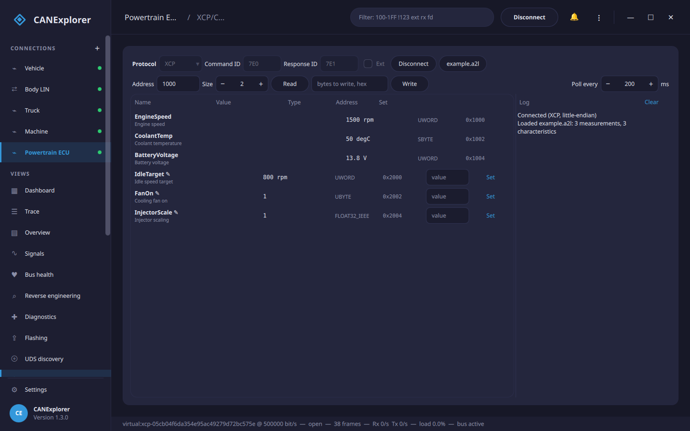

# XCP/CCP measurement & calibration

The **XCP/CCP** page of a connection reads and writes an ECU's internal variables over XCP (ASAM MCD-1 XCP) or CCP
(the older CAN Calibration Protocol) on the connection's CAN bus. It is the measurement-and-calibration counterpart
to the [Diagnostics](diagnostics.md) page: measurements are watched live and calibration values are read and
changed, by address or — with an [A2L file](#a2l-files) — by name in physical units.



!!! warning "Calibration changes the running ECU"
    Writing calibration values changes how the ECU behaves immediately. Do it on ECUs you own or are authorised to
    work on, on a bench, with the vehicle stationary and the power supply stable.

Open the connection to the ECU's CAN bus first, then go to the **XCP/CCP** page.

## Connecting

| Field | Meaning |
|---|---|
| **Protocol** | **XCP** or **CCP** |
| **Command ID** | The CAN identifier the master sends commands on (XCP CMD, CCP CRO) |
| **Response ID** | The CAN identifier the slave answers on (XCP RES/ERR, CCP DTO) |
| **Ext** | 29-bit identifiers |
| **Station** (CCP) | The station address (hex) selecting the ECU on a shared bus |
| **Byte order** (CCP) | The ECU's byte order for addresses and values; XCP reports its own on CONNECT |

**Connect** performs the protocol's CONNECT handshake. XCP reads the slave's byte order and packet sizes from the
response. **Disconnect** releases the ECU.

## Reading and writing by address

Without an A2L you can still work directly with memory: enter an **Address** (hex) and a **Size** and **Read** the
raw bytes (shown in the log), or enter bytes and **Write** them. XCP uses SHORT_UPLOAD / SET_MTA + DOWNLOAD and CCP
uses SHORT_UP / SET_MTA + DNLOAD, split over several frames when needed.

## A2L files

An **A2L file** (ASAM MCD-2 MC) describes the ECU's measurements and characteristics — their names, memory
addresses, data types and conversions. **A2L file…** loads one and fills the table with:

- **Measurements** (read-only): polled live and shown in physical units, e.g. *EngineSpeed 1500 rpm*.
- **Characteristics** (marked ✎, writable): the calibration values. Type a number and **Set** to write it; the
  value is read back to confirm.

Values are converted with the A2L's linear scaling (`IDENTICAL`, `LINEAR` and the linear case of `RAT_FUNC`),
decoded with the data type (`UBYTE`…`FLOAT64_IEEE`) and the byte order. **Poll every** sets how often the
measurements are refreshed (50–5000 ms).

Curves, maps, verbal tables and non-linear formulae are not read; their values can still be reached by address.

## Trying it without an ECU

`can_explorer.core.xcp.XcpSlaveSimulator` and `can_explorer.core.ccp.CcpSlaveSimulator` are simulated slaves backed
by a byte array, for trying the page and for test scripts. `examples/calibration/example.a2l` matches the memory a
simulated slave exposes (engine speed, coolant temperature, battery voltage, idle target, …).

## In scripts

`can_explorer.core.xcp` and `can_explorer.core.ccp` drive XCP and CCP from [test scripts](test-automation.md):

```python
from can_explorer.core.a2l import read_a2l
from can_explorer.core.can_command import CanCommandClient
from can_explorer.core.xcp import XcpClient

client = XcpClient(CanCommandClient(session, 0x7E0, 0x7E1))
await client.connect()
variables = {v.name: v for v in read_a2l('ecu.a2l')}
speed = variables['EngineSpeed']
print(speed.decode(await client.read(speed.address, 0, speed.size), client.byte_order), speed.unit)
idle = variables['IdleTarget']
await client.write(idle.address, 0, idle.encode(850.0, client.byte_order))
await client.disconnect()
```

`CcpClient` has the same `read`/`write`/`connect`/`disconnect` interface (with a station address).
