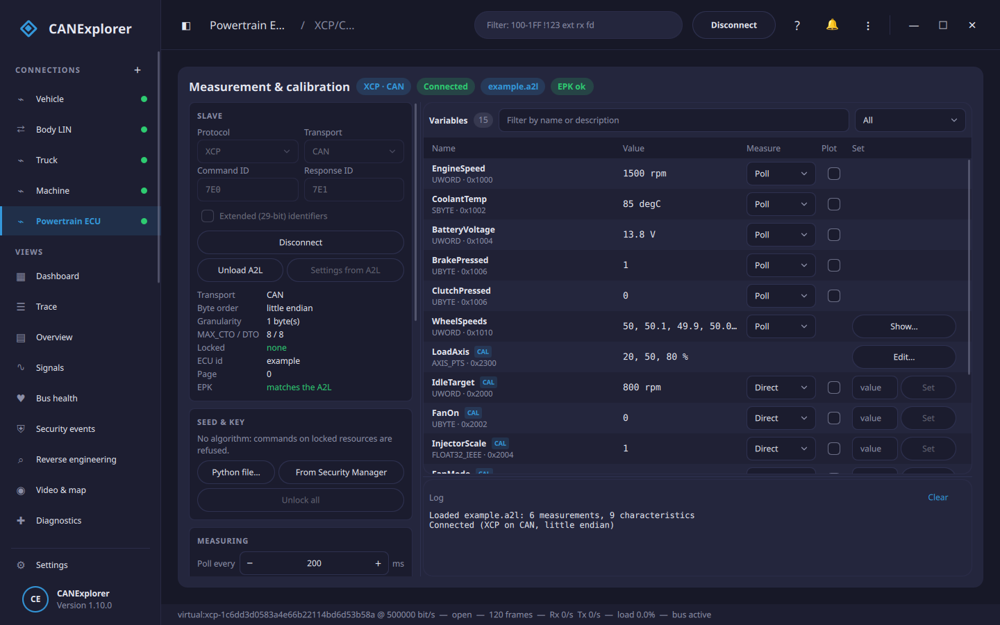
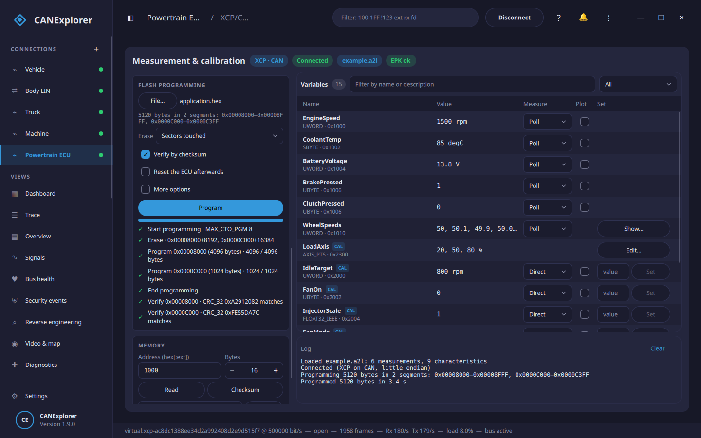

# XCP/CCP measurement & calibration

The **XCP/CCP** page of a connection measures and calibrates an ECU's internal variables over XCP (ASAM MCD-1 XCP),
on CAN, CAN FD or Ethernet (UDP/TCP), or over CCP (the older CAN Calibration Protocol). It is the
measurement-and-calibration counterpart to the [Diagnostics](diagnostics.md) page. Measurements are watched live,
by polling or synchronously by DAQ, and can be plotted. Calibration values, curves and maps are read and changed,
by address or, with an [A2L file](#a2l-files), by name in physical units, or written at an ECU event by
[STIM](#stimulation-stim). An XCP slave that offers programming can also have its flash
[programmed](#flash-programming).



!!! warning "Calibration changes the running ECU"
    Writing calibration values changes how the ECU behaves immediately. Do it on ECUs you own or are authorised to
    work on, on a bench, with the vehicle stationary and the power supply stable.

For XCP on CAN or CCP, open the connection to the ECU's CAN bus first. XCP on Ethernet does not need it. Then go to
the **XCP/CCP** page.

The page has three parts:

- **The header** shows the session's state: the protocol and transport, whether the slave is connected, the A2L file,
  the EPK check, the resources still locked, and whether DAQ is running.
- **The sections on the left** hold the slave connection and the tools: seed & key, measuring, calibration pages,
  flash programming (XCP), memory and datasets.
- **The variable table on the right** lists the A2L's measurements and characteristics, above the log. Filter it by
  name or description, or by kind (measurements, characteristics, plotted, measured by DAQ). In a narrow window, the
  type and address move under the name.

## Connecting

| Field | Meaning |
|---|---|
| **Protocol** | **XCP** or **CCP** |
| **Transport** (XCP) | **CAN**, **CAN FD** (the connection must be a CAN FD one; packets up to 64 bytes), **UDP** or **TCP** |
| **Command ID** | The CAN identifier the master sends commands on (XCP CMD, CCP CRO) |
| **Response ID** | The CAN identifier the slave answers on (XCP RES/ERR, CCP DTO) |
| **Extended (29-bit) identifiers** | 29-bit CAN identifiers |
| **Host**, **Port** (XCP on Ethernet) | The slave's address, port 5555 by default |
| **Station address** (CCP) | The station address (hex) selecting the ECU on a shared bus |
| **Byte order** (CCP) | The ECU's byte order for addresses and values; XCP reports its own on CONNECT |

With an A2L loaded, **Settings from A2L** fills the fields from its interface description (`IF_DATA XCP`:
the CAN identifiers, CAN FD, or the UDP/TCP address; `IF_DATA ASAP1B_CCP`: the CRO/DTO identifiers and the station
address).

**Connect** performs the protocol's CONNECT handshake. Below the buttons, the **Slave** section then lists what the
slave reported:

- the transport and byte order;
- for XCP, the address granularity, the packet sizes (MAX_CTO / MAX_DTO) and the resources still locked;
- the ECU's identification (XCP GET_ID, CCP EXCHANGE_ID);
- the active calibration page;
- with an A2L, the **EPK** check. The A2L's build identifier (`MOD_PAR EPK`) is compared with the ECU's memory at
  `ADDR_EPK`, and a mismatch is reported: the A2L does not describe this software and its addresses may be wrong.

**Disconnect** stops DAQ and releases the ECU.

XCP details handled for you:

- **Address granularity:** addresses count in bytes, words or dwords.
- **Block modes:** slave and master block modes speed up large transfers.
- **Busy slave:** an *ERR_CMD_BUSY* answer is repeated.
- **Timeouts:** after a lost response the master sends SYNCH, restores the memory pointer and repeats the command,
  so data is never shifted.
- **CCP responses:** CCP checks the command counter of every response and skips late answers. Event messages and
  DAQ data are kept apart from the responses.

## Seed & key

ECUs usually lock calibration, DAQ and programming behind seed & key. Choose the algorithm in either of two ways:

- **Python file…** takes a Python file defining `compute_key(level: int, seed: bytes) -> bytes`. Here `level` is the
  resource to unlock: for XCP 1 = CAL/PAG, 4 = DAQ, 16 = PGM; for CCP 1 = CAL, 2 = DAQ, 64 = PGM.
- **From Security Manager** picks a seed/key entry of the [key store](security-manager.md), or a security profile
  that computes keys.

With an algorithm set, a command the ECU refuses as *access locked* unlocks the locked resources and is repeated.
**Unlock all** unlocks them all at once. A wrong key is reported; an XCP slave ends the session after a wrong key.

## Reading and writing by address

Without an A2L you can still work directly with memory, in the **Memory** section. Enter an **Address** in hex,
optionally with the address extension after a colon (`1000:1`), and the number of **Bytes**, then **Read** them
into the log (at most 64). To change memory, enter bytes and **Write** them.

## A2L files

An **A2L file** (ASAM MCD-2 MC) describes the ECU's measurements and characteristics: their names, memory
addresses, data types, layouts and conversions. **A2L file…** loads one, along with its `/include` files, and fills
the table:

- **Measurements**: scalars and arrays (`ARRAY_SIZE`, `MATRIX_DIM`), including bit flags (`BIT_MASK`).
- **Characteristics** (marked ✎, writable unless `READ_ONLY`):
    - `VALUE` scalars;
    - `VAL_BLK` blocks;
    - `ASCII` strings;
    - `CURVE` and `MAP`, with their axes;
    - `AXIS_PTS` axis breakpoints.

Each variable keeps its address extension (`ECU_ADDRESS_EXTENSION`) and byte order (`BYTE_ORDER`, else the
module's `MOD_COMMON` one).

Conversions to physical values:

- **`IDENTICAL`**, **`LINEAR`**: plain scaling.
- **`RAT_FUNC`**: also non-linear.
- **`TAB_INTP` / `TAB_NOINTP`**: tables, with or without interpolation.
- **`TAB_VERB`**: verbal values such as *Off / Auto / On*, typed by name.
- **`FORM`**: formulae, evaluated safely. Writing one needs its `FORMULA_INV`.

Record layouts:

- **Supported items:** `FNC_VALUES` (`ROW_DIR` / `COLUMN_DIR`), `AXIS_PTS_X/Y` (`INDEX_INCR` / `INDEX_DECR`),
  `NO_AXIS_PTS_X/Y` (the number of points is read from the ECU), `FIX_NO_AXIS_PTS`, `RESERVED` and `ALIGNMENT_*`.
- **Axes:** `STD_AXIS`, `FIX_AXIS` (`FIX_AXIS_PAR`, `_DIST`, `_LIST`), and `COM_AXIS` / `RES_AXIS` / `CURVE_AXIS`
  through their `AXIS_PTS` or curve.

Variables that cannot be read are listed with the reason, e.g. pointer addressing (`PBYTE`…), `ALTERNATE_*` maps,
`AXIS_RESCALE`, or `CUBOID` and higher.

!!! note "Alignment"
    Without `ALIGNMENT_*` keywords (in the record layout or `MOD_COMMON`) the items of a record layout are read
    packed, one after the other.

## Measuring

Measurements are refreshed every **Poll every** milliseconds (50–5000 ms). Neighbouring measurements are read
together, in one upload of up to 252 bytes with gaps of up to 16 bytes, rather than one command each.

For synchronous, faster measurement, set a measurement's **Measure** column from *Poll* to a **DAQ event**:

- **Where the events come from:** the A2L's `IF_DATA` events (e.g. *10ms*, *100ms*), the ECU's own (XCP
  GET_DAQ_EVENT_INFO), or the CCP rasters.
- **Start DAQ** configures DAQ lists in the ECU, one per event, and the ECU then sends the values by itself on each
  event. An ECU with dynamic DAQ gets lists allocated for exactly these measurements. An ECU with static DAQ has a
  fixed set of lists: each event takes the first free one that can run on that event and is large enough
  (GET_DAQ_LIST_INFO).
- **Predefined DAQ lists**, whose content the ECU fixes, are used when they carry a measurement: every byte of
  it, on its event (a list may be tied to one). Their content comes from the A2L (`DAQ_LIST` … `PREDEFINED`), or
  is read from the ECU with READ_DAQ; the log names the predefined lists used. Measurements they do not carry get
  a configured list as usual.
- **XCP DAQ:** ODTs are packed and split to the packet size, all four identification field types work, and DAQ
  timestamps are used when the ECU has them.
- **CCP DAQ:** DAQ lists of 7-byte ODTs.
- **Stop DAQ** stops it. The log says how many samples arrived and how many were lost.

Tick **Plot** to plot a measurement or value on the [Plot](signal-plots.md) page, as `XCP.<name>`, next to the bus
signals.

!!! note "DAQ support"
    Dynamic, static and predefined DAQ lists are supported. A predefined list whose content is neither in the A2L
    nor readable with READ_DAQ (an optional command) is not used.

### Stimulation (STIM)

With XCP, STIM is DAQ in the other direction: the master sends the values, and the ECU writes them into its memory
at an event, in step with its own task. It is used to feed a function with test inputs, or to bypass one.

Set a scalar calibration value's **Measure** column from *Direct* to **STIM** on an event, then **Start DAQ**
(alone or with measurements). From then on, **Set** checks the value against the A2L limits and sends it; the ECU
writes it at the next event, and the next poll shows it. The values start out as the ECU's own: they are read just
before DAQ starts. **Stop DAQ** ends STIM too, and **Set** writes directly again.

STIM needs an ECU that offers it (the STIM resource of CONNECT) and, with static DAQ, a list that can run in the
STIM direction. Curves, maps and blocks are written directly.

If the ECU reports a **STIM timeout** (it had no new STIM data at an event), the values are sent again at once.
The first timeout is logged, and the slave details count them. An ECU that expects data before every event
needs them resent continuously, as scripts and the MCP `xcp_stimulate` tool do with a STIM period.

## Calibrating

Characteristics carry a **CAL** badge. Curves, maps, axes, blocks and strings are read once when the slave connects
and shown in the table: a curve or map by its size and value range, e.g. *4 × 3 · 10 … 75 %*.

Type a new value next to a scalar characteristic and **Set** it. Use a number, or a verbal value such as `On`. The
value is checked against the A2L limits, written and read back.

Curves, maps, blocks and arrays have **Edit…**, which opens a grid:

- **Curve:** the X axis on top and the values below.
- **Map:** the X axis on top, the Y axis in the first column, and `values[y][x]` in the cells.

The cells are shaded by their value, like a heat map, and the editor shows the A2L limits and the axes' input
quantities. Points of standard axes can be edited too; common axes are changed through their `AXIS_PTS`. Changed
cells are outlined until they are written. **Write** writes the grid and reads it back, and **Revert** goes back to
the values read from the ECU.

**Calibration pages.** A page number with **Activate** switches the ECU and the XCP access to another page, e.g. 0 for
the working page (RAM) or 1 for the reference page (flash). With CCP, give the page's start address.
**Restore working page from reference** (XCP COPY_CAL_PAGE 1 → 0) copies the reference page over the working page, undoing every change.

**Checksum.** **Checksum** in the **Memory** section asks the ECU for the checksum of the address range
(BUILD_CHECKSUM). XCP also uploads the
range and compares the checksum when its type is a standard one (ADD_11…ADD_44, CRC_16, CRC_16_CITT, CRC_32). The
CCP checksum algorithm is ECU specific, so CCP only shows the value.

## Datasets

**Save…** writes every writable characteristic of the A2L as it is in the ECU to a **JSON** file, or to a **DCM**
file (the DAMOS format: `FESTWERT`, `FESTWERTEBLOCK`, `KENNLINIE`, `KENNFELD`, `TEXTSTRING`,
`STUETZSTELLENVERTEILUNG`) by its `.dcm` extension.

**Compare…** loads such a file and lists the values that differ from the ECU. **Write dataset to the ECU** writes it to the ECU,
with the points of standard axes, and compares again.

## Flash programming

!!! danger "Programming replaces the ECU's software"
    A wrong file, address or interruption can leave the ECU unable to start. Program ECUs you own or are
    authorised to work on, with the file meant for them, a stable power supply, and do not disconnect while
    programming.

An XCP slave that offers programming (the PGM resource; typically a bootloader) can have an Intel HEX, Motorola
S-record or binary file written to its flash, in the **Flash programming** section:



1. **File…** loads the file and shows its address ranges. A binary file starts at address 0.
2. **Erase** chooses what is cleared first. Flash is erased a whole sector at a time, so by default every
   **sector the image touches** is cleared, as the ECU describes them (GET_SECTOR_INFO); an ECU that describes no
   sectors has the image's ranges cleared instead. **Image ranges only** clears just those ranges, and **Nothing**
   clears nothing (for an ECU that erases by itself).
3. **Program** runs the sequence: PROGRAM_START, PROGRAM_CLEAR for each range, PROGRAM (in blocks when the ECU
   takes them), and PROGRAM with no data to end it. With **Verify by checksum**, the ECU then computes the checksum
   of each range (BUILD_CHECKSUM), which is compared with the file's; a user-defined checksum type is shown, not
   compared. With **Reset the ECU afterwards**, PROGRAM_RESET starts the new software, which ends the session:
   connect again to work with it.

Each step shows its state and the progress bar the bytes written. A locked PGM resource is unlocked with
[seed & key](#seed-key), as for the others. Stop DAQ before programming.

**Erasing by function.** *Functional areas* clears what the ECU knows by function instead of by address: its
**calibration**, **code** or **NVRAM** areas (PROGRAM_CLEAR in functional mode).

**More options** holds what some bootloaders need:

- **Flash kernel:** code the ECU must have in RAM to program its flash. It is announced with PROGRAM_PREPARE,
  downloaded, and started from its entry point (the file's start address, or its first address) by PROGRAM_START.
- **Compression** and **Encryption:** the manufacturer's method codes (80–FF hex) that the file was prepared with,
  sent with PROGRAM_FORMAT before the data. The ECU decodes the data. The page refuses methods the ECU says it
  does not support, and refuses plain data when it requires them.
- **Encoder:** when the file is not prepared yet, a Python file defining `encode(data, address) -> bytes`
  compresses or encrypts each range before it is sent (as for [UDS flashing](flashing.md)). The checksum is still
  compared with the file as it ends up in the flash.
- **Full packets as PROGRAM_MAX:** sends full packets with PROGRAM_MAX, for ECUs that program faster that way.
- **ECU check:** after programming, PROGRAM_VERIFY asks the ECU to run **its own** check of the new content, or
  to compare **a value** you give (e.g. a signature or CRC from the software supplier), over the areas the
  **type** names: 0001 calibration, 0002 code, 0004 complete flash.

For programming over UDS (ISO 14229) instead, see [Flashing](flashing.md).

## In the trace

Choose the **XCP** or **CCP** [protocol decoder](protocols.md) for the connection to label the session's frames:
commands with their parameters, responses, errors, events, DAQ data, STIM data from the master
(`STIM PID 4: …`), the STIM timeout event, and the programming commands (`PROGRAM_CLEAR 8192 absolute`,
`PROGRAM_CLEAR functional: code`, `PROGRAM_FORMAT …`, `PROGRAM_VERIFY …`, `PROGRAM end of sequence`). The
page tells the decoder its
identifiers when it connects; otherwise the decoder learns them from a CONNECT and its answer.

## With an AI agent

The [MCP server](mcp.md) has `xcp_*` tools for these steps:

- list the A2L's variables (`xcp_list_variables`; sends nothing);
- connect to the slave (`xcp_connect`), check the session and the EPK (`xcp_status`), and disconnect
  (`xcp_disconnect`);
- read values and memory (`xcp_read`, `xcp_read_memory`);
- measure by DAQ or polling (`xcp_measure`).

These need `--allow-diagnostics`. Writing calibration values or memory (`xcp_write`, `xcp_write_memory`) needs
`--allow-control`. `xcp_measure` uses the ECU's static DAQ lists when it has no dynamic DAQ, and says so, and
the predefined lists the A2L describes. `xcp_daq_info` shows the DAQ configuration and `xcp_flash_info` what the
ECU offers for programming (both `--allow-diagnostics`). `xcp_stimulate` writes values by STIM and `xcp_program`
programs the flash (both `--allow-control`); programming replaces the ECU's software, so let an agent do it only
with a file meant for that ECU.

## Trying it without an ECU

Simulated slaves are backed by a byte array:

- `can_explorer.core.xcp_slave.XcpSlaveSimulator` on a CAN session;
- `can_explorer.core.xcp_ethernet.XcpEthernetSlave` on UDP or TCP;
- `can_explorer.core.ccp.CcpSlaveSimulator`.

They answer:

- memory access (XCP with byte, word or dword granularity);
- seed & key (`protected=`, the demo algorithm `demo_key` inverts every seed byte);
- two calibration pages and checksums;
- the identification;
- dynamic DAQ with cyclic events, or static DAQ (`static_daq=DEFAULT_STATIC_LISTS`: a predefined list, two DAQ
  lists and one that can also do STIM);
- predefined DAQ lists (`predefined_daq=` for a dynamic slave, or in `static_daq=`), readable with READ_DAQ
  (`read_daq=False` refuses it);
- STIM, written to the memory at the list's event (`stim=False` for an ECU without it), and the STIM timeout
  event at an event without new data (`stim_timeout=True`);
- programming: the reference page is the flash, divided into `sectors` (by default 0x8000–0xFFFF in three sectors).
  PROGRAM_CLEAR erases whole sectors (functionally: all of them for the code areas), PROGRAM and PROGRAM_MAX only
  write erased bytes, and PROGRAM_RESET restarts the slave with the new flash as its working page (`sectors=()`
  for an ECU without programming). Encryption method 80 is a demonstration cipher (`demo_encrypt`, every byte XOR
  5A); PROGRAM_VERIFY with a value compares it with the CRC-32 of the whole flash; `kernel=` makes programming need
  a flash kernel at that address;
- injected errors (`busy_count`, `drop_count`).

`example_memory()` fills the memory to match `examples/calibration/example.a2l`. That example has an EPK, measurements
with a bit mask and an array, a verbal value, a curve, a map with a common axis, a block and a string, and the
`IF_DATA` of XCP and CCP.

## In scripts

`can_explorer.core.xcp` and `can_explorer.core.ccp` drive XCP and CCP from [test scripts](test-automation.md), and
`can_explorer.core.calibration` reads and writes A2L variables of every kind:

```python
from can_explorer.core.a2l import load_a2l
from can_explorer.core.calibration import read_value, write_value
from can_explorer.core.can_command import CanCommandClient
from can_explorer.core.xcp import DaqSignal, XcpClient

a2l = load_a2l('ecu.a2l')
client = XcpClient(CanCommandClient(session, 0x7E0, 0x7E1), compute_key=my_compute_key)
await client.connect()
print(await read_value(client, a2l.variable('EngineSpeed'), a2l))  # CalibrationValue(…, value=1500.0, …)
await write_value(client, a2l.variable('IdleTarget'), 850.0, a2l)
fuel = await read_value(client, a2l.variable('FuelMap'), a2l)  # fuel.value[y][x], fuel.axes
speed = a2l.variable('EngineSpeed')
daq = await client.start_measurement([DaqSignal('speed', speed.address, speed.size, event=0)], print)
await daq.stop()
await client.disconnect()
```

STIM and programming:

```python
from can_explorer.core.flashing import load_image
from can_explorer.core.xcp_flash import XcpFlashJob, XcpFlashOptions

target = a2l.variable('IdleTarget')
stim = await client.start_stimulation([DaqSignal('idle', target.address, target.size, event=0)])
stim.stimulate({'idle': target.encode(850.0, client.byte_order)})  # Written by the ECU at event 0
await stim.stop()

job = XcpFlashJob(load_image('application.hex'), XcpFlashOptions(erase='sectors', verify=True, reset=True))
await job.run(client)  # job.steps and job.bytes_done follow the progress; the reset ends the session

options = XcpFlashOptions(
    erase='functional',  # clear_areas=CLEAR_CODE_AREAS by default
    kernel=load_image('flash_kernel.hex'),  # PROGRAM_PREPARE + download first
    encryption=0x80,
    encode=my_encrypt,  # PROGRAM_FORMAT; encode(data, address) -> bytes
    ecu_check='internal',  # PROGRAM_VERIFY
)
```

`client.start_measurement(signals, on_sample, predefined=a2l.predefined_daq_lists)` uses the predefined DAQ lists
the A2L describes; `on_stim_timeout=` is called at each STIM timeout.

`client.start_measurement(signals, on_sample, stimuli=[…])` measures and stimulates in one DAQ configuration.

`CcpClient` has the same `read`/`write`/`connect`/`disconnect`/`start_measurement` interface, with a station
address. `XcpEthernetTransport(host, port, 'udp')` replaces the `CanCommandClient` for XCP on Ethernet; call
`await transport.open()` first.

## Sources and limits

The XCP and CCP packet layouts follow what the public open-source implementations use: Vector's XCPlite, pyxcp
and openblt for XCP, and the freely circulated CCP 2.1 for CCP. The ASAM standards themselves are not public.
Some choices are therefore assumptions, or are left out:

- **CCP multi-byte parameters** (addresses, DAQ prescaler, DTO identifier) are sent in the ECU byte order you
  choose. The station address is always Intel.
- **CCP SET_DAQ_PTR:** its element number is used as the byte position in the 7-byte ODT, with elements of 1, 2
  or 4 bytes.
- **The TP_BLOB byte-order code** of `IF_DATA ASAP1B_CCP` is read but not interpreted. Choose the byte order
  yourself.
- **XCP programming** follows the open-source OpenBLT bootloader's XCP loader and pyxcp, with the command
  descriptions of a public XCP command reference: PROGRAM with no data is sent once after the data (it ends a
  memory segment, and an image normally targets one), PROGRAM_RESET ends the sequence and may go unanswered (the
  ECU resets), and the PROGRAM_CLEAR length is sent in address elements like the other lengths. The flash kernel
  is downloaded before PROGRAM_START with the MTA at its entry point; PROGRAM_FORMAT goes right before the data;
  PROGRAM_VERIFY (mode byte, type word, value dword, as pyxcp sends it) after the data. The functional clear
  areas (1 calibration, 2 code, 4 NVRAM) and verification types (1, 2, 4) come from that reference and NI's XCP
  documentation. PROGRAM_FORMAT's programming and access methods stay at their defaults (sequential, absolute). These are the same for the byte-addressed ECUs bootloaders
  are; with word or dword addresses, sectors are not used and each range is cleared on its own. The sector length
  of GET_SECTOR_INFO is used as the slave reports it.
- **STIM** DTOs carry the same identification field as DAQ DTOs and no timestamp, and go to the slave on the
  command identifier (XCP on CAN) or as a packet of its own (Ethernet).
- **Static DAQ:** the lists after the predefined ones (`MIN_DAQ` … `MAX_DAQ - 1`) are configured; unused ODT
  entries are left cleared (size 0).
- **Predefined DAQ lists:** the A2L's `ODT_ENTRY` is read as entry number, address, extension, size (in address
  elements) and bit offset, the order of its fields in the XCP A2ML (which does not name them). READ_DAQ's answer
  follows pyxcp. Bit entries (a bit offset other than FF) are never used for a measurement. Predefined lists are
  used for measuring, not for STIM.
- **STIM timeout:** the layout of the event's data is not public, so it is not interpreted: any STIM timeout
  makes all STIM data go out again.
- **Not implemented:** `MODIFY_BITS`, PROGRAM_FORMAT's functional access method (programming by flash content
  sequence number), compression in the simulator, and the `SEGMENT`/`PAGE` details of `IF_DATA`.
